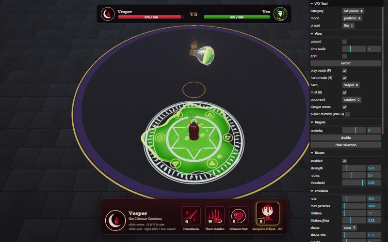
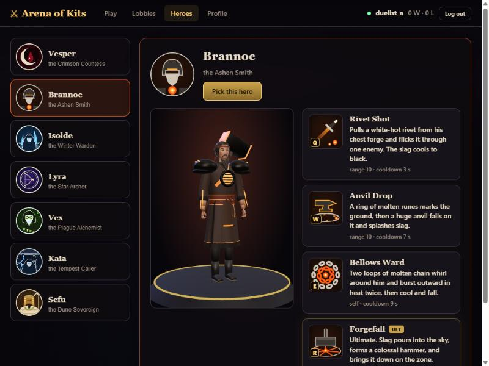

# Using the tool

How to run VFX Tool and use each of its modes: the particle editor, the effect browser, the targeted arena, play
mode with the hotbar, and hero mode with the MOBA hero kits. Everything is driven from the panel on the right and
a few keys.

## Run it

```bash
npm install
npm run dev
```

Open http://localhost:5173. Other scripts: `npm run typecheck` (`tsc --noEmit`), `npm run build` (typecheck and
production build into `dist/`), `npm run preview`.

## The panel

| Folder | What it does |
|---|---|
| **VFX Tool** | `category` picks a family (set pieces, paladin, iconic, original, targeted, weapons, weapon attacks, parts kit, hero: blood / forge / frost / astral / alchemy, ...); `mode` picks the effect in it. `particles` is the emitter editor. |
| **View** | `paused`, `time scale`, `grid`, `restart`; `play mode (P)`; `hero mode (H)` and `hero` (which hero); `danger zones` (telegraphs); `player dummy (WASD)` |
| **Targets** | Arena enemies: `enemies` (count), `shuffle`, `clear selection` (shown for targeted effects and play mode) |
| **Bloom** | `enabled`, `strength`, `radius`, `threshold` (each effect sets its own values when selected) |
| **&lt;effect name&gt;** | `▶ play`, `frame camera`, and the effect's own settings (damage, timings, colours, `loop`) |
| **Emission / Motion / Appearance** | The particle emitter's settings (particles mode only) |

The bottom-left line shows the frame rate, the effect, the controls for the current mode and, in the arena, hits
and kills. A broken effect shows its build error there instead.

## Modes

### Particles
One CPU-simulated emitter with presets (fire, smoke, sparks, magic, snow). Tune it in Emission, Motion and
Appearance. Drag to orbit, scroll to zoom.

### Effects
Pick any effect: it plays and the camera frames it. **Space** or **▶ play** replays it. Cinematic heroes run their
own scripted camera with letterbox bars.

### Targeted arena
Targeted effects (the `targeted` category and every hero kit) play in a shared arena: a golden caster and a pack of
enemies with 100 HP, damage numbers, knockback and death.

| Input | Action |
|---|---|
| Click an enemy | Target it (the effect replays at it) |
| Shift-click | Add enemies (multi-target effects) |
| Click the ground | Aim at that spot (ground effects) |
| Targets → enemies / shuffle / clear selection | Change the pack |

Red **danger zones** fill as a countdown and flash when the hit lands. With **View → player dummy (WASD)** on, walk
the blue figure out of them to get DODGED instead of HIT.

### Play mode (P)
Walk the caster with **WASD** (camera-relative), drag to orbit the following camera, cast from the **1–5** hotbar
(click a slot's name to assign any effect; remembered per browser). Click enemies or the ground to aim.
Non-targeted effects are moved onto the caster and turned toward the target.

### Hero mode (H)
A MOBA-style test of a hero kit: the hero you pick plays as a rigged figure with its four spells on Q W E R.

| Input | Action |
|---|---|
| Left or right click on the ground | Walk there |
| **Q W E R** (or click a slot) | Aim that spell: a range ring around the hero, a strip to the hovered enemy (single target) or the area circle at the cursor (ground spells) |
| Click | Cast at the aimed enemy or spot. Out of range: the hero walks into range, then casts |
| Right-click, **Esc** or the same key | Cancel the aim |
| E-type self spells | Cast at once, no aim |
| Mouse wheel | Zoom the camera |
| Click the portrait, or **View → hero** | Switch hero (Vesper, Brannoc, Isolde, Lyra, Vex) |
| **H** or **P** | Leave hero mode |

The bar shows each spell's icon, key, cooldown sweep and seconds, and a tooltip with range and cooldown. R is the
ultimate (gold frame). The hero is rooted until each spell lands; spells overlap, so a W can still be playing when
the Q lands. Enemies keep their HP between casts and respawn 4 s after dying.

### Duel: play (B) or run (N)
A 1 vs 1 fight in hero mode in a small ring with a gold rim. Both heroes have 600 HP (bars at the top).

- **▶ play duel (B)**: you against an AI hero of another kit. Pick the opponent in **View → opponent** (random by
  default, never your own hero).
- **▶ run duel, AI vs AI (N)**: both heroes are played by the AI and the camera watches the whole ring; the
  card names the winner. Your hero (View → hero) is one side, the opponent the other.
- The AI walks, keeps its distance, strafes and casts its kit on cooldown: Q and W at the other side, E when it is
  close, R when the other side is hurt or the fight runs long.
- Every spell shows its red danger zone first. A hit only lands if the target is still in that zone (or near where
  it aimed) when it lands: walk out to get **DODGED**. This works both ways.
- The round ends with **VICTORY** / **DEFEAT** (play) or **&lt;HERO&gt; WINS** (run); **Rematch** starts a new
  round, **leave duel** (or the same key) ends it. Switching your hero mid-duel starts a new round.
- The ring has **cover**: a wall across the middle, four pillars and two side walls. Nobody walks through them, and
  a spell needs **line of sight**: aiming at an enemy or a spot behind cover shows "No line of sight" (the aim ring
  turns pale), and the hero walks round until it can see the target, then casts. Self spells always go.



### The duel game (`/game.html`)
**Arena of Kits**, the multiplayer version: open `http://localhost:5173/game.html` (with `npm run dev`) in two
windows, create an account in each, then either **Find match** with a hero in each (two different heroes are
paired) or **Lobbies → Create lobby** in one and **Join** in the other, pick heroes and press **Ready** in both.
Each window controls its own hero with the same controls as hero mode; **Forfeit** (top right) gives up. After the
match, **Back to menu**; **Profile** shows wins, losses, matches, the favourite hero, per-hero numbers and recent
matches; **Heroes** shows every kit with its four spells and a turning model. How it works:
[multiplayer.md](../architecture/multiplayer.md).



## Keys at a glance
| Key | Where | Action |
|---|---|---|
| Space | Effects | Replay |
| 1–5 | Play mode | Cast hotbar slot |
| P | Anywhere | Toggle play mode (leaves hero mode) |
| H | Anywhere | Toggle hero mode |
| W A S D / arrows | Play mode, player dummy | Walk |
| Q W E R | Hero mode | Aim a spell |
| Esc | Hero mode | Cancel the aim |
| B | Anywhere | Play duel: you vs the AI (turns hero mode on) |
| N | Anywhere | Run duel: AI vs AI |

## See also
- [Docs home](../README.md)
- [Hero roster](../catalog/heroes/README.md) and [effect catalog](../catalog/effects.md)
- [Hero mode internals](../architecture/hero-mode.md), [targeting and arena](../architecture/targeting-and-arena.md)
