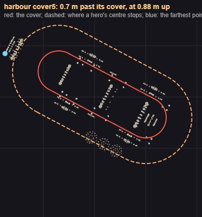
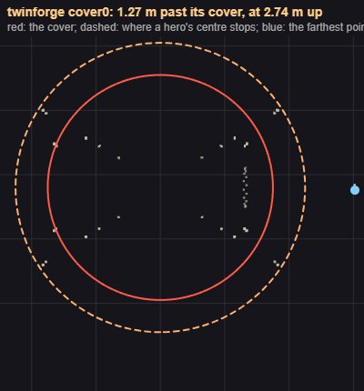

# The arenas' props and backdrops, and the weapons

Checked 2026-11-16.

## The arenas in the heroes' style (7 files)

The duel arenas harbour, battlefield, canyon, cavern and the Raid's rooms sunburst (the Heart of Noon), sunhall (the Sun Warden's
hall), twinforge (Ash and Ember): every prop laid against the obstacle it stands for, vertex by vertex
(`pipeline/tools/arena-fit.js`; the layout's own rules are `pipeline/tools/arena-check.mjs`, which "cannot see the meshes"). A hero's
centre is kept 0.5 m from an obstacle's capsule (`pushOut`), so a prop that reaches up to about 0.5 m past its capsule is touched at
most; past that a hero stands in it. The rooms' fixed walls have no mesh of their own (the backdrop draws them) and are skipped. All
props stand on the floor (bases sunk on purpose). Not looked at from the game's camera this round: these are numbers and top-down
plans.

| Arena | Props | Most past its cover, below 2.2 m | Found |
|---|---|---|---|
| Harbour | 9 | **0.70 m** | the two cannons: the gun's breech and carriage tail, 0.9 m up, stand 0.7 m past the end of their wall: a hero's legs go into it |
| Battlefield | 9 | 0.33 m | |
| Canyon | 9 | 0.29 m | |
| Cavern | 9 | 0.24 m | |
| Sunburst (the Heart's room) | 8 (39 fixed walls) | 0.44 m | the low walls' plinths, 0.15 m up: touched, not entered |
| Sunhall (the Warden's hall) | 93 (45 fixed walls) | 0.51 m | the pillars' bases, 0.25 to 0.6 m up: touched, not entered |
| Twinforge (Ash and Ember's forge) | 2 (12 fixed walls) | 0.44 m | Ash's anvil's horn reaches 1.27 m past its cover, but 2.7 m up, over a hero's head |

 

The older duel arenas (temple, frost, caldera, glade, skyruins) build their props onto the obstacles in code (`*_props.glb`
instanced per obstacle), so they fit by construction; their backdrops stand outside the ring and were not looked at this round.

## For the Blender round (the obstacles are gameplay and stay; the meshes move)

- **Harbour, the two cannons** (`blender/arenas/real/harbour.py`, `cannons()`): the gun is about 3.2 m long on a 2.7 m wall and its
  back end stands 0.7 m past the wall's capsule. At `scale=S * 0.9` instead of `S * 1.05` it is about 2.75 m (or move it 0.35 m along
  the wall toward its muzzle end). Rebuild, then `pipeline/tools/arena-fit.js`: harbour covers 5 and 6 under 0.5.

(A first, rougher measure with boxes also blamed Ash's anvil in the Twin Forge; measured point by point, what sticks out is the horn,
over a hero's head. Nothing to change there.)

## The weapons (5 files)

`public/models/weapons/` (the dragon sword, the ice sword, the guandao, the thunder hammer, the phoenix fan) are used only by the
VFX tool's weapon effects (`src/spells/weapons/`, the attach points in `src/effects/weapons/sockets.ts`); no hero in the game holds one
(the heroes' weapons are part of their own models). Not reviewed in the game for that reason.
