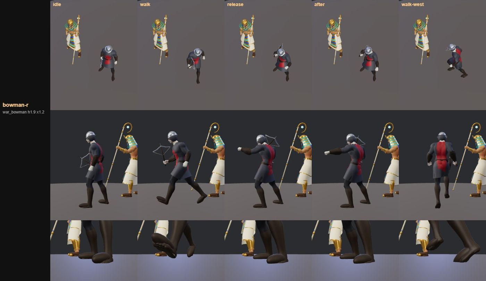
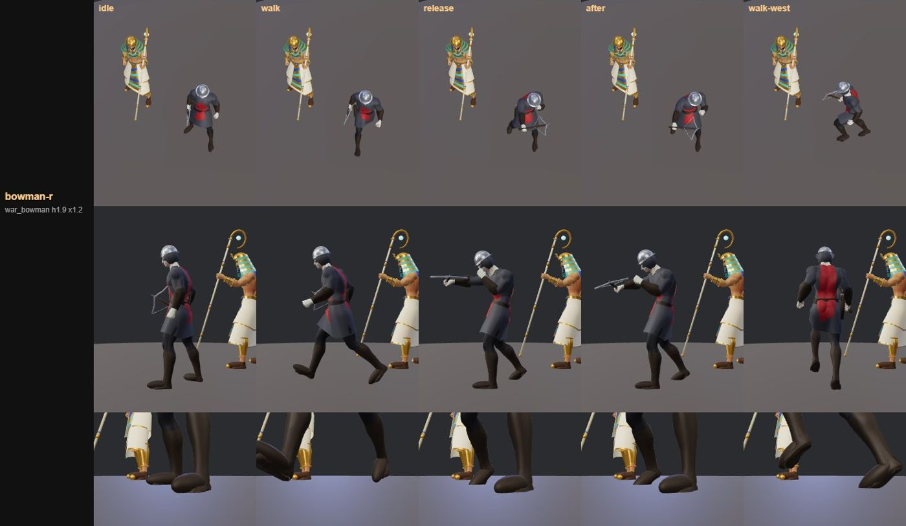
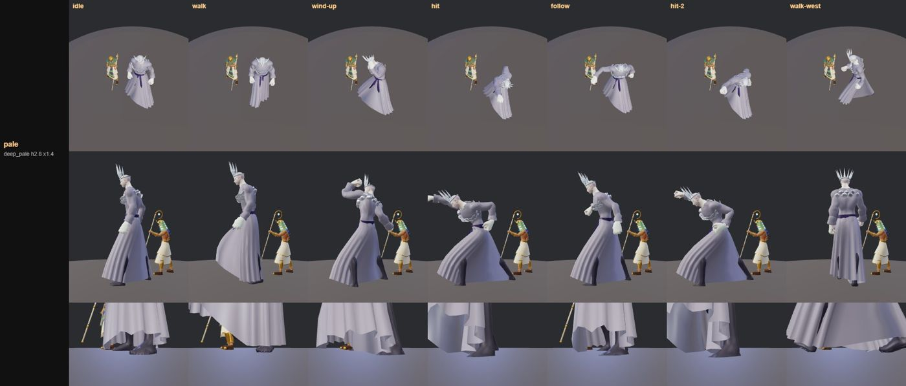
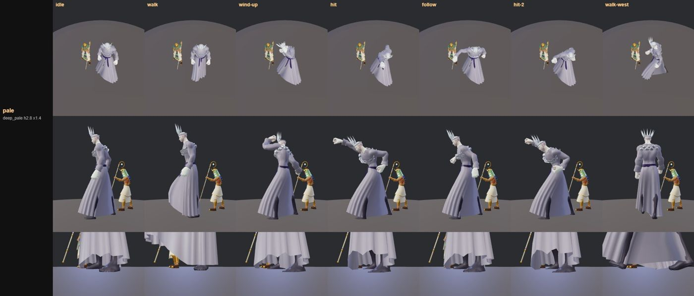

# The Climb's enemies (15 models, 24 looks)

Checked 2026-11-16. Every enemy look in `src/tower/world/foeKinds.ts` (the 15 models and the tinted or liveried looks that share
them: the barnacle, the Dune Mother, the War's two armies, the ashen, the bearer, the deserter), each through the game's own pose
code (`foeModels.ts`) at its unit's real size beside Sefu: standing, walking, its blow (wind-up, the moment it lands, the follow,
a second blow) or its shot (the release and after), and a walk to the west. Three heroes went through the same code as the
yardstick. Then four chapters in the game (floors 2, 12, 22, 32, 42), packs woken beside the hero and every unit sampled for five
seconds: which way it faces against the way it goes and against its target.

Sheets, one row a look (top: the game's camera; middle: from the side, the figure's left; bottom: the feet at ground level):
[Sea](enemies/sheet-sea.jpg), [Wood](enemies/sheet-wood.jpg), [Sands](enemies/sheet-sands.jpg), [Deep](enemies/sheet-deep.jpg),
[War](enemies/sheet-war.jpg), [the heroes as the yardstick](enemies/sheet-heroes.jpg).
Tools: `pipeline/tools/foe-anim-sheet.js` (the sheets and numbers), `pipeline/tools/foe-world-probe.js` (in the floors).

## Found and fixed (in the game's code; no gameplay number changed, the fights replay the same)

1. **The War's bowman shot with the wrong arm.** His shot played the pack's jab, a LEFT-hand punch: the empty left fist went at the
   target while the crossbow in his right hand swung back to his shoulder, pointing behind him. Now the cross (the right hand), so the
   crossbow is levelled at the target. Right hand at the release: 0.03 m in front of the hips before, 0.78 m after.
   Before:  After: 
2. **The Pale One's gown went through the ground at every blow.** The hook takes a third of the legs, which drops the hips; on a
   floor-length gown the hem went 0.25 m into the floor. A new `legs` share per model (`FoeModel.legs`, 0.3 for the Pale One) keeps
   the hem on the ground: 0.06 m at the deepest moment (a 4.5 m figure).
   Before:  After: 
3. **Units that back off or circle walked forwards sideways.** The packs' tactics keep a unit facing its target while it moves
   (archers back off, the War's soldiers circle); the pack has only forward walks, so the feet stepped forwards while the unit slid
   sideways or backwards. Now a figure that goes backwards plays its stride backwards, and one that goes sideways turns its body up to
   about 50 degrees toward the way it goes (only the figure turns; the unit's facing, its blows and its bolts are the game's, and the
   turn is undone within about a fifth of a second when it strikes or shoots). Floor 42's crimson pack: 36 % of the moving moments had the
   hips turned more than 50 degrees from the way they went, 17 % after; the median 41 degrees, 25 after. Same fight, frame for frame.

## Checked and left as they are

- **Feet on the ground:** every model stands where the heroes do. Standing, the soles go 3 to 7 % of the figure's height into the
  floor, the same as Sefu (3 %), Kaia (5 %) and Brannoc (7 %): it is the pack's idle stance (heels lowered on a flat foot), not a
  model. At the moment a blow lands it is 15 to 24 % for every figure that steps into it, heroes too. A floor-wide fix would belong in
  `src/motion/real.ts` (the heroes' code) and is left for the hero review.
- **Facing:** all face +Z as the game expects; walking west the feet point -77 to -94 degrees (west is -90). Standing, the feet of
  every figure, heroes included, point about 25 degrees to the right: the pack's guard stance.
- **Held things:** every weapon is in the right hand, every staff in the left (the thorn sprite's), the footmen's shields on the
  left arm, the net caster's and the slinger's throw is overhand with the right hand. The chief's glaive is swung overhead, as a
  glaive is.
- **Size:** the commons stand a little under a hero (the docker 2.07 m beside Sefu's 2.34), the big ones over two heroes high (the
  Harbourmaster's Mate 3.5 m, the moss giant 3.3 m), the Hollow Oak 8 m and the Dune Mother 7 m with her crest, as the floors scale them.
- **Shadows:** the model enemies cast none (`dress` turns it off), the code-drawn ones do. Left: it was chosen for the phone's frame.

## For the Blender round

Nothing that needs a rebuild was found on the enemies.
