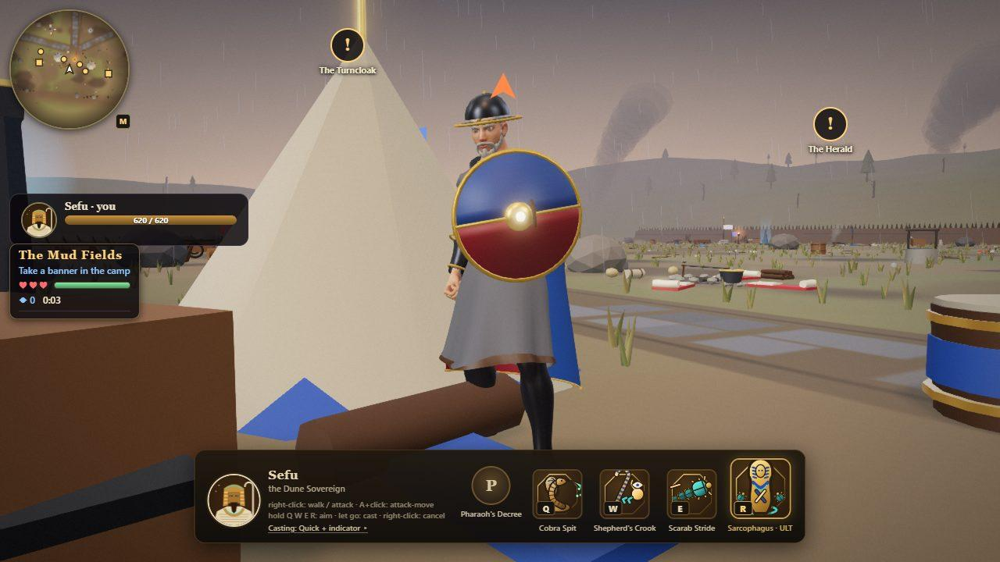
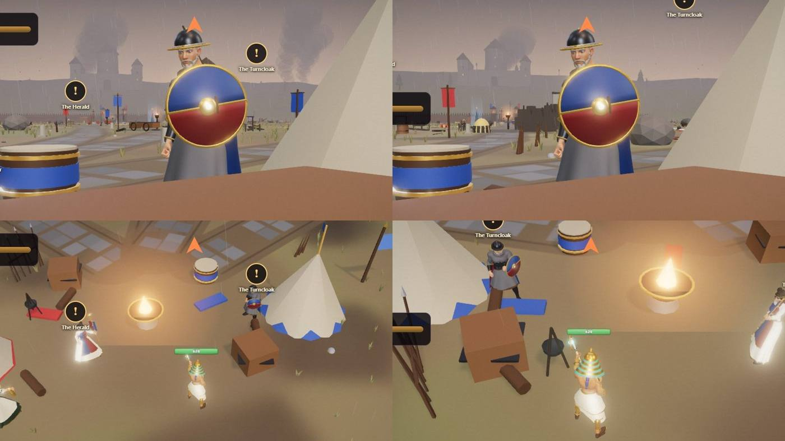
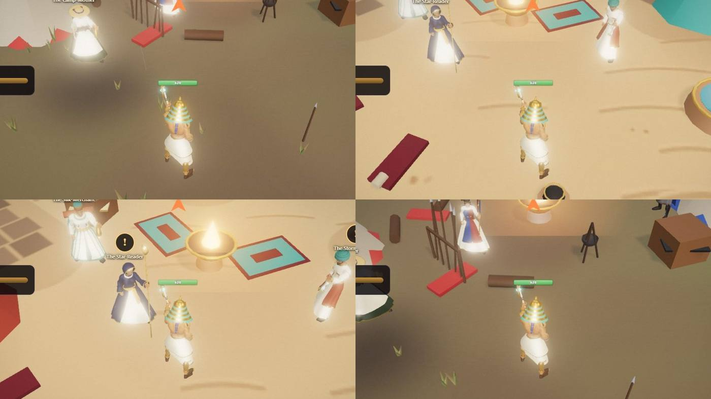

# The Climb's people (25 models)

Checked 2026-11-16. Every person's spot on all 50 floors from the floors' data (246 people with the rivals: none stands inside
cover, none faces cover within 1.6 m, all but one face within 60 degrees of the way the hero comes from the camp; the one is floor
31's rival Tempo, a hero, who faces away from the start at 17 m, as his scene has him). Then every person in the game on the chapters'
first two floors (1, 2, 11, 12, 21, 22, 31, 32, 41, 42) and on 43 and 47: from the game's camera with the hero 6 m in front, and close
from in front, with the feet measured.

Close-ups: [the Sea and the Wood](people/sea-wood.jpg), [the Sands and the Deep](people/sands-deep.jpg), [the War](people/war.jpg).
Tool: `pipeline/tools/people-probe.js`.

## Found

Nothing to fix in the code: every person stands on the ground (the soles 3.6 to 6 cm into it, the heroes' 2.6 to 7 cm: the pack's
stance), faces the camp, turns to the hero when the hero comes near, and holds its thing in the left hand (the Lamp-Bearer's lantern,
the Firefly-Seller's yoke on the shoulders, the Turncloak's shield on the left arm).

- **Placement, for the floor reviewers:** on the made War floors the Turncloak (the camp's quest giver) stands in the camp's things:
  on floor 42 in the log bench (it runs through his right shin), on floor 43 against the tent's side. Move him about 1.2 m clear,
  toward the fire.  
- **A matter of taste, for the user:** the people in cream (`#e2d6b8`: the Sands' Star-Reader, Storm-Counter, Silk-Merchant and
  Glass-Seller, Beacon-Keeper, the War's Camp-Mother and Herald) glow in the Sands' and the War's light: the cream crosses the bloom's threshold,
  as Sefu's linen does a little.  If it should go: in Blender, each of those modules' `R.mat("cream",
  "#e2d6b8", ...)` to `#cdbf9c` (about 15 % darker), then the build command of `docs/tower/models/README.md` for those seven (`war/herald.py` has `#e2d8c0`).
