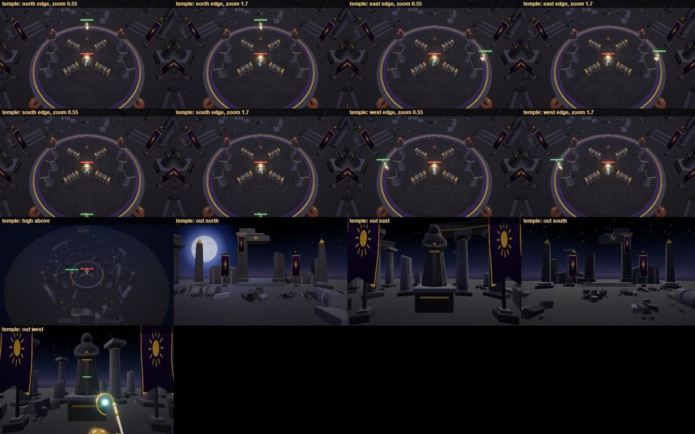
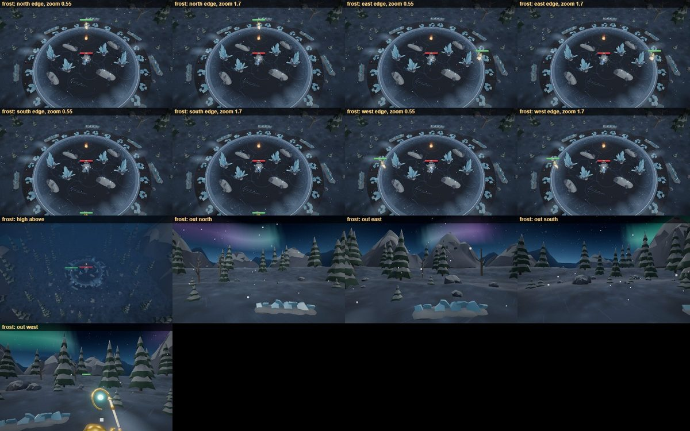
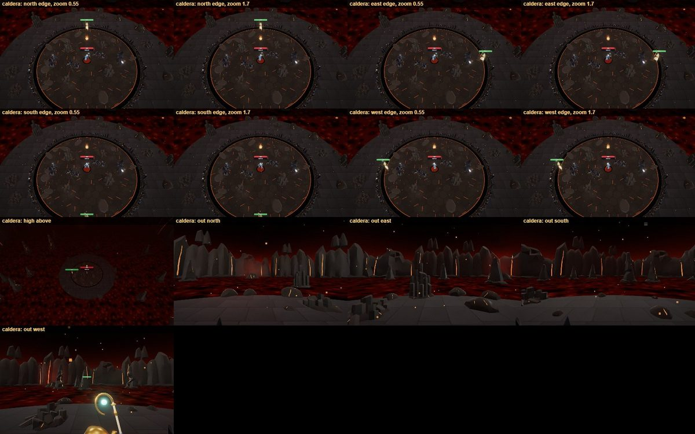
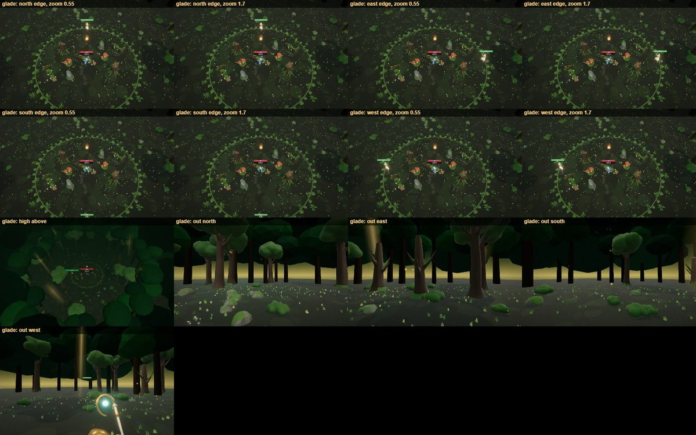
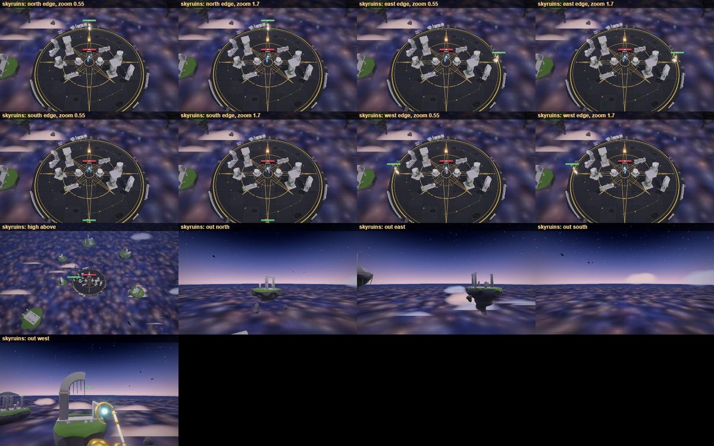

# 4. The older arenas' backdrops

The five duel arenas not yet in the heroes' style (the Temple, Frost, the Caldera, the Glade, the Sky Ruins). In a duel the camera is
fixed over the ring (it does not follow the hero), so the first eight frames of each sheet are what a player sees, with the hero at the
four edges; then a view from high above and four from the rim looking out at a person's height. Numbers from the arena's own meshes:
pieces whose bottom stands over 0.4 m above the ground outside the ring, and points between 0.3 and 4 m high inside the ring that are not
by a piece of cover. Tool: `pipeline/tools/arena-backdrop.js`.

**Found: nothing to fix.** From the duel camera none shows a seam, a hole, a floating piece or anything cutting into the ring. The
"floating" pieces the numbers list are what they should be: hilltop trees and peaks on the far slopes (Frost), the treetops of the
canopy (the Glade), the islands and clouds (the Sky Ruins), the lintels over the temple's columns.

**Notes for the user (small):**
- **Frost:** inside the ring, low parts of meshes (up to 0.6 m high) stand more than 0.6 m from the edge of any cover, round (3, 5),
  (-3, 9), (7, 8) and (-6, 6) (in pairs, as the layout is): most likely the ends of the long ice slabs reaching past their cover, so a
  hero can stand in their tips. Not looked at close; worth a look with the way `arena-fit.js` measures. Last round measured the same
  kind of thing on the new arenas (`arena-fit.js`), where the cannons were then made smaller.
- **The Temple:** from the rim (a view no player has) two lintels seem to hang past their columns.

