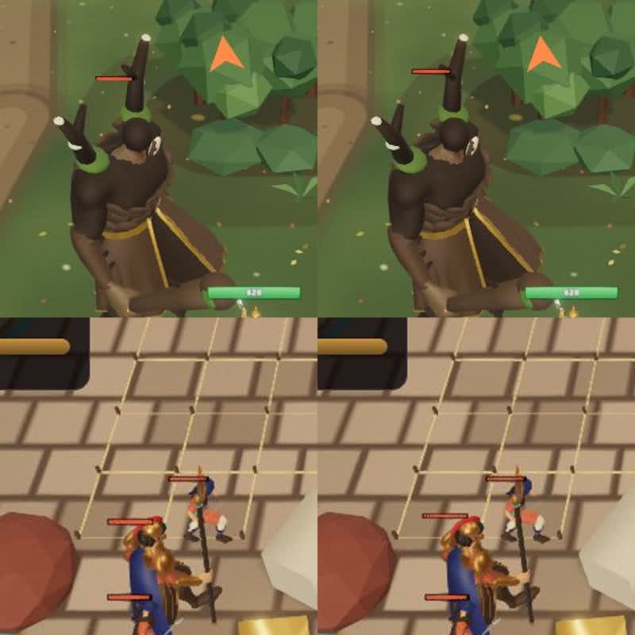
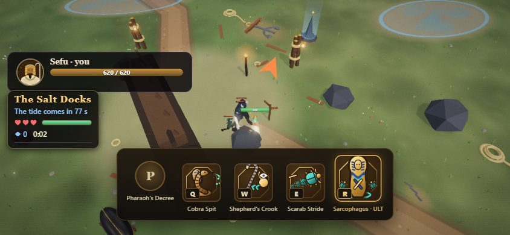
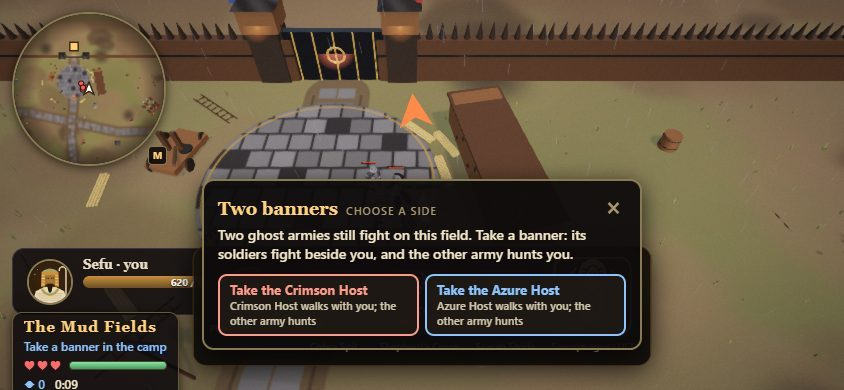

# 3. The enemies' health bars, in their floors

Last round set 16 looks' bar heights from measurements without looking. This round each look's first pack on the chapters' floors was
woken beside the hero, at a phone's size (844 x 390) from the game's camera, and for 3 s each unit was measured every few frames: the
top of its figure (the bar left out) against its bar. "Clear" is how far the bar stands over the top. Tool: `pipeline/tools/bar-probe.js`.

| Look | Floor | Bar over the ground (m) | Top, median | Clear, median | Clear at its highest moment |
|---|---|---|---|---|---|
| mate | 2 | 3.80 | 3.65 | 0.15 | -0.82 (weapon overhead) |
| barnacle | 2 | 4.60 | 4.41 | 0.19 | 0.02 |
| docker | 2 | 2.27 | 2.08 | 0.20 | 0.11 |
| **Hollow Oak** | 11 | 8.52 | 8.49 | **0.03** | -0.18 |
| raider | 21 | 2.34 | 2.16 | 0.18 | -0.07 |
| slinger | 21 | 2.27 | 2.12 | 0.15 | 0.08 |
| **Raider Chief** | 21, 25 | 3.78 | 3.71 to 3.73 | **0.05 to 0.07** | -0.55 (glaive overhead) |
| Dune Mother | 25 | 7.48 | 7.36 | 0.12 | -0.97 |
| thief | 31 | 3.07 | 2.92 | 0.16 | 0.04 |
| Pale One | 31 | 4.76 | 4.55 | 0.21 | 0.04 |
| footman (red, blue) | 41 | 2.52 | 2.35 | 0.17 | -0.21 |
| bowman (red, blue) | 41 | 2.46 | 2.32 | 0.14 | 0.05 |
| knight | 42 | 3.58 | 3.42 | 0.16 | -0.47 |
| bearer | 42 | 3.82 | 3.65 | 0.17 | -1.24 (banner swung) |
| ashen | 42 | 2.52 | 2.43 | 0.09 | -0.21 |
| deserter | 42 | 3.64 | 3.49 | 0.15 | -0.55 |

## Fixed

Two looks stood in their bars most of the time: the Hollow Oak's crown (0.03 m clear) and the Raider Chief, whose stand-in carries his
glaive up past his head (0.05 m). Their bars are raised (`barY` in `src/tower/world/foeKinds.ts`: the oak 3.55 to 3.62, the chief 2.1 to
2.2; only where the bar is drawn): **the oak now 0.20 m clear, the chief 0.23 m.**
Before (left) and after (right), the oak on floor 11 and the chief on floor 25, from the game's camera:

## Left as they are

- A weapon swung overhead passes the bar for a moment in every heavy blow (the mate, the knights, the bearer's banner): the bar would
  have to float a metre over them all the time to avoid it.
- The ashen (the footman's figure) stands 0.09 m under its bar while it fights, its shield raised; the same figure as the footmen.
- Not one of the 16: the Deep's mites (a drawn look, not a model) have their bar right on their backs (0 m clear).

From the game's camera on a phone:  
