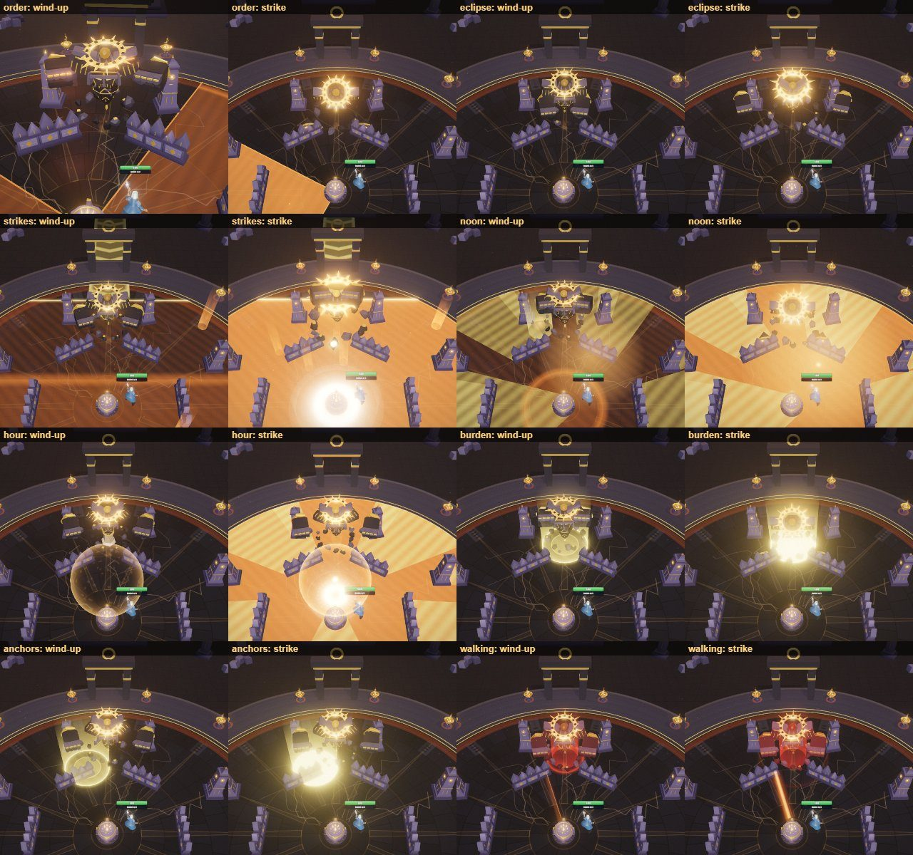
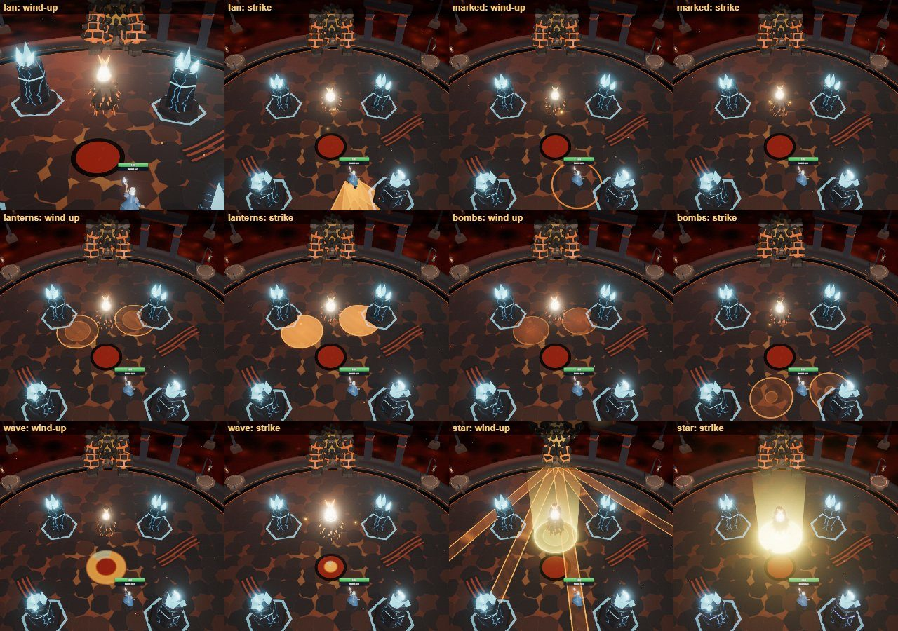
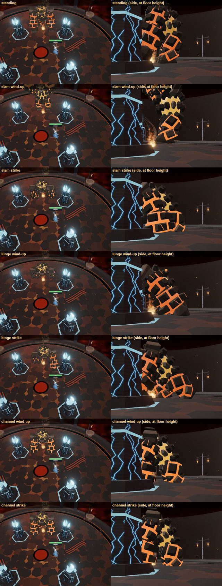
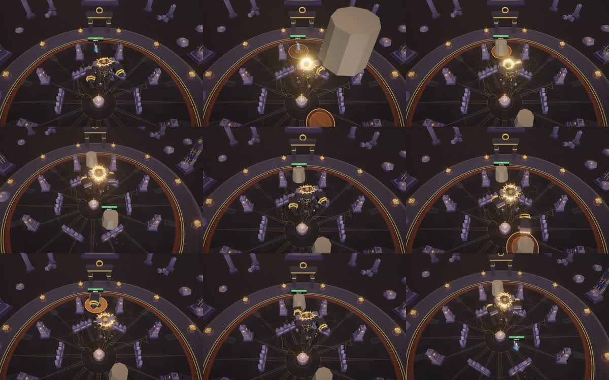
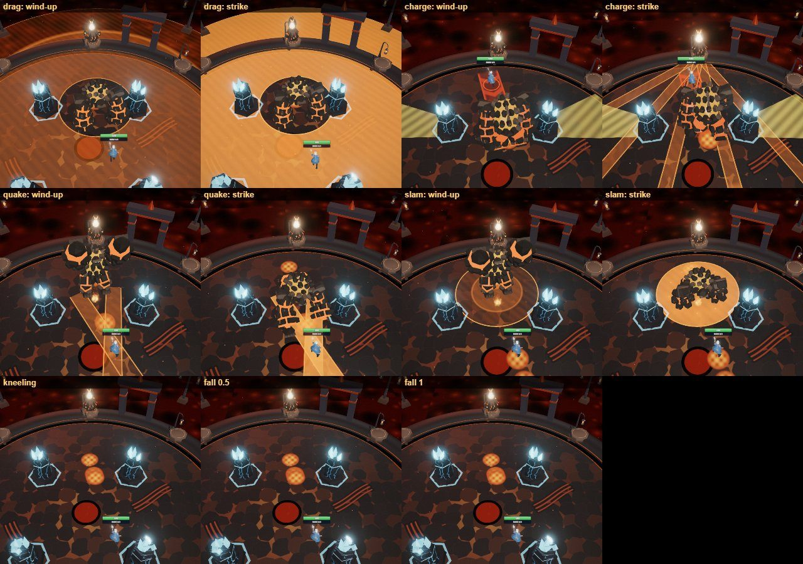

# 1b. The Sun Warden, Ash and Ember in real fights

Each in its own room, its brain choosing its moves for 90 s, the hero 8 m off and taking nothing (so the fight never ends), the boss's
health cut at 30 % and 60 % of the run. The camera as near as a player may zoom (0.55 of the default distance). Each move pictured at its
wind-up and strike the first time it came, a 12-second clip filmed, and the body measured all through: its lowest point (visible meshes
only, so last round's hidden-model mistake cannot happen) and how far it reaches from its middle below 2.5 m. Then kneeling and the fall.
Tool: `pipeline/tools/boss-fight-look.js`.

| Boss | Moves seen | Lowest, median | Lowest of all (when) | Kneeling | Fallen | Reach below 2.5 m (median) | Hit circle |
|---|---|---|---|---|---|---|---|
| Sun Warden | ray, pillars, fists, sweep | +0.34 | -1.41 (a fist slammed down) | -0.18 | -4.4 | 3.6 m (its fists) | 1.2 m |
| Ash | drag, charge, quake, slam | -0.49 | -1.67 (slam) | -2.1 | -3.9 | 4.5 m | 1.8 m |
| Ember (tagged in by hand) | (Ash's, see below) | +0.50 (floats) | -0.77 | -0.17 | -1.9 | 1.3 m | 0.9 m |

Nothing in the pictures and clips is wrong to the eye: the Warden's fists slam into the floor and come back, its fall sinks it (as last
round found), Ember floats. The fights did not bring the Warden's later moves (the cut health did not start its later phases within 90 s)
nor Ember's own moves (the twin fight did not tag her in), so those were **cast by hand** through the boss's link, one by one, and
pictured at their wind-up and strike (`pipeline/tools/boss-moves.js`): the Warden's Order, Eclipse, Strikes, Noon, the Long Hour, the
Shared Burden, the Anchors and the Walking Sun; Ember's Fan, Marked, Lantern Toss, Vent Bombs, Lava Wave and Falling Star. All read
right; the Warden's lowest points there (-1.6 to -1.8 m in Order, Noon and the Burden) are its fists slammed into the floor, as in its
other slams.  

**Ash's legs (for the user).** Measured part by part, standing still in his room's middle, Ash is on the floor (his legs 0.03 to 0.10 m,
a fist at 0.00). In every cast his legs go about a metre under it: the slam -1.0 m, the lunge's wind-up -1.15 m, the channel -0.9 m,
and the kneel and fall deeper (`pipeline/tools/boss-parts.js`). His legs are rigid and hang from his torso, so when his pose lowers the
torso to crouch (`src/raid/bodies/ash.ts`) they go down with it instead of bending. From the game's camera he looks crouched; from the
side at floor height his lower legs are cut off by the floor. A fix (lift the legs by what the torso drops, so they push up into the
body) changes how he crouches: it waits for a yes. 

**For the raid's owner:** once, with the hero put at the room's rim by the tool, Ash's charge carried him past the rim onto the lava
(third frame of the second row of the clip frames). A player standing at the rim may see the same; not a model fault.

Warden:   clip: [warden.mp4](bosses/warden.mp4)

Ash:   clip: [ash.mp4](bosses/ash.mp4)

Ember, tagged in by hand at the start (the brain still cast Ash's moves, so these are her body in his casts; her kneel and fall were out of the frame, the numbers above are of her body):  clip: [ember.mp4](bosses/ember.mp4)
