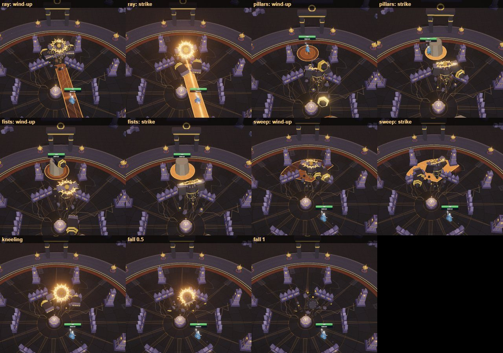
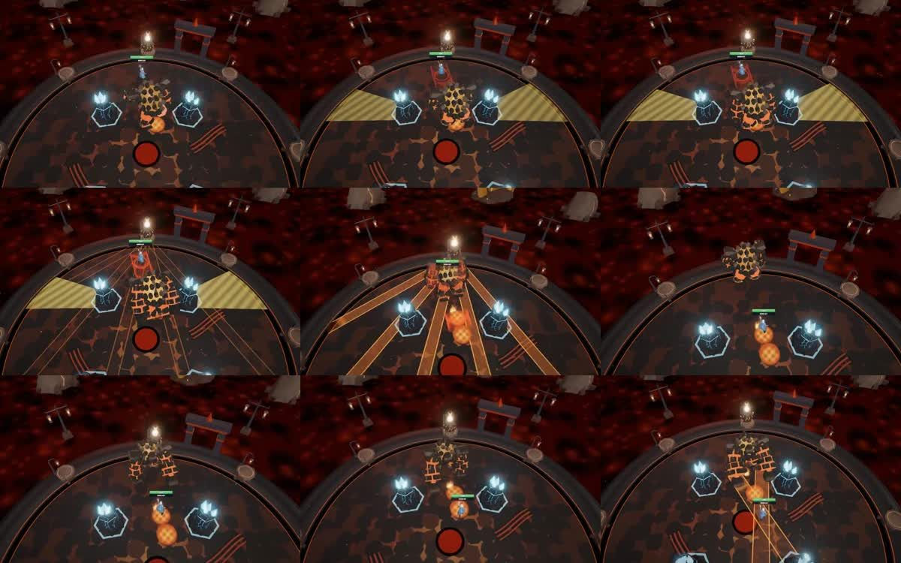
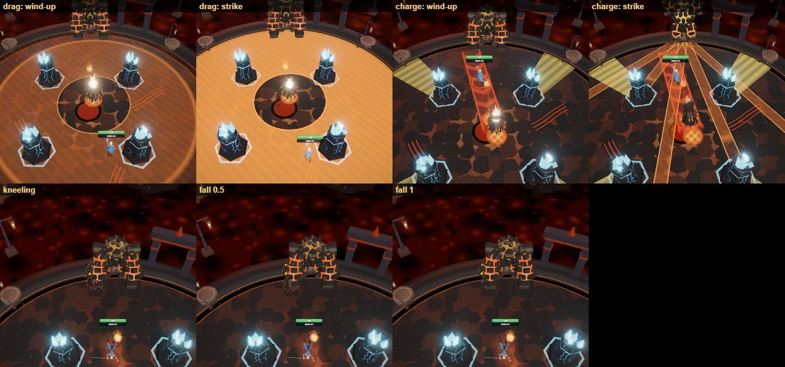

# 1b. The Sun Warden, Ash and Ember in real fights

Each in its own room, its brain choosing its moves for 90 s, the hero 8 m off and taking nothing (so the fight never ends), the boss's
health cut at 30 % and 60 % of the run. The camera as near as a player may zoom (0.55 of the default distance). Each move pictured at its
wind-up and strike the first time it came, a 12-second clip filmed, and the body measured all through: its lowest point (visible meshes
only, so last round's hidden-model mistake cannot happen) and how far it reaches from its middle below 2.5 m. Then kneeling and the fall.
Tool: `pipeline/tools/boss-fight-look.js`.

| Boss | Moves seen | Lowest, median | Lowest of all (when) | Kneeling | Fallen | Reach below 2.5 m (median) | Hit circle |
|---|---|---|---|---|---|---|---|
| Sun Warden | ray, pillars, fists, sweep | +0.34 | -1.41 (a fist slammed down) | -0.18 | -4.4 | 3.6 m (its fists) | 1.2 m |
| Ash | drag, charge, quake, slam | -0.49 | -1.67 (slam) | -2.1 | -3.9 | 4.5 m | 1.8 m |
| Ember (tagged in by hand) | - | +0.50 (floats) | -0.77 | -0.17 | -1.9 | 1.3 m | 0.9 m |

Nothing in the pictures and clips is wrong to the eye: the Warden's fists slam into the floor and come back, its fall sinks it (as last
round found), Ash stands on feet and knuckles with his plates, Ember floats. Not seen: the Warden's later moves (the cut health did not
bring its later phases in 90 s) and Ember's own moves in a fight (the twin fight did not tag her in within 90 s).

**Notes for the user (not changed):** Ash's lowest point is half a metre under the floor most of the time (his legs and knuckles in his
low stance; the floor of his room hides it); and once, with the hero put at the room's rim by the tool, his charge carried him past the
rim onto the lava (third frame of the second row of the clip frames). A player standing at the rim may see the same: for the raid's
owner, not a model fault.

Warden:   clip: [warden.mp4](bosses/warden.mp4)

Ash:   clip: [ash.mp4](bosses/ash.mp4)

Ember, tagged in by hand at the start (the brain still cast Ash's moves, so these are her body in his casts; her kneel and fall were out of the frame, the numbers above are of her body):  clip: [ember.mp4](bosses/ember.mp4)
