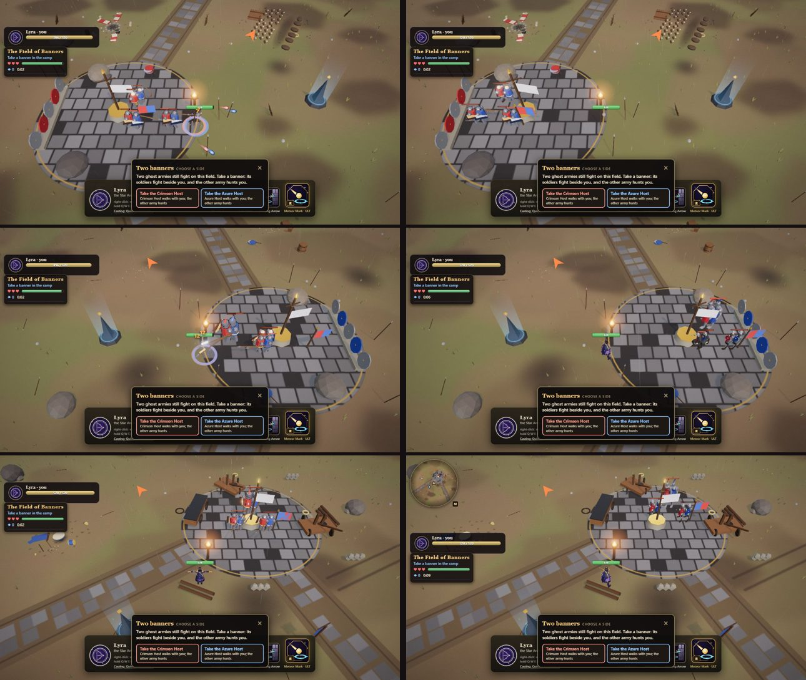
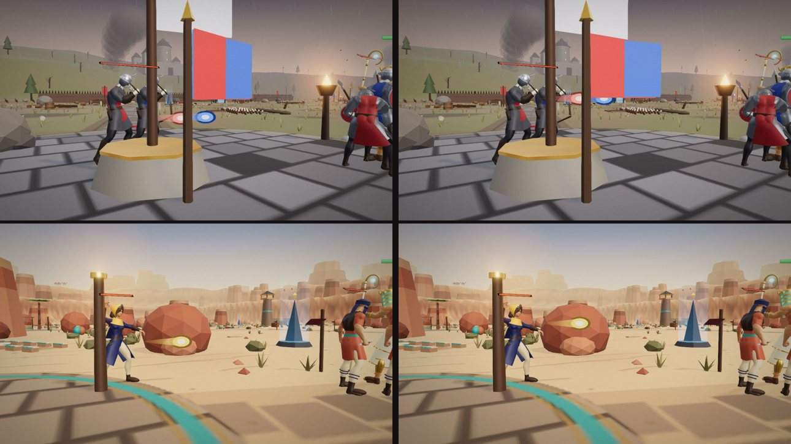
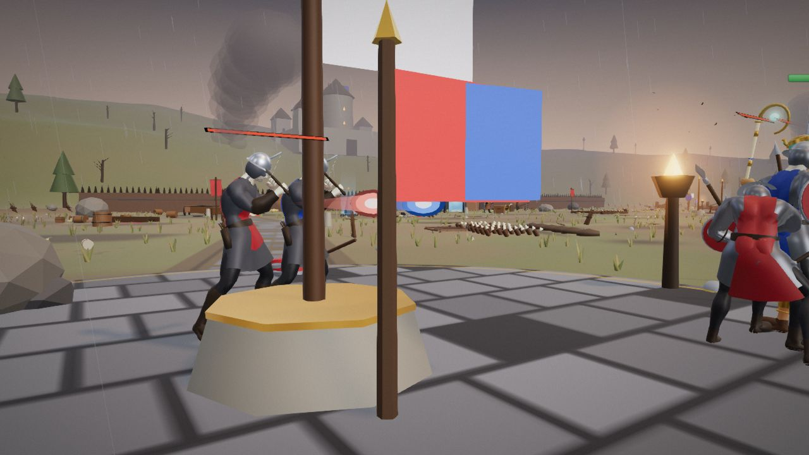
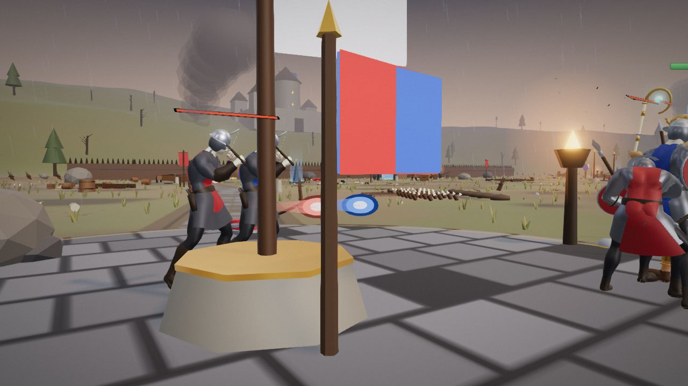
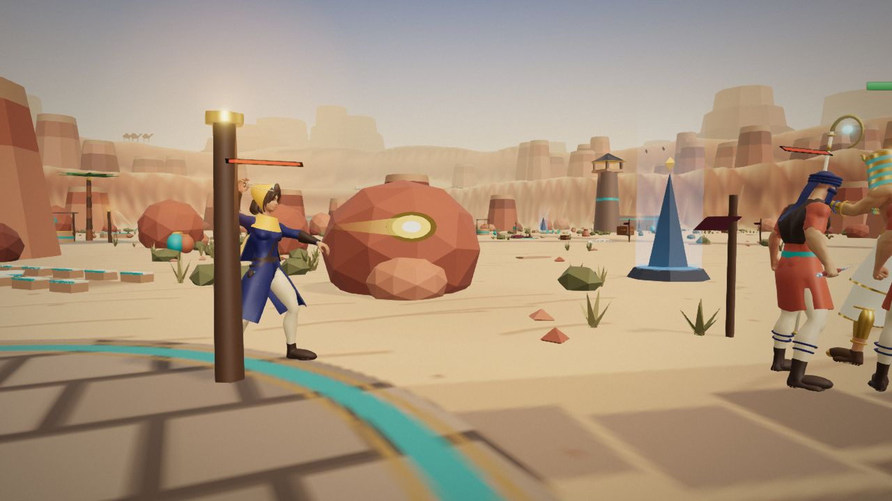
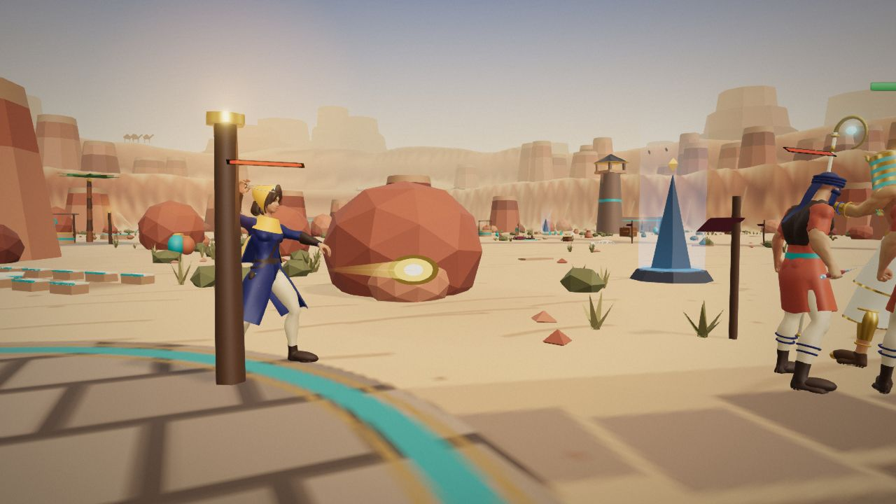
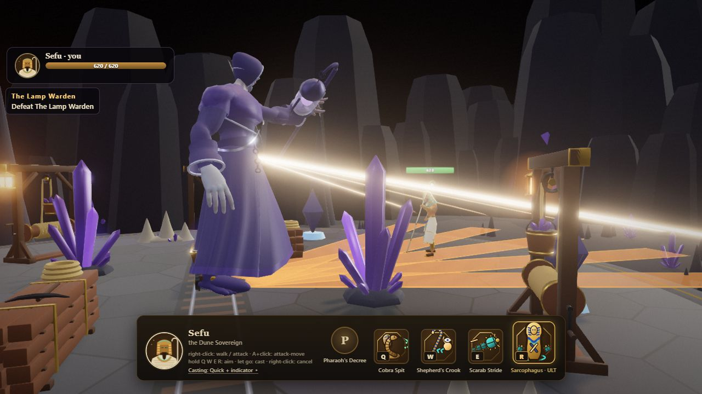
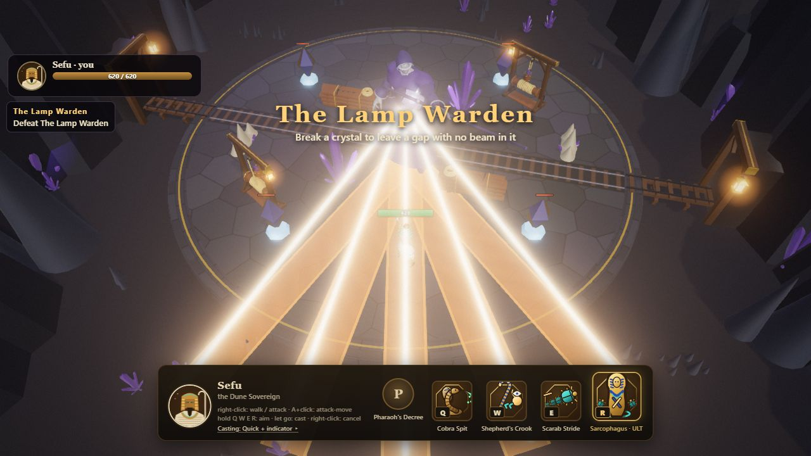

# Fixed after round 2 (2026-11-16)

Two items of this round's lists, done after it. This folder is written by hand; the page's "Fixed after" section links here.

## Floor 41: the places and the armies' homes off the standards' stone feet

The west ridge, the east ridge and the north works each have the main quest's standard on a 0.9 m stone foot (cover) in their
middle, and their stand and the homes of the packs there (a-r, a-b at the west, b-r, b-b at the east, c-r, c-b at the north) were
that same point: inside the foot. The round named east and north; the west is the same layout and had the same fault (measured:
all three 0.9 m inside the foot).

Fixed in the floor's generator (`makeBannersFloor`, `src/tower/world/gen/war.ts`) and re-baked (`node pipeline/tools/gen-banners.ts`,
`src/tower/world/floors/banners-made.ts`): each of the three stands, and the two armies' homes there, is 2.4 m from the middle, 1.5 m
clear of the foot, on its outer side, between the standard and the shields or catapults behind it. The first try put them on the inner
side, towards the field's middle: that brought the homes within 15 m of the waystones there, the floor's own check refused the layout and
the bake moved on to another seed (a different floor). On the outer side the floor keeps its seed (41000) and only those 9 points moved
(3 stands, 6 homes; 18 lines of the bake). The standards, the quest's "take the standard" steps (they touch the standard from 3.8 m),
the roads and the waystones are where they were. The hub's pack table re-written (`node pipeline/tools/climb-packs.mjs`; only floor
41's line changed).

The route bot plays the floor through: cleared with four stars, no fall, no console error, 1083 s of game time.

Woken at home, before: each site's six soldiers crowd onto and round the foot (the game pushes them out of the cover, to its edge);
after: they stand behind the standard, clear of it. Left: before; right: after (west, east, north; each "before" taken with that site
visited first, since in this check only the first site visited shows its pack at home):

The War's made floors 42 to 50 are laid out by the same generator's ridges and works (`placeAll` keeps a ridge's and a works'
stand at its middle): they were not changed here.

## Where shots leave

Every enemy bolt left at 1.1 m whatever the hand. Now a bolt can leave higher and glides down to 1.1 m over its first 4 m:

- `src/effects/projectile.ts`: `ProjectileOptions.height` (optional), `GLIDE = 4`; the bolt starts at `height`, its y comes down to
  `BOLT_HEIGHT` over 4 m of flight. What a bolt meets is found in x and z as before, and a hit is still reported at `BOLT_HEIGHT` (the
  point a hit's `from` and the spells' hit callbacks get), so no hit changes. After a hit (a bounce) it flies at 1.1 m.
- `src/effects/parts/minion.ts`: `MinionRig.shotY` and `MinionFx.shotY`; `src/effects/summon.ts` `shoot` passes it as `height`.
- `src/tower/world/foeModels.ts`: `FoeModel.shotY` (before the unit's scale), passed to the rig; `src/tower/world/packs.ts` scales it
  with the unit, as it does the bar.
- `src/tower/world/foeKinds.ts`: the hands measured in the game at the release (the second shot of a woken pack):

| Who | Unit scale | Hand at the release | `shotY` | Bolt leaves |
|---|---|---|---|---|
| Net caster (floor 1) | x1.3 | 1.75 m (throwing hand) | 1.35 | 1.75 m |
| Slinger (floor 21) | x1.3 | 1.75 m (throwing hand) | 1.35 | 1.75 m |
| War bowman (floor 41) | x1.2 | 1.8 m (crossbow) | 1.5 | 1.8 m |
| Thorn sprite (floor 11) | x1.55 | 1.28 m (casting hand; the torch is in the other) | 0.83 | 1.28 m |

**The rulers: nothing to change.** A ruler fires no bolt from its hand. Its stand-in hero's basic attack is never used in a ruler's
fight (logged through 30 s of the route bot's fight with the Prism Mother on floor 31: no bolt, no attack missile), and its moves are zones on the
floor except two: the "Fan of Light" (the Deep's floors 32 to 40 and floor 23), whose beams already start at 1.4 m times the ruler's size
(3.58 m for the Lamp Warden at x2.56: its right hand is at 3.17 m and its raised left at 5.1 m at that moment; `fan` in `src/tower/moves.ts`), and the "Volley", fired by its sentries
(cannons, lamps, standards on the floor), not by the ruler. So nothing in `src/duel.ts` or `src/arena.ts` was touched. (Round 2 had
expected the ranged rulers' bolts at 1.1 m; they have none.) How far this was checked: every bolt is made in one place
(`arena.ts`, the projectile system's `spawn`), and one ruler fight was logged with it hooked (30 s, floor 31); the fan and the volley
were read in the code, and the fan was seen in a fight (floor 33, below). Not every ranged ruler's fight was logged.

**The hit is the same:** `python pipeline/tools/hero-prints.py check Anka,Kaia,Sefu --port 5194` SAME with the old bolt code and
with the new (bae036d3, cf160412, bfb83e68); the perf prints (desktop, `perf.py scenes ... --port 5195`, the old code against the new,
`perf-show.py shots-before shots-after`): world-3 (floor 21, slingers) 45b46573, world-5 (floor 41, bowmen) 216f3d58, raid-party
9c4a9c48, the same fights. Both tools use a dev server already answering on their port, so they were run on ports checked free first:
a first run on 5192 had measured another worktree's server (its hero-prints server stood there).

From the side, a moment after the shot (top: the bowman; bottom: the slinger; left before, right after):

| | before | after |
|---|---|---|
| Bowman, side |  |  |
| Bowman, game camera |  |  |
| Slinger, side |  |  |
| Slinger, game camera |  |  |

The Lamp Warden's Fan of Light (floor 33, a fight in play mode with its model loaded), unchanged: from the side and from the game's
camera. The beams leave 3.58 m up, from its outstretched arm; the hero (Sefu) stands in front of it.

