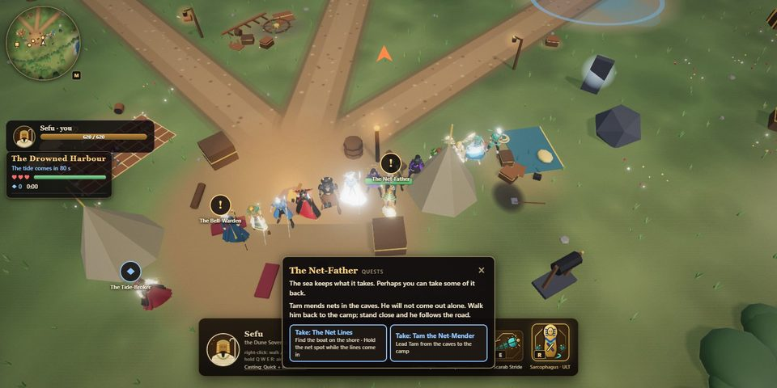

# 5. The heroes on the Climb's floors

All 40 heroes on the first floor of each chapter (1 the Sea, 11 the Wood, 21 the Sands, 31 the Deep, 41 the War), in rows of ten with
Sefu and Kaia at the head, each beside one of the floor's first four people, standing where the game stands a hero, through the hero
figure code. Pictures from the game's camera and from in front. Tool: `pipeline/tools/climb-lineup.js`.

- **Feet:** every hero's soles at 0.00 to 0.01 m on every floor (the hero review's raise works on the Climb too). The walkable ground of a
  floor is level (its hills and slopes start past the walkable edge, `land.ts`), so there is no slope for a foot to sink into where a
  hero can go.
- **Sizes:** the heroes and the floors' people are of one size family (next entry has the numbers).
- **Spells:** a hero on a floor casts from the same spot and height as in a duel (the ground is level at the same height), so a spell
  leaves from where it does in a duel; bolts leave at 1.1 m like every bolt (see "Where shots leave"). Not checked: each hero casting
  each spell on a floor.
- Nothing for the floor reviewers: the rows went through camp props only because the tool lined them up in a straight line.

The Sea, the Wood, the Sands, the Deep, the War (the game's camera):

From in front on floor 1: 
