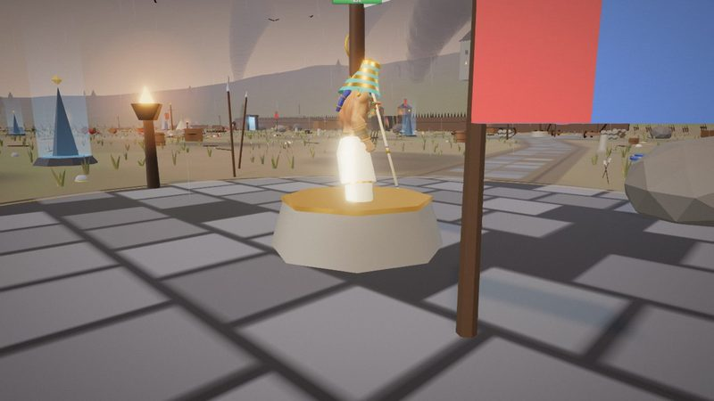
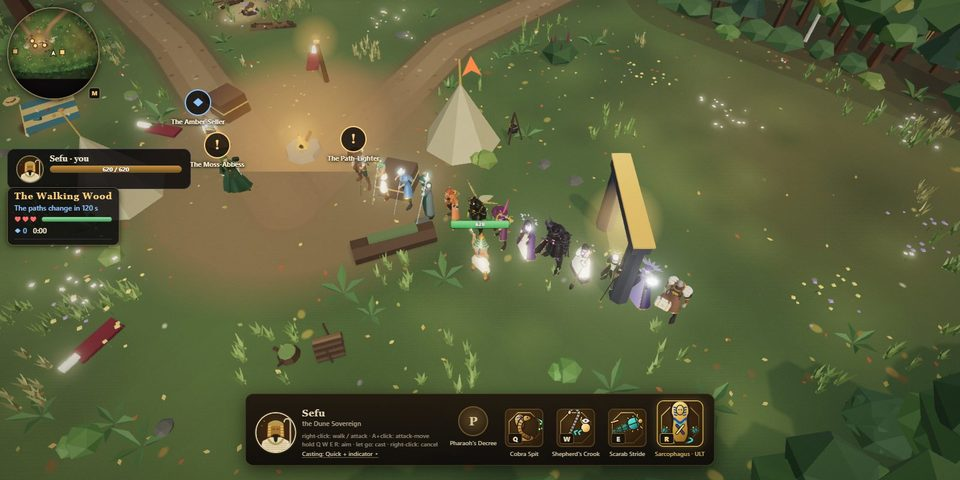
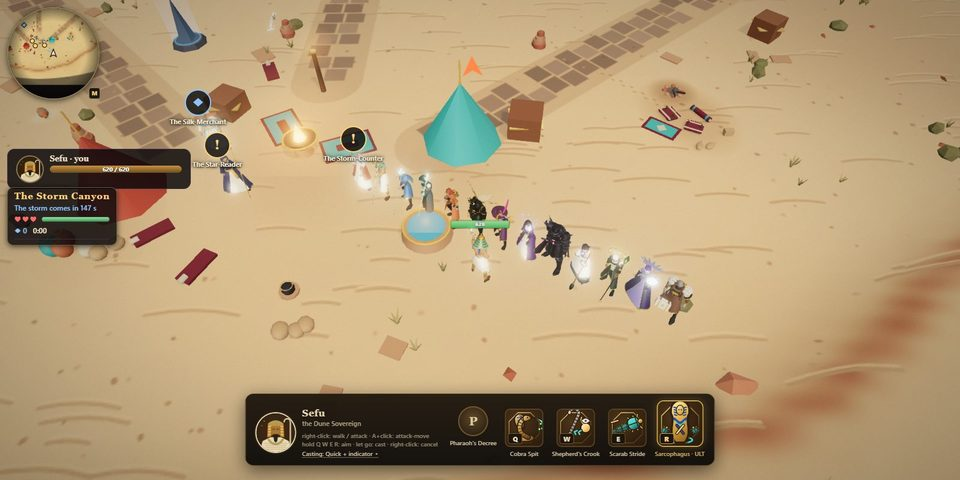
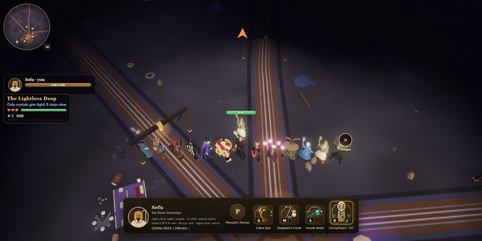
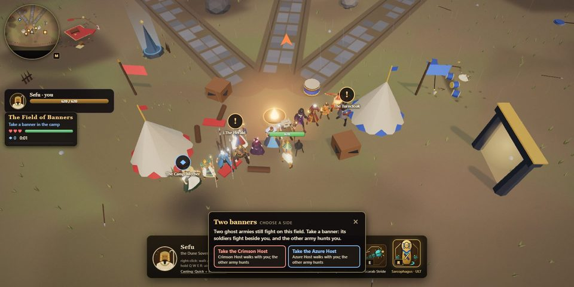
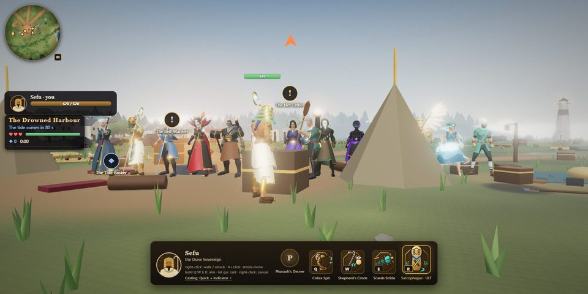

# 5. The heroes on the Climb's floors

All 40 heroes on the first floor of each chapter (1 the Sea, 11 the Wood, 21 the Sands, 31 the Deep, 41 the War), in rows of ten with
Sefu and Kaia at the head, each beside one of the floor's first four people, standing where the game stands a hero, through the hero
figure code. Pictures from the game's camera and from in front. Tool: `pipeline/tools/climb-lineup.js`.

- **Feet:** every hero's soles at 0.00 to 0.01 m (the hero review's raise works on the Climb too). That is where the game stands a hero;
  whether the drawn ground is there too was measured apart (`pipeline/tools/ground-probe.js`): the real hero put at every place, person and
  pack home of the five floors, and 3 m beyond each (202 spots), a ray down through the floor's drawn ground under it. The game keeps the
  hero at height 0 everywhere, and the drawn ground under it is at 0 at every spot a hero can walk to. The seven spots where something drawn
  stood above its feet (0.4 to 3.3 m) all lie inside a piece of cover (a wreck, a well, a cart, the War's hill and two drums), where only
  the tool, not a player, could put a hero.
- **For the floor reviewers:** on floor 41 the places "east" and "north", and the homes of the packs b-r, b-b (east) and c-r, c-b (north),
  are in the middle of a 0.9 m drum of cover (a stone drum with a gold top). The game keeps heroes and units out of cover, so a unit sent
  home walks to its edge; but the place's own spot is the drum. Move the place and pack spots about 1.5 m off it.
  
- **Sizes:** the heroes and the floors' people are of one size family (next entry has the numbers).
- **Spells: not checked by casting.** No hero cast a spell on a floor in this round. What was checked is what a spell starts from: the
  hero stands at the same height (0) on a floor as in a duel, and a bolt starts at 1.1 m in both, so a spell should leave from where it
  does in a duel; seeing each hero cast on a floor is still to do.
- The line-up rows went through camp props only because the tool lined them up in a straight line.

The Sea, the Wood, the Sands, the Deep, the War (the game's camera):

From in front on floor 1: 
