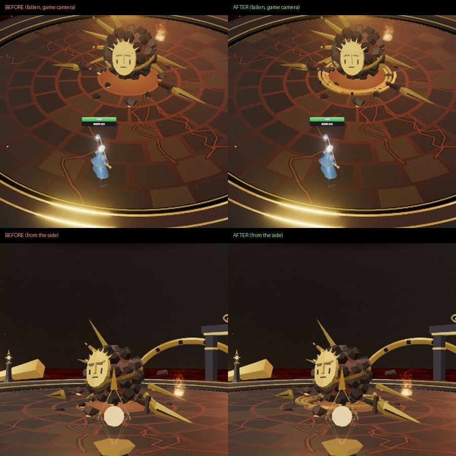
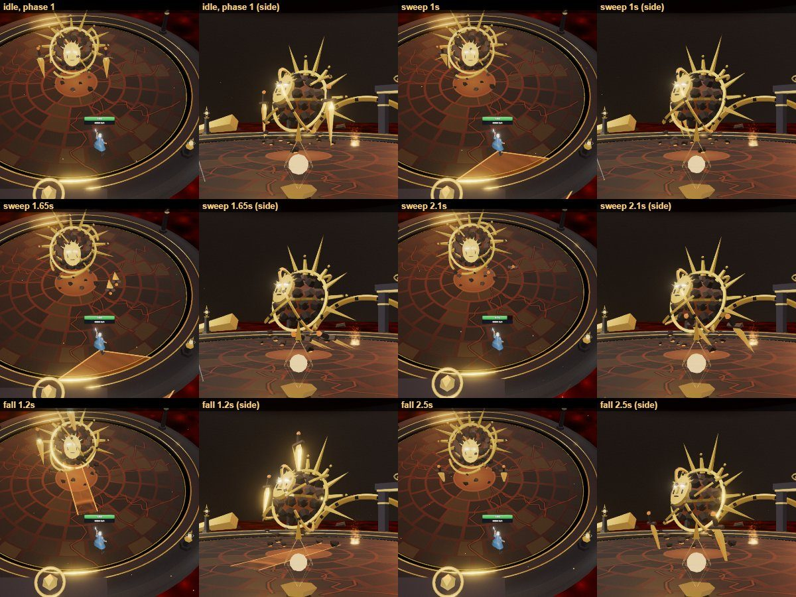
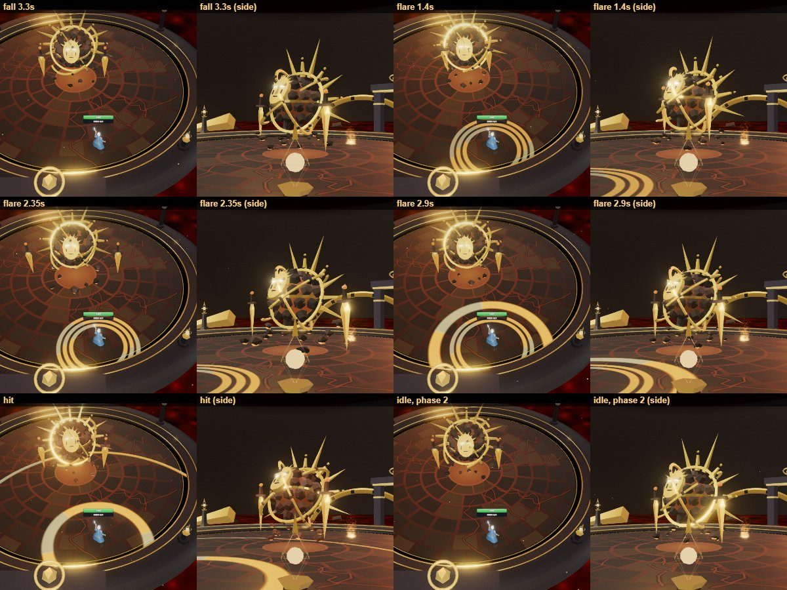
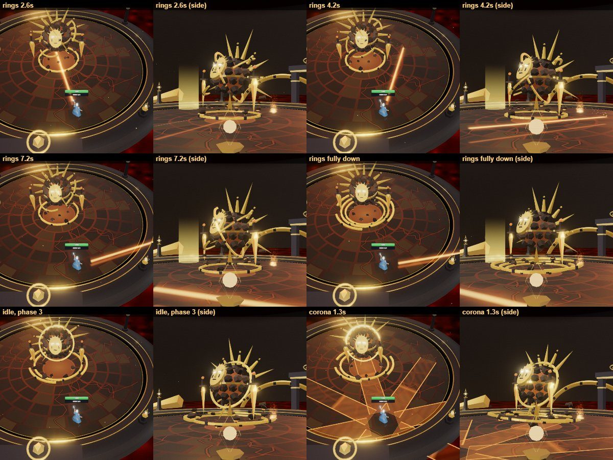
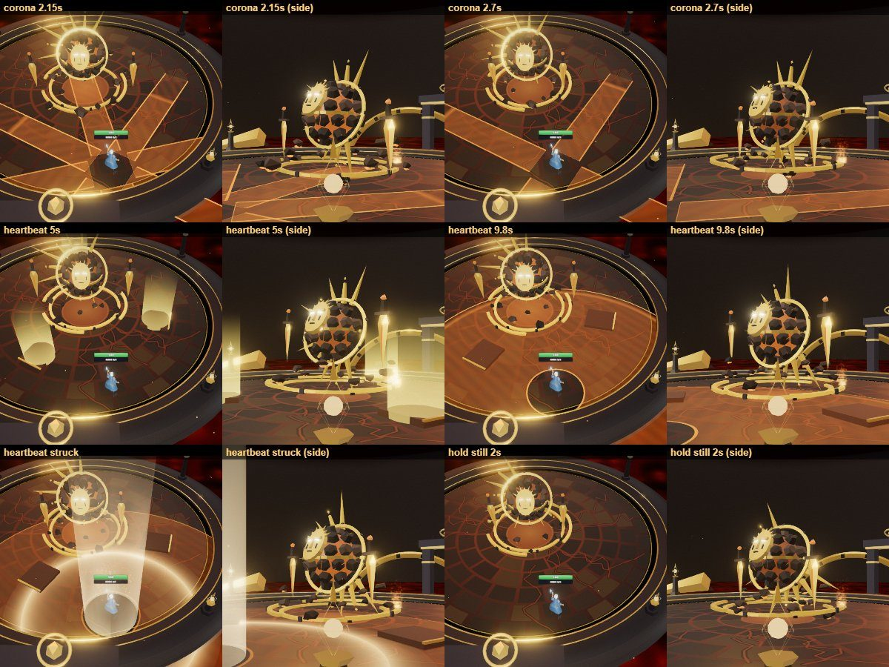
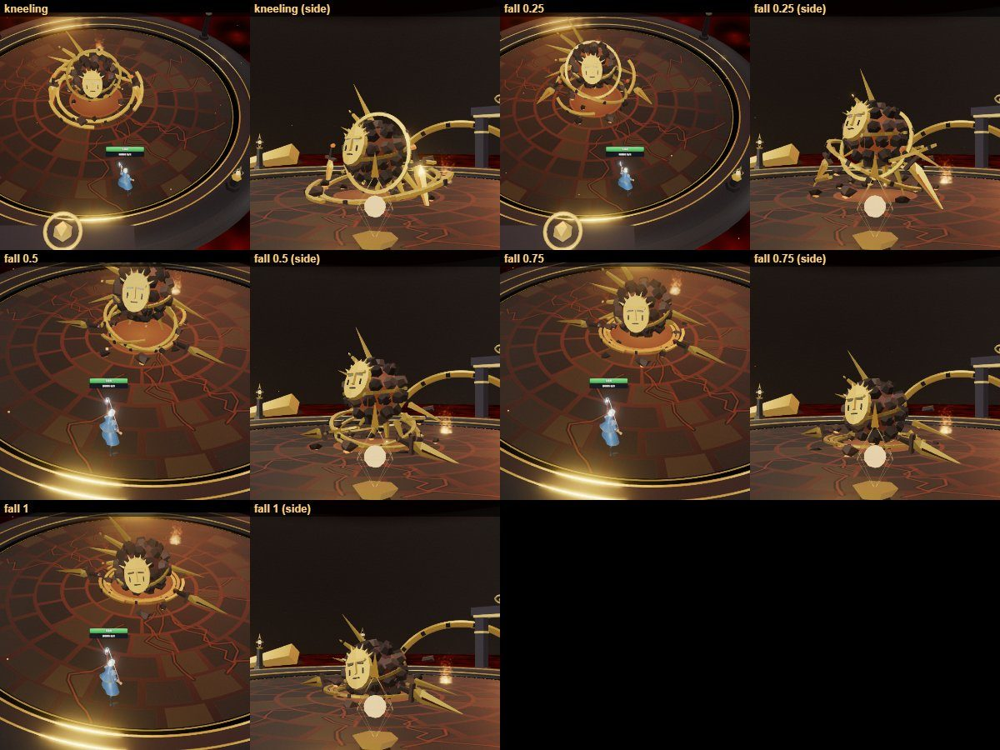

# 1. The Heart of Noon in its room

Checked through its own solo room (the Sunken Heart), every move cast for real through its link so its body, its rings and its
Heartbeat play as in a fight: Blade Sweep, Blade Fall, Solar Flare, The Rings Turn (and the rings fully down), Crown of Rays,
Heartbeat (gathering and struck), Hold Still; a hit, each phase at rest, kneeling, and the fall at four moments. Two views each: the
game's camera from where a hero stands, and from the side at its middle's height. Each part (core, face, crown, the three rings, the two
blades, the shards) measured: its lowest point. The party's own moves (Take the Blade, The Ring of Hands, the floor turning, the crust)
were pictured last week by `heart-phase-shots.py` and were not done again. Tool: `pipeline/tools/heart-poses.js`.

## Found and fixed

**The rings went under the floor when it fell.** The look says "the rings fall and lie on the floor", but the rings hang inside the
core: they were dropped 3.4 m in the core's own space while the core itself sank 2.2 m and tipped, so they ended 2.8 m under the
floor and out of sight. Now each ring is laid flat on the floor round its foot in the world (`src/raid/bodies/heart.ts`, the fall).
Lowest point of the three rings at the end of the fall: **before -2.82, -2.85, -2.89 m; after +0.15, +0.21, +0.27 m.**
It changes only how the fallen body looks; the fight is over by then.

## Checked and left as they are

- The blades go point-down into the floor when it kneels (-0.8 m) and in Blade Fall (-0.6 m): as the look says ("the blades point-down
  in the floor beside it", "down point-first where the line lands").
- The rings lie on the floor in The Rings Turn (lowest 0.3 to 0.7 m), as designed.
- The shards round its foot sink 0.7 m at the end of the fall, under the heart going "dark into the floor": with the core half under
  the floor this reads as one thing.
- **For the user:** in its last phase the crown of rays turns slowly all the time ("faster in the last phase"), so its long upper rays
  come round underneath and reach into the floor: 0.6 to 0.7 m during Crown of Rays, 1.7 m while it kneels (the kneel sinks it 1.4 m).
  The side views of the sheets show the rays standing in the floor under it. A fix would stop the turn short of half a turn, or sink
  less when kneeling: a change of look, so it waits for a yes.

The sheets, every move, two views each (left the game's camera, right from the side):

