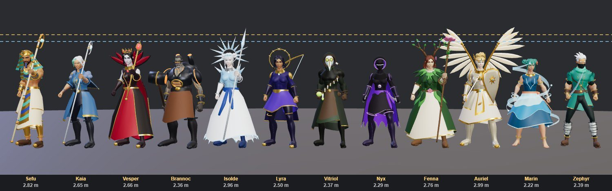
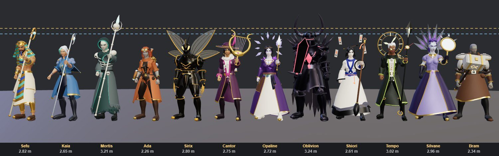
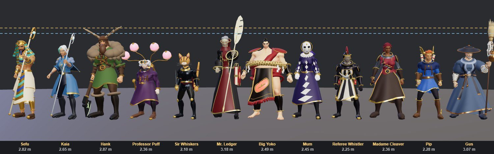
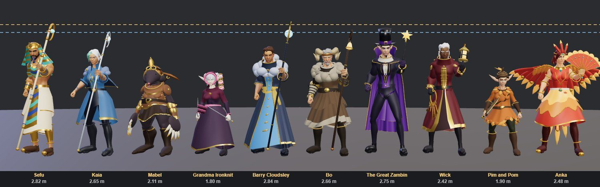
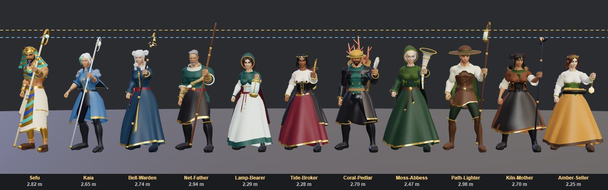
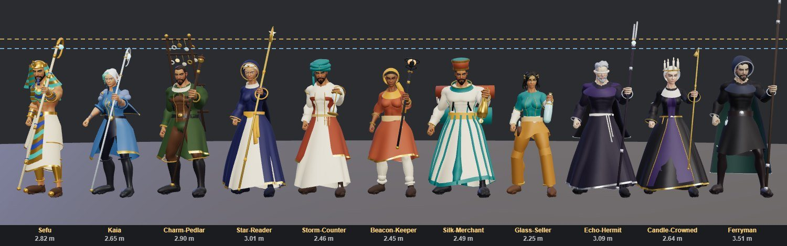
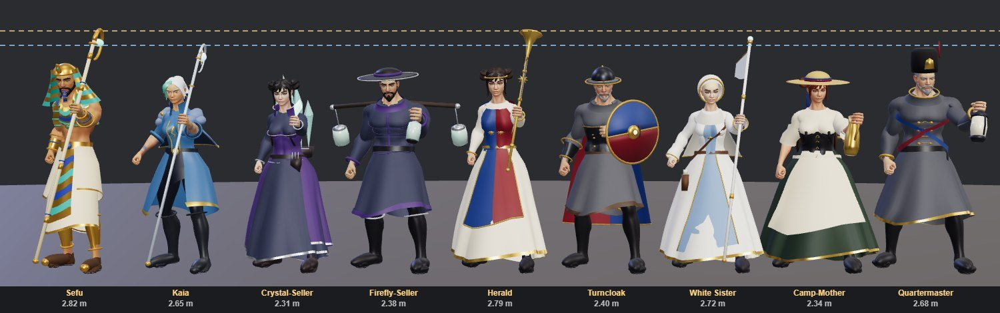

# 6. A line-up of all 40 heroes and the Climb's people

On a plain floor, through the hero figure code (so with the hero review's raise), Sefu and Kaia at the head of every row, a narrow lens so
heights compare; the dashed lines are Sefu's (gold) and Kaia's (blue) tops. The number under each figure is its top in metres with what it
holds and wears on its head. Tool: `pipeline/tools/lineup-plain.js`.

- Every sole is at 0.00 to 0.01 m: all stand on the floor.
- Heroes: from Grandma Ironknit 1.80 m and Pim and Pom 1.90 m to Mortis 3.21 m and Oblivion 3.24 m (staffs, hats and horns counted);
  Sefu 2.82 m with his crook, Kaia 2.65 m.
- The Climb's people: from the Amber-Seller and the Glass-Seller 2.25 m to the Echo-Hermit 3.09 m and the Ferryman 3.51 m (his pole). Their
  bodies are of the heroes' size: they read as the same people.

Nothing to fix.

The Climb's people:

