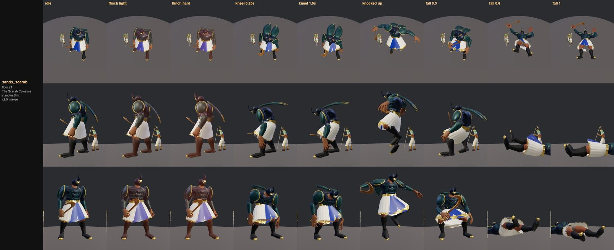
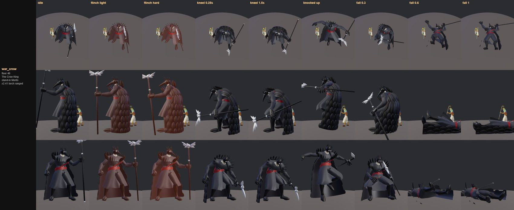

# The lists

## For the user (each a change of look: a yes or no)

1. **The rulers lying through the floor when they fall** (the Scarab Colossus 1.5 m, the Crow King 1.1 m, the Antler King 1.0 m; the others
   0.1 to 0.9 m): lift a fallen Climb figure part of the way, or a fall onto the front for the rulers? 
2. **The Heart of Noon's crown in its last phase:** its long rays turn round underneath and into the floor (0.7 m in a fight, 1.7 m while it
   kneels). Stop the turn short of half a turn? (see the side views in [the sheets](heart/moves-3.jpg))
3. **The Crow King's staff in his kneel** hangs head-down to the floor: keep it (a staff let fall) or hold it upright?
   
4. **Small arena notes:** Frost's low ice pieces past their cover inside the ring (a measure with `arena-fit.js` would say how far);
   the Temple's lintels from the rim. The Deep's mites have their bar right on their backs.
5. Still waiting from last round: the cream that blooms white on seven of the Climb's people in the Sands' and the War's light (it shows
   again in the line-ups on floor 21).

## For the raid's owner

- Ash once charged past his room's rim onto the lava, with the hero standing at the rim (the tool put the hero there): worth a look
  whether the charge stops at the rim.

## For the floor reviewers

Nothing: no person, pack or prop was found standing wrong on the floors looked at (1, 2, 11, 15, 21, 25, 31, 41, 42).

## For the engine

Where shots leave: the proposal in "7. Where shots leave".
