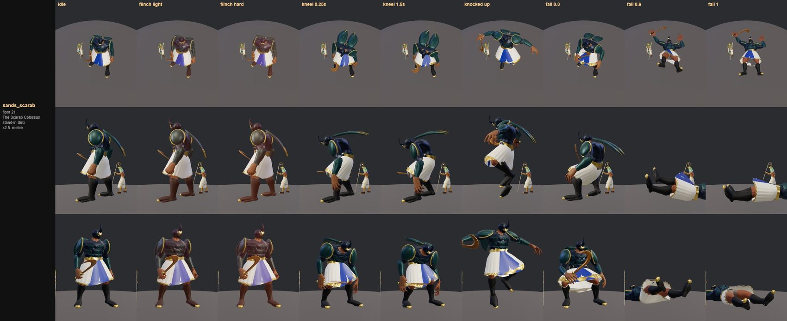
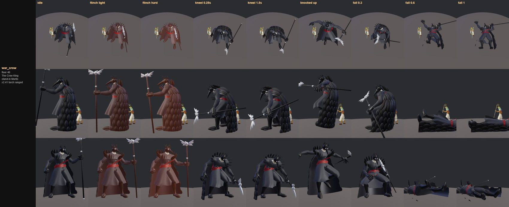

# 2. The Climb's rulers flinching, kneeling and falling

Each of the 15 rulers at its first floor's size, through the hero figure code it fights with (`climbFigure` on), beside Sefu, three
views a frame (the game's camera, the side, the front): standing, a light and a hard flinch (a hit from in front), kneeling (stunned:
the game's kneel, 0.25 s and 1.5 s in), knocked up, and the fall at 0.3, 0.6 and 1. Tool: `pipeline/tools/ruler-react.js`.

Lowest point other than the feet (a hem, a staff, a cloak), in metres at the floor's size (the feet stay within 0.02 m of the floor
standing, flinching and kneeling; knocked up they read -0.07 to -0.13 m because this harness keeps the figure on the floor where the
game lifts it; in the fall they lift as the body tips):

| Ruler | Size | Hold | Standing | Hard flinch | Kneeling | Knocked up | Fallen |
|---|---|---|---|---|---|---|---|
| The Drowned Captain | x2.2 | - | +0.34 | +0.34 | +0.35 | +0.76 | -0.15 |
| Mother of Wrecks | x2.2 | - | +0.10 | +0.10 | +0.05 | +0.43 | -0.36 |
| The Tide Judge | x2.28 | - | +0.21 | +0.21 | +0.13 | +0.69 | -0.12 |
| The Elder Root | x2.7 | staff | +0.14 | -0.23 | +0.01 | +0.70 | -0.82 |
| The Thorn Mother | x2.86 | staff | +0.12 | -0.45 | +0.09 | +0.56 | -0.46 |
| The Antler King | x2.88 | - | +0.45 | +0.46 | +0.48 | +1.04 | -1.04 |
| The Scarab Colossus | x2.5 | - | +0.40 | +0.40 | +0.42 | +0.95 | -1.51 |
| The Brass Sphinx | x2.42 | - | +0.29 | +0.29 | +0.23 | +0.86 | -0.12 |
| The Glass Serpent | x2.5 | - | +0.38 | +0.39 | +0.41 | +0.82 | -0.82 |
| The Prism Mother | x2.6 | staff | +0.13 | -0.49 | -0.10 | +0.36 | -0.84 |
| The Lamp Warden | x2.56 | staff | +0.26 | -0.48 | +0.23 | +0.78 | -0.31 |
| The Glass Abbot | x2.56 | - | +0.42 | +0.42 | +0.44 | +1.00 | -0.88 |
| The Last Marshal | x2.4 | - | +0.19 | +0.19 | -0.07 | +0.51 | -0.87 |
| The Siege Lord | x2.43 | - | +0.41 | +0.41 | +0.43 | +0.96 | -0.20 |
| The Crow King | x2.41 | staff | -0.02 | -0.41 | -0.27 | +0.16 | -1.11 |

## Found

Nothing that is clearly a fault to fix without changing a look:

- **Flinch and knock-up:** clean. The five staff rulers' staff foot dips 0.2 to 0.5 m into the floor at a hard flinch (a tenth of a
  second, the staff three times a hero's): from the game's camera it does not show.
- **Kneeling:** clean, the gowns on the floor. The Crow King holds his staff head-down while he slumps, its silver head on the floor
  (front view, "kneel"): for the user, it reads as a staff let fall, not as a fault.
- **The fall (for the user):** the pack's death clip lays a figure on its back. On the big rulers what is thick at the back goes
  through the floor as they lie: the Scarab Colossus's shell 1.5 m, the Crow King's feathered cloak 1.1 m, the Antler King's antlers
  1.0 m. From the side the upper body is cut off by the floor; from the game's steep camera they read as lying down. Two ways, both a
  change of look: lift a fallen Climb figure by part of the depth, or give the rulers a fall onto the front. Waits for a yes.

The Scarab Colossus (the deepest fall): 
The Crow King (staff head-down in the kneel; cloak through the floor fallen): 
More: [the Elder Root](rulers/react-wood_elder.jpg), [Mother of Wrecks](rulers/react-sea_queen.jpg),
[the Prism Mother](rulers/react-deep_prism.jpg), [the Antler King](rulers/react-wood_antler.jpg).
