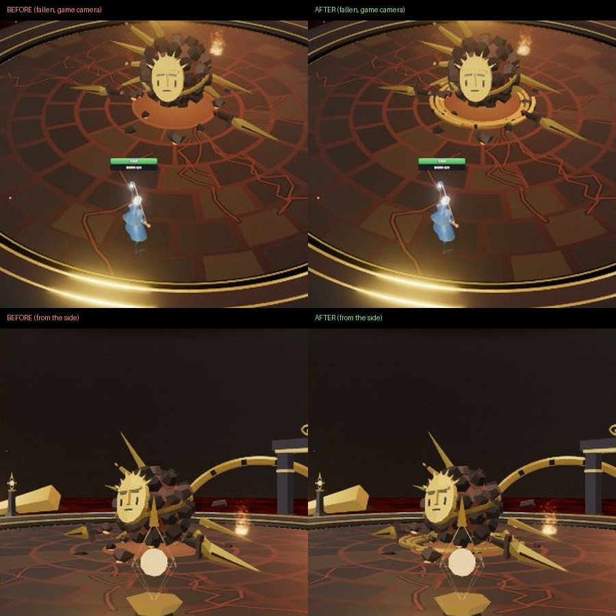

# In short

The user (2026-11-16): "make the agents look at all models we made and correct them; there may be clipping or bad direction; make it
so that they fit the scenes." Two rounds were done ([the Climb, bosses and arenas](../index.html), [the 40 heroes](../../../heroes/review/index.html)).
This second round looked at what they left unchecked, in the game itself (real fights, real floors), not only in pictures.

**Checked (seven items):** the Heart of Noon through all its solo moves, phases, kneel and fall; the Sun Warden, Ash and Ember in real
fights, filmed; the Climb's 15 rulers flinching, kneeling, knocked up and falling; the health bars of the 16 enemy looks set last round,
in their floors at a phone's size; the five older arenas' backdrops from the duel camera and from the rim; all 40 heroes on one floor
of each chapter beside its people; a line-up of all 40 and of the Climb's 25 people with Sefu and Kaia; where enemies' shots leave.

**Fixed (3 faults, nothing a fight counts changed; the four speed prints are the same before and after):**
1. The Heart of Noon's three rings sank 2 to 3 m under the floor when it fell; now they drop and lie on the floor round it.
2. The Hollow Oak's health bar touched its branches (0.03 m clear); now 0.20 m.
3. The Raider Chief's glaive stood through his bar (0.05 m clear standing); now 0.23 m.

**Fine as they are:** every hero's soles on all five chapters' floors (0.00 to 0.01 m), every hero's and person's size, the five older
arenas from the duel camera, the rulers' flinch, kneel and knock-up, the other 14 bars.

**Waiting:** four calls for the user (the rulers lying through the floor when they fall, the Heart's crown rays in its last phase, a staff
held head-down in a kneel, two small arena notes), one thing for the engine (where shots leave, with a proposal), nothing for the floor
reviewers. Below, one entry per item; the lists at the end.

Tools made for this round (all in `pipeline/tools/`): `heart-poses.js`, `boss-fight-look.js`, `ruler-react.js`, `bar-probe.js`,
`arena-backdrop.js`, `climb-lineup.js`, `lineup-plain.js`. Each says at its top how to run it.
