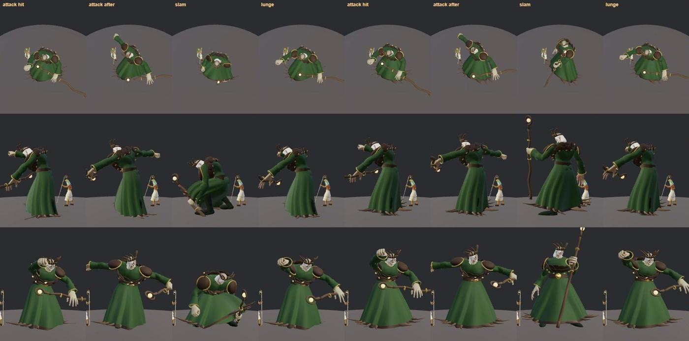
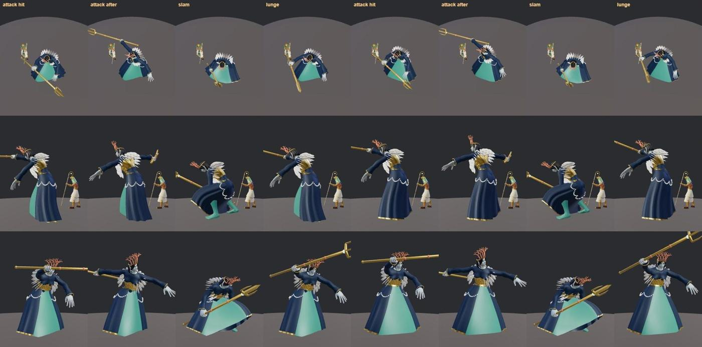
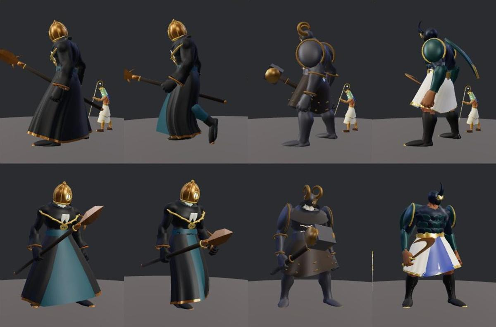

# The Climb's rulers (15 models)

Checked 2026-11-16. Each ruler at its first floor's size and with its stand-in hero's way of striking (`pieces/rulerModels.ts`,
`pieces/ruler.ts`), through the hero figure code it fights with (`src/heroFigure.ts`), beside Sefu: standing, walking, the basic
attack (wind-up, hit, after) and each cast pose its moves use (`thrust` for the fan of light, `swing` for the cleave, `slam` for the
turning fire, the tilting room and the tide, `lunge`, `raise` for the falling stones and the calls). Three views a frame: the
game's camera, the side, the front, on a plain floor: this is the code a ruler fights with, but the rulers were not each watched in
their own fight. Only the Drowned Captain was (floor 1, the harbour ring, 2.2 times a hero: in scale with the ring's props and the
hero); a probe of the others in their fights read the wrong figure and is not used. Not checked: a ruler's flinch, kneel and fall, and
the rulers in their chapters' light.

Sheets: [the Sea](rulers/sheet-sea.jpg), [the Wood](rulers/sheet-wood.jpg), [the Sands](rulers/sheet-sands.jpg),
[the Deep](rulers/sheet-deep.jpg), [the War](rulers/sheet-war.jpg). Tool: `pipeline/tools/ruler-sheet.js`.

## Found and fixed (in the game's code; the fights' numbers and timings are unchanged)

1. **The five rulers with a staff drove it two metres into the floor at every slam** (the Elder Root, the Thorn Mother (Briar Queen),
   the Prism Mother, the Lamp Warden, the Crow King). The slam plays the pack's landing, which swings the left arm down: the staff held
   upright in it went through the ground. Now a Climb figure holding a staff stands through a slam with the staff planted and the free
   hand raised (the ground still breaks around it).
2. **Gowns and long coats went into the floor at every blow and lunge** (the Mother of Wrecks 0.46 m, the Tide Judge 0.41 m, the Brass
   Sphinx 0.34 m...). A Climb figure now takes 40 % of a blow's step instead of all of it (`CLIMB_LEGS` in `src/heroFigure.ts`), so the
   hips do not drop as far: the hem stays within 0.2 m of the floor at the deepest moment, the feet sink 0.35 to 0.5 m at a lunge's
   deepest instead of 0.55 to 0.8.

Both apply only to a figure loaded from `models/tower/` (the rulers; the people only stand); every hero moves as before.

Before (left) and after (right), the Elder Root: the attack, its follow, the slam, the lunge:

The Mother of Wrecks, the same moments: 

The lowest point of each ruler other than its feet (a hem, a staff, a cloak), at its deepest moment, in metres at its floor's size,
and its feet:

| Model | First floor's name | Size | Hold | Lowest, before | Lowest, after | Feet, before | Feet, after |
|---|---|---|---|---|---|---|---|
| sea_admiral | The Drowned Captain | x2.2 | - | -0.10 (attack after) | +0.01 (attack after) | -0.63 | -0.40 |
| sea_queen | Mother of Wrecks | x2.2 | - | -0.46 (attack after) | -0.16 (attack hit) | -0.53 | -0.35 |
| sea_judge | The Tide Judge | x2.28 | - | -0.41 (attack after) | -0.10 (attack after) | -0.67 | -0.42 |
| wood_elder | The Elder Root | x2.7 | torch | -2.28 (slam) | -0.17 (attack wind) | -0.72 | -0.47 |
| wood_briar | The Thorn Mother | x2.86 | torch | -2.21 (slam) | -0.20 (attack hit) | -0.70 | -0.46 |
| wood_antler | The Antler King | x2.88 | - | -0.10 (lunge) | +0.04 (lunge) | -0.76 | -0.48 |
| sands_scarab | The Scarab Colossus | x2.5 | - | -0.12 (attack after) | +0.01 (attack after) | -0.76 | -0.48 |
| sands_sphinx | The Brass Sphinx | x2.42 | - | -0.34 (attack after) | -0.04 (attack hit) | -0.71 | -0.44 |
| sands_jackal | The Glass Serpent | x2.5 | - | -0.09 (lunge) | +0.04 (lunge) | -0.63 | -0.39 |
| deep_prism | The Prism Mother | x2.6 | torch | -2.00 (slam) | -0.19 (lunge) | -0.57 | -0.38 |
| deep_lamp | The Lamp Warden | x2.56 | torch | -2.20 (slam) | -0.06 (lunge) | -0.62 | -0.41 |
| deep_seam | The Glass Abbot | x2.56 | - | -0.13 (attack after) | +0.01 (attack after) | -0.79 | -0.51 |
| war_marshal | The Last Marshal | x2.4 | - | -0.55 (slam) | -0.55 (slam) | -0.70 | -0.44 |
| war_siege | The Siege Lord | x2.43 | - | -0.13 (attack after) | +0.02 (attack after) | -0.76 | -0.49 |
| war_crow | The Crow King | x2.41 | torch | -1.96 (slam) | -0.23 (lunge) | -0.57 | -0.37 |

## Left as they are

- **The Last Marshal's cloak** still goes 0.55 m into the floor at a slam (he holds no staff: the landing's crouch is the pack's own;
  taking less of it left the feet half-bent and lower). Seen from the game's camera it is a moment in a dust cloud.
- **Facing and hands:** all face the way they walk and turn to the hero; weapons in the right hand, staffs in the left; a ranged
  ruler with a staff (the Prism Mother, the Lamp Warden, the Crow King) thrusts it at the hero with its push, as designed.
- **A ruler's basic attack is still its stand-in hero's** (known since the models were made, `docs/tower/models/README.md`).

## For the Blender round

- **The Tide Judge's glaive** (`blender/tower/sea/judge.py`, the harpoon-glaive): held at rest its haft runs back through the gown
  behind the right hip (it reaches 0.6 of its length behind the hand). Change the haft to start at `o - d * 0.3 * s` and the pommel
  ellipsoid to `o - d * 0.31 * s` (lines 89-90), then rebuild `sea.judge`. 
