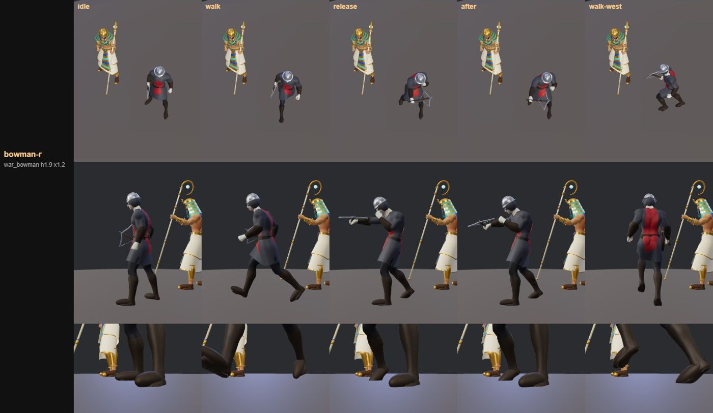
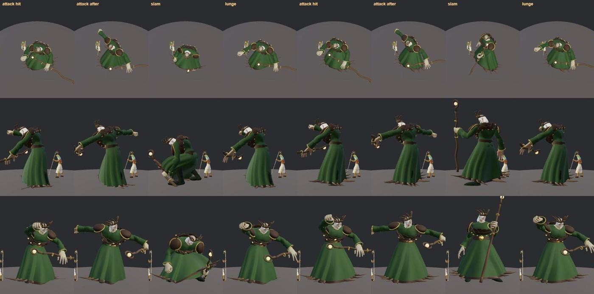

# In short

The user (2026-11-16): "make the agents look at all models we made and correct them; there may be clipping or bad direction; make it
so that they fit the scenes." This round: every model that is not a hero (another agent reviews the heroes).

**Checked:** the Climb's 55 (15 enemies in 24 looks, 15 rulers, 25 people), three of the Raid's four bosses, the 7 arenas in the
heroes' style (139 props against their cover), the 5 weapons (used only by the VFX tool). The people in their own floors; the enemies
in their floors and, for every move, on a plain floor beside Sefu; the rulers on a plain floor through the code they fight with (one
seen in its fight); the bosses in their rooms; the arenas' props as numbers and plans. Feet, lowest points, facing and hands measured.

**Fixed in the game's code (6 faults, nothing a fight counts changed):**
1. The War's bowman punched with his empty left hand while his crossbow swung back over his shoulder: now he levels the crossbow.
2. The Pale One's gown went 0.25 m through the ground at each blow: now it stays on it.
3. Enemies that back away or circle the hero slid sideways on a forward walk: now they step the way they go (sideways moments 36 % to 17 %).
4. The five rulers with a staff drove it two metres into the floor at every slam: now they plant it.
5. The rulers' gowns and coats went up to half a metre into the floor at a blow: now within 0.2 m.
6. Sixteen enemies' health bars stood in their crowns, plumes and heads: now over them.

**Waiting:** two rebuilds for the Blender round (the Tide Judge's glaive through his gown, the harbour's cannons past their walls),
one taste call for the user (people in cream glow), one placement for the floor reviewers (the Turncloak in a bench on floor 42), one
note for the engine (shots leave at 1.1 m whatever the unit holds). Not checked: the Heart of Noon, the rulers' flinch, kneel and fall,
the enemies and rulers close up in their chapters' light, the older arenas' backdrops.

**Round 2 (2026-11-16): [what this round left unchecked](round2/index.html)**: the Heart of Noon, the three other bosses in real fights,
the rulers' flinch, kneel and fall, the bars looked at in the floors, the older arenas' backdrops, the heroes on the Climb's floors, the
line-ups, where shots leave. Three fixes (the Heart's rings in its fall, two bars), four calls for the user, one proposal for the engine.
