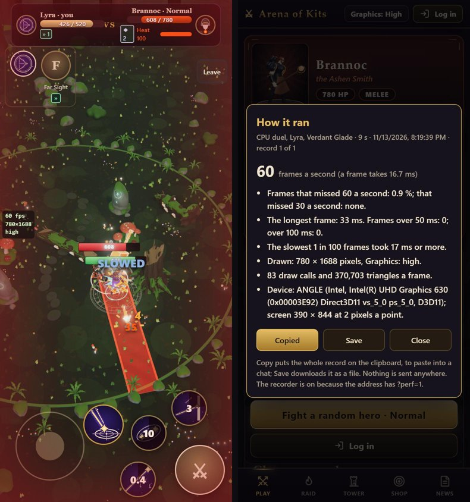
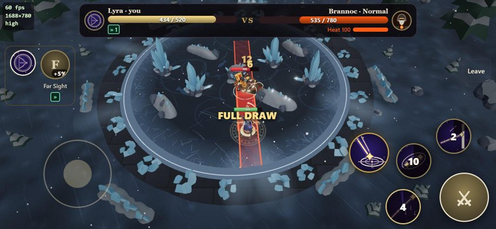

# Performance: measuring it, and keeping it

`python pipeline/tools/perf.py` plays fixed scenes of the real game in a browser with the real graphics card and times
every frame; it also measures loading. The results as a page: [perf/performance.html](../perf/performance.html)
(`python pipeline/tools/perf-report.py` writes it). This page says how to run the tool, how to read it, what was found
with it on 2026-11-13, and the rules that keep the game fast.

Needs: `pip install playwright pillow`, Chrome or Edge (`--browser chrome|msedge`; the default is whichever is installed).

## The commands

| Command | What it answers | Time |
|---|---|---|
| `perf.py scenes --label after` | Frame times of every scene on every device profile | 25 min (one profile: 5) |
| `perf.py scenes --label try --profiles phone-4x --scenes raid-party` | One scene on one profile | 1 min |
| `perf.py load --label after --headed` | Loading: bytes, requests, the menu's first frame, the first fight and its first 20 s in real time. `npm run build` first | 1 min |
| `perf.py passes --scene duel-temple` | What each step of drawing a frame costs the graphics card (its own timer) | 1 min |
| `perf.py parts --scene duel-temple` | What each part of the picture costs the card: the frame drawn again with one part hidden at a time; shadows, bloom, reflections, half the pixels | 1 min |
| `perf.py profile --scene raid-party` | Which functions the processor's time goes to, and which make the garbage | 1 min |
| `perf.py census --scene raid-party` | Who the draw calls belong to | 1 min |
| `perf.py flips --scene raid-party` | Materials that make three look their shader up again every frame | 1 min |
| `perf.py files` | The sizes of the built chunks and the models | at once |
| `perf-show.py baseline after` | Two result files as a table, with whether each scene was the same fight | at once |
| `perf-diff.py cmp-base cmp-new` | The pictures of two runs compared pixel by pixel | at once |
| `perf-report.py` | The page | at once |
| `perf-phone.py record.json` | A record from the in-game recorder (a real phone) as a table | at once |

Options that matter: `--set "{\"quality\": \"auto\"}"` (a quality level), `--set "{\"noPrebuild\": true}"` (see "The same
fight"), `--root <folder> --port <n>` (another checkout of the game, see "Before and after"), `--headed` (a visible
browser), `--frames`, `--seed`.

## The scenes and the profiles

Six scenes (`SCENES` in perf.py; the page side is `scenes` in perf-page.js): the Play screen with the turning hero; a duel
in the Night Temple (Lyra against Oblivion) and one in the Harbour (Anka against Isolde), the autopilot at the keys, with
the player's camera and bars; the Sun Warden alone; the Sun Warden with nine scripted partners that walk, attack and cast,
in the Hall of Noon; a horde floor of the Tower of week 2026-W46, begun again when cleared. 1,500 frames of a 60th of a
second each (25 s). More scenes by name only (`MORE` in perf.py): `arena-<id>` (a duel in each arena), `raid-ash`,
`raid-heart`, `raid-heart-party`, and `world-1` to `world-5` (a floor of the Tower's worlds: the wide zone, the hero set
down beside one pack after another; the five handmade floors, which since the Climb became 50 floors are floors 1, 11, 21, 31 and 41:
the names stayed, and so did the fights' prints). To add a scene: a function in `scenes` that sets the game up and returns `{ stepped, frame(i), print() }`,
and a row in `SCENES`.

Five profiles: `desktop` (1920 x 1080), `phone` (844 x 390 points at 3 pixels a point, touch: drawn at 1688 x 780), and
`desktop-4x`, `phone-4x`, `phone-6x` with Chrome's processor throttle. The graphics card is the computer's own; every
result names it and says so if the browser fell back to software drawing (then the numbers mean nothing).

## How a frame is timed

- The page's frame loop is taken over: `requestAnimationFrame` callbacks are queued and run by the tool, one batch a
  frame. Nothing depends on the window being seen, and every renderer on the page draws exactly once a frame.
- A frame is: the game's step (`step`), the draw calls (`draw`), and the wait until the graphics card has finished
  (`card`): one pixel is read back from each canvas, which makes the browser wait. That read costs 0.4 ms by itself, and
  the frame times it gives match the frame rate of a visible window (checked: 37 ms measured, 40 ms between real frames).
  Without it only the time to queue the frame would be measured.
- **A slowed profile does not force that wait.** Chrome's throttle holds the page's thread for three quarters of all
  time, a forced wait included, which made such frames far too slow. Left alone the wait comes by itself inside the draw
  calls, so on a slowed profile `draw` contains the card's time and there is no `card` column.
- One scene is one fresh browser, so its first seconds are the cold start a player meets. `warm` in the result is the
  scene without its first five seconds.
- Also counted: draw calls and triangles (all passes of a frame), particles on screen, textures, geometries and shaders
  alive, memory, garbage made a second, every shader built in the middle of the scene with the frame it cost and what
  it belongs to (`compiles`).

## The same fight, and the same picture

Time (`performance.now`) follows the tool's clock and the dice (`Math.random`) are seeded, so a scene is the same fight
every run. Each run writes its fight down (health and places every second) and prints a short hash of it (`print`). Two
runs with the same hash played the same fight: after a change to the engine that must not change the rules, the hashes
must match. `perf-show.py a b` says "same fight" or "ANOTHER FIGHT".

The game's warm-up builds both heroes' spell effects before the fight; building an effect rolls dice, so with it the
fight is another one than before it existed. `--set "{\"noPrebuild\": true}"` builds them at the first cast, as the game
of 2026-11-12 did: with it the game of today plays that game's very fights. Use it for the check, not for the timings.

`perf-diff.py` compares the pictures the runs end with. The same frame of the same fight differs by the film grain alone
(about 1 of 255 on average, no pixel far apart). A change that claims to leave the picture alone must give that.

## Before and after

`--root <folder>` measures another checkout with this checkout's tool. A frozen copy of the code before a change:

    git worktree add --detach C:/VFXTool-perf-base <commit>
    cmd /c mklink /J C:\VFXTool-perf-base\node_modules C:\VFXTool\node_modules
    python pipeline/tools/perf.py scenes --label baseline --root C:/VFXTool-perf-base --port 5185

So "before" is measured on the same day and the same computer as "after", again whenever a number looks off. While a
run uses the main checkout's dev server, do not edit `src/`: every scene loads the page afresh and would take the edit.

## Measuring a real phone

The tool measures this computer with a phone-sized screen. For a real phone the game has a recorder of its own
(`src/game/perfRecorder.ts`), loaded only when the address ends in `?perf=1`:

1. On the phone, open the game with `?perf=1` at the end of the address (`.../game?perf=1`). A small "Recorder on" mark
   shows in the menu's top corner.
2. Play a fight: a duel, the Raid, the Tower. A small line at the screen's left edge (in the top corner on a phone held
   sideways) shows frames a second, the pixels being drawn and the Graphics level. Touches go through it.
3. Back in the menu a card says how it ran: frames a second, how many frames missed 60 and 30 a second, the longest
   frame, what was drawn, the device. **Copy** puts the whole record on the clipboard, to paste into a chat; **Save**
   downloads it as a file. The mark in the menu opens the last card again; the last six records are kept in the
   browser (`aok.perf.records`).

Nothing is sent to any server. Without `?perf=1` the recorder's file is not even fetched: no line, no card, nothing kept.
A record covers one stay in a fight, from the first frame on screen to the return to the menu; loading pages and a
hidden tab are left out. A record is not the same fight as the tool's scenes (a person plays it, the arena is drawn by
lot), so compare its frames a second with the tool's, not its fights.

    python pipeline/tools/perf-phone.py record.json            # one row a fight, beside each other
    python pipeline/tools/perf-phone.py record.json --seconds  # and every second of it: where it was slow, what Auto did

To try a Graphics level on the phone: the Graphics button, or `?perf=1&quality=auto` (tried, not kept).

## What a windowless browser hides

Frame times are the same with and without a window. **Loading and stutters are not**: a windowless browser compiles a
shader late even when it was compiled ahead (first draw of a heavy shader: 140 ms cold, 65 ms compiled ahead, where a
visible browser has 787 ms and 8 ms). Measure loading, and anything about shaders compiled ahead, with `--headed`.

## What was found (2026-11-13)

Measured on an Intel UHD 630. The numbers are on the page; the causes, for the next person:

1. **Three draws solid things in the order of their materials' ids, not front to back.** The ground was drawn first and
   every floor over it after: two or three layers of lit, textured floor shaded for each pixel. `opaqueOrder` in
   `src/runtime.ts` draws the big surfaces last, the highest first. A third of a frame.
2. **A shader's identity includes where it draws and the shadow type.** `renderer.compile` with no target bound makes
   shaders for the canvas (sRGB, tone mapped); the game draws into the composer's target (linear, no tone mapping). And
   three turned `PCFSoftShadowMap` into `PCFShadowMap` at the first shadow it drew. Either one makes everything compiled
   before the first frame the wrong shader, compiled again when first drawn, with the page frozen. The warm-up binds the
   composer's target; the shadow type is set to the one three uses.
3. **A camera that sees one layer leaves the lights out**, and to three that is another set of lights: every lit material's
   shader was looked up again, twice a frame, whenever a spell bent the picture. Lights are on every layer now.
4. **A see-through two-sided material is drawn in two goes and marked changed before each.** `forceSinglePass` where the
   picture is the same (flat shapes, glows that only add).
5. **`Math.hypot` makes an array on every call**, and a helper that returns `{ x, z }` an object. In checks that run
   thousands of times a frame that is the garbage. `hyp` in `src/obstacles.ts` gives the same number to the last bit.
6. **Three's `updateMatrixWorld` walks hidden things too**, and once for each `render` call of a frame.
7. **The menu drew the fight's scene behind itself.**
8. **The page's start was shaders, not script**: two reflection maps and their shaders before the menu.

## Rules that keep it fast

- A new arena: one layer of floor where it can be. A second lit layer that fills the screen costs about 7 ms at full HD
  on an integrated card. Run `perf.py parts` on it.
- A room made of many small pieces: each piece is a draw call, and a second one if it casts a shadow. Run `perf.py census`.
- Never `Math.hypot` or a fresh object in something that runs for every obstacle, every frame. Use `hyp`.
- Do not set `material.needsUpdate` every frame, and do not share one material between a rigged mesh and a plain one.
  `perf.py flips` finds both.
- After a change to the engine: `perf.py scenes --label try --profiles desktop --set "{\"noPrebuild\": true}"`, then
  `perf-show.py baseline try`: the fights must be the same. Then without the option, for the times.
- Anything that changes what the player sees for speed (fewer pixels, no shadows) belongs in a quality level
  (`src/quality.ts`), not in the game for everyone.

## The quality setting

`src/quality.ts` and `quality` in `src/runtime.ts`. High (the look as it was; the default), Medium (at most 1.2 million
pixels, a 1024 shadow map), Low (at most 0.6 million, no shadows), Auto. The button is in the menu's top bar; on a phone
with an account that bar is full, and it is on the Profile screen. Auto, before each fight and behind the loading
page, draws the scene five times with the wait for the card and sets the share of pixels so a frame at rest takes 12.5 ms;
if the processor's part is most of a slow frame it drops the shadows instead. During the fight `FramePacer` follows the
frame rate: down at once when 40 frames average over 17.8 ms, up after four fast windows, back when an up fails; a cut
that does not make the next window faster (the processor is the limit, or the phone holds itself to 30 a second) is taken
back and none is tried for a while.
`?quality=low` in the address tries a level without keeping it. `game.api.quality` in the console shows what it chose.
