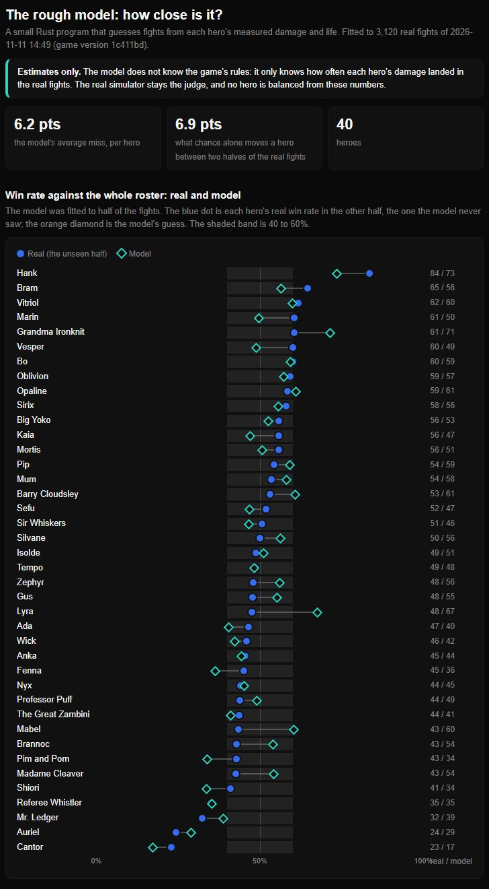

# The rough Rust model of fights

Asked for by the user on 2026-11-11, after the [fight simulator](simulator.md): "I think we should remade this
[simulator] into some language". Of four remakes offered they chose **"Rust, rough model first"**: a small program,
each hero a short sheet, quick what-ifs; its numbers are estimates and the real simulator stays the judge.

**It is not a second copy of the game's rules.** It knows no spell, no stun and no arena. It knows, for each hero,
how much damage it really takes before it falls and how often and how hard each of its sources of damage (Q, W, E, R,
basic attack, units, passive) landed in real fights. A fight in the model is two such sheets racing each other with
some luck. That is why it runs in milliseconds, and why it is rough.

## Ask it

```
pipeline\rustsim\target\release\rustsim.exe whatif "Anka" hp=480 q.damage=58
pipeline\rustsim\target\release\rustsim.exe whatif "Sir Whiskers" q.cooldown=2.5 --foes all
pipeline\rustsim\target\release\rustsim.exe check
```

`whatif` prints the hero's real win rate, the model's, and the model's after the change, against the six benchmark
foes (or the whole roster with `--foes all`), with the same luck before and after, so the difference is the change
and not chance. Keys: `hp=N`, `ehp=+N` (life the HP bar does not show: a heal, a shield, a second life),
`q|w|e|r.damage=N`, `q|w|e|r.cooldown=N`, `attack.damage=N`, `attack.interval=N`. Names with spaces go in quotes.
Every answer says "estimate" and ends with the command that asks the real simulator.

## How close it is (first check, 2026-11-11)



Full page: [balance/rough-model-2026-11-11.html](../balance/rough-model-2026-11-11.html).

- **Win rate against the whole roster.** Fitted to half of 3,120 real fights and graded on the other half, the model
  misses a hero by **6.2 points** on average. The two halves of the real fights differ from each other by 6.9 points
  from chance alone (78 fights a hero in each half), so with this much data the model is as close as chance lets
  anything be. Furthest off: Lyra (real 48, model 67), Mabel (43, 60), Vesper (60, 49), Brannoc and Madame Cleaver
  (43, 54).
- **Does it predict a change?** Anka's own balance steps are the test: the same kit with three numbers different,
  measured for real against the six benchmark foes. The model puts her at 48% now (real: 48).

  | Changed back | Real | Model |
  |---|---:|---:|
  | HP 460 to 480 | 59 | 52 |
  | and Q 54 to 58 | 63 | 55 |
  | and W 54 to 60, rising with 30% not 25% | 69 | 60 |

  It gets the direction of each step and about half to two thirds of its size. Each real number is from 96 to 192
  fights and can itself be 7 to 10 points off.
- **What it cannot see:** a change of rules (Anka went from 27% to 69% when a new ember could no longer be stamped
  at once: no number in a sheet says that); who beats whom (a hero is one sheet against every opponent); how the CPU
  plays a changed spell; anything since the last real run.

**So:** use it to throw away bad ideas quickly and to see which of two changes is the bigger one. Do not rebalance a
hero from it. Rule 9 and gate 5 of [new-hero.md](new-hero.md) stay on the real simulator.

## Where its numbers come from

Nothing is typed by hand.

| File | What |
|---|---|
| `pipeline/rustsim/export.js` | Read from the game by `page-shots.py`: each hero's HP, walk speed, basic attack, and per spell its cooldown, reach and the damage its own settings give. Only what a what-if needs to turn "Q 54 to 58" into a factor |
| `pipeline/sim/sim.py all --reps 2 --keep` | A real roster run with every fight kept: winner, seconds, damage and hits by source for both sides, casts per slot |
| `pipeline/rustsim/data/heroes.json`, `run.json`, `stamp.json` | The sheets, the fights (800 KB) and the game version and day they are from. In git, so the model works on any computer without a 12 minute run |
| `pipeline/rustsim/src/main.rs` | The model: `fit` (per hero: life, hits a second and damage a hit per source, how much of an average opponent's damage reaches it), `duel` (one fight), `check`, `whatif` |
| `pipeline/rustsim/refresh.py` | All of it again: export, roster run, fit, check, page. **Run it after any change to a hero, a spell or the CPU**: about 15 minutes, most of it the real run |
| `pipeline/rustsim/report.html` | The page's template (`data/check.html`, not in git; a copy worth keeping goes to `docs/balance/`) |

A hero's life in the model is the damage it really took in the fights it lost, so heals, shields, Sir Whiskers's
lives and Anka's second life are in it without a rule for any of them (Anka: 460 HP, 519 of life). One number, the
luck, is fitted so that the spread of win rates matches the real one (0.2 now).

The model says when it is out of date: its data carries the last commit that changed `src/`, and every answer warns
when the game has a newer one.

## Not built

- **Special rules per hero.** The first check shows no hero further off than chance explains, so none were added. If
  a later check shows one, that hero gets a rule, not all of them.
- **The full copy of the rules in Rust** (the option the user did not take): every hero written twice.
- **Positions.** Melee against ranged, cover and kiting are in the model only as averages.
