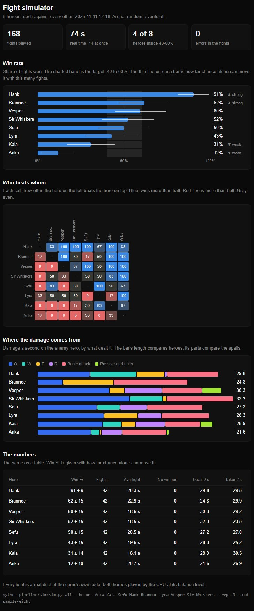

# Fight simulator

Asked for by the user on 2026-11-11: "can we make like simulator of fights so we dont need to test all the duels ...
it will be faster to balance all heroes ... make it in rust or in python ... and make like visualization for
everything you make, like page or something". Of the two ways offered they chose **Python on the real game**.

`pipeline/sim/sim.py` plays CPU duels with the game's own code in many hidden browsers at once and writes the results
as a page. Nothing is written a second time: each browser loads the tool page and steps real duels, so a new hero, a
changed number or a new arena is in the next run without touching the simulator.

## Run it

From the repo folder (Windows PowerShell or any shell):

```
python pipeline/sim/sim.py hero Anka                      one hero against the six benchmark foes, 16 fights each
python pipeline/sim/sim.py hero Anka Lyra --fights 32     two heroes, more fights (less chance in the number)
python pipeline/sim/sim.py duel Anka Brannoc              one pairing, 20 fights each way round
python pipeline/sim/sim.py all --reps 2                   every hero against every other, both ways round
python pipeline/sim/sim.py all --heroes Anka Kaia Sefu Hank --reps 6
python pipeline/sim/sim.py page <name>                    a run's page again from its .json
```

Add `--open` to show the page when it is done, `--events` to turn the arenas' events and closing stages on,
`--arena harbour` to pin an arena (default: random), `--out name` to name the run.

## It stays out of the way

The first version ran 14 browsers at full load and the computer was barely usable (a plain `tail` took over a minute).
The user: "can we make it somehow not that laggy when the simulation is working". Now, by default:

- **A quarter of the processor's threads are never touched** (`--reserve 4` here: 12 of 16 are used). The run limits
  itself, and the dev server and every browser it starts inherit the limit.
- **Everything runs at the lowest priority.** Chrome gives its own working processes normal priority whatever its
  parent has, so the run asks again every few seconds for every process it has started (`keep_low` in `sim.py`).

Measured here while 12 browsers fought: `git status` 0.11 s (idle 0.05), starting a program 1.3 s (idle 0.15), a
piece of pure work 0.43 s (idle 0.30). The run itself is about as fast as before (3.4 fights a second against 4).
`--priority normal --workers 14` gives the old behaviour, for when nobody needs the machine.

It prints the table and writes `pipeline/sim/out/<name>.html`, `<name>.json` and `latest.html` (the folder is not in
git: copy a page worth keeping to `docs/balance/`).

## What a run costs (this computer, 16 threads)

| Run | Fights | Real time |
|---|---:|---:|
| `hero <Name>` (one hero's balance check) | 96 | about 45 s, 25 s of it loading the browsers |
| `all --heroes` with eight heroes, `--reps 3` | 168 | about 75 s |
| `all --reps 2` (the whole roster) | about 3,100 | about 15 min |

One fight takes 0.7 s in one browser (30 times faster than real time: a fight is stepped, never drawn); with fourteen
at once the machine does about four fights a second.

## The page



- **Win rate:** a bar per hero, the 40-60% target shaded, and on each bar a thin line for how far chance alone can
  move it with that many fights (96 fights: about plus or minus 10 points; 16: plus or minus 25). A hero outside the band is
  marked strong or weak.
- **Who beats whom:** a grid, blue where the hero on the left wins more than half, red where it loses.
- **Where the damage comes from:** damage a second on the enemy hero by Q, W, E, R, basic attack and passive. A spell
  that hardly shows is one the CPU does not use, or one that does not land.
- **Fights nobody won** (a stall is a bug) and **errors** (a fight with an error is not a fair fight), when there are
  any.

## What it measures, and what it does not

- A fight is a `run` duel at the balance CPU level: the hero on the player's side, the foe on the opponent's, both
  played by the CPU, as `pipeline/tools/kit-balance.js` has always run them. A kit's target is 40-60% against the six
  benchmark foes (Brannoc, Kaia, Isolde, Sirix, Cantor, Oblivion).
- **It measures the CPU playing the hero**, not a person. A hero the CPU plays badly looks weak here (rule 8 of
  [new-hero.md](new-hero.md): teach the CPU first, then read the number).
- Offline duels only: no network, no second screen. The Raid has its own tool (`pipeline/tools/raid-tool.js`).
- It cannot tell whether a fight is fun: a person has to play it.

## How it is built

| File | What it is |
|---|---|
| `pipeline/sim/sim.py` | Starts its own dev server (port 5181, no hot reload, so saving a file never reloads a fight), opens the browsers (Playwright driving the installed Chrome, headless), hands out the fights, gathers the records, writes the page |
| `pipeline/sim/page.js` | The half that runs inside the tool page: `_simFight(job)` plays one duel and returns its record (winner, seconds, HP, damage by source, errors) |
| `pipeline/sim/report.html` | The page's template; the data goes in where it says `/*__DATA__*/` |
| `pipeline/sim/vite.sim.config.ts` | The simulator's dev server |

Needs Python 3.10+, `pip install playwright`, Google Chrome (or `--browser msedge`) and the repo's `node_modules`.
Every wait ends by itself: a fight has 120 simulated seconds and 90 real ones, the whole run 60 minutes
(`--max-minutes`). The server it starts is the one it stops.

## Why a browser, and what the other ways would cost

The user asked (2026-11-11): "in rust would it lag much smaller, and why are we doing it in chrome, can it be just
simulation in python?"

- **Why a browser:** the rules of a fight exist in one place only, the game's own code (40 heroes' spells and
  passives, the arenas, the CPU's brain), and that code runs in a browser. The simulator runs it as it is.
- **A simulation written again in Rust or Python** would be small and fast (Rust: the whole roster in seconds, no
  load worth noticing; Python: slower than the browser). But every hero would have to be written a second time and
  changed in two places for ever, and special mechanics (embers, doors, trees, mirrors) only roughly: where the two
  differ, the simulator's numbers are wrong and nobody sees it. Not built.
- **The middle way, not built:** the game's real fight code run without a browser (in Node). The same true numbers,
  no Chrome, far less memory. It needs the fight code separated from what draws it (the duel touches the 3D scene and
  the page's HUD), which is real work on shared engine files. Worth doing if the browser way ever becomes the limit.
