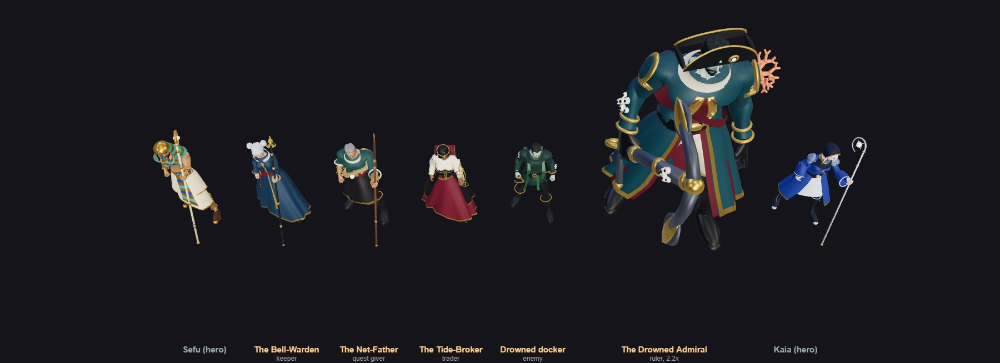
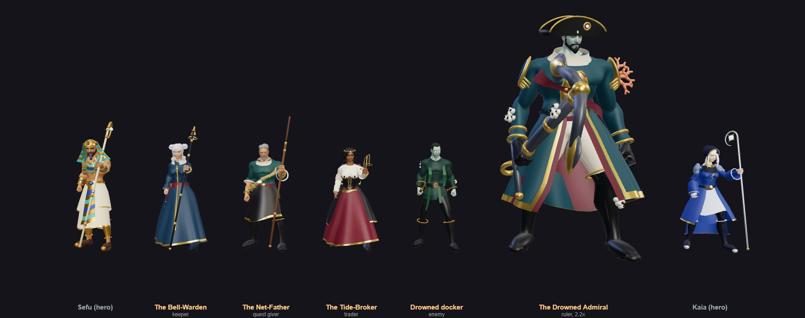
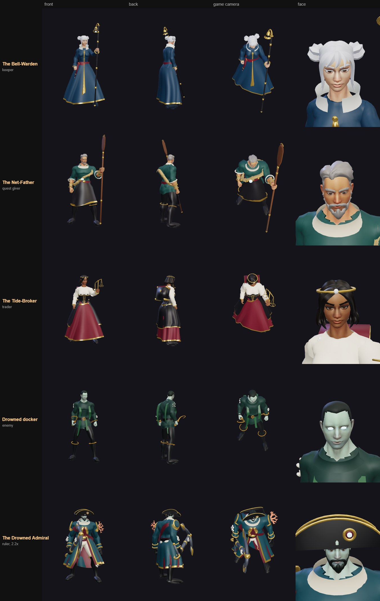

# The Tower's own figures

The user, 2026-11-14: "if you need to create like new model for some npc and stuff make new ones also for enemies just
make new dont just reuse heroes that we have". Today the Tower's people and rulers are roster heroes (a ruler is a hero drawn
big and tinted), and its enemies are drawn in code (`src/tower/world/looks.ts`). This folder holds the first sample of new
models, for chapter 1 (the Sea), **for the user's yes before any more are made. Nothing here is in the game.**

## The sample: chapter 1, the Sea







All five stand in the pack's idle clip, drawn by the game's own figure code (`HeroFigure`) in the hero stand's light,
at true sizes beside the heroes Sefu and Kaia (the admiral at 2.2 times a hero, as a ruler is drawn). One picture per
figure as well: `sea-keeper.jpg`, `sea-fisher.jpg`, `sea-trader.jpg`, `sea-docker.jpg`, `sea-admiral.jpg`.

| Figure | Role | What it is | Body and parts |
|---|---|---|---|
| **The Bell-Warden** | keeper (main quest) | She rings the harbour bell that calls the drowned ships home. Silver hair in buns, a sea-navy gown to the floor with a gold hem and front seam, a flared sea-foam collar, a wine sash knotted at the hip, and a tall black staff whose gold crook holds the harbour bell; its clapper is her one light. | Female body (height 1.03). Fitted gown, `skirt` in folds, `collar`, `band`; the staff in the LEFT hand (held upright like Sefu's crook). |
| **The Net-Father** | quest giver | The old fisher who mends the nets that hold the sea back. Grey hair and beard, bare-headed, a snug cream roll neck, a sea-green tunic, rope bracers, a black apron, his net coiled across the chest with gold floats and one glowing sea-glass float, a steering oar blade-up. | Male body, broad (width 1.1). Pack hair and beard; the net is a strap round the trunk; the oar in the LEFT hand. |
| **The Tide-Broker** | trader | She weighs what the tide gives back. A cream blouse with full sleeves, a black bodice laced in gold, a long wine skirt with an open black overskirt, pearls, a gold circlet, a strongbox on her back, and a brass balance held up, a glowing pearl in one pan. | Female body. Pack long hair; the balance in the LEFT hand. |
| **Drowned docker** | enemy, melee | A dock hand the sea sent back up the quay. Pale grey-green skin, no brows, a cold sea-glass light for eyes, a sea-green jersey, clean dark-green kelp ribbons from the shoulders and belt, smooth cream barnacles on one shoulder and one forearm, a shackle and short chain, a brass cargo hook. No rags: what is drowned is told by colour, weed and barnacles. | Male body, lean. The hook in the RIGHT hand (strikes as Brannoc does). 19,000 faces. |
| **The Drowned Admiral** | ruler (boss) | The admiral who went down with his fleet. Built as a giant, not a hero made big: broad and deep, a smaller head, hands 1.3 times as big. A long deep-teal coat with wine lining and gold braid, gold epaulettes, a cream neck-stock, a wine sash, a black bicorne with a glowing sea-glass cockade, coral grown through the left epaulette, barnacles, and a great anchor held by the shank, carried crown-up across his chest at rest (his move is the Anchor Sweep). | Male body, width 1.3, depth 1.25, head 0.86, `big_hands`. The anchor in the RIGHT hand. |

**Kept from the house rules:** the fourth hero style (the pack's realistic body, one continuous skin, on the Universal
Animation Library's skeleton, so every clip the heroes play plays on these); mythic roles, never jobs played for a joke
(ART_BIBLE §1; the jokes may live in names); the arena's materials (`blender/arenas/real/STYLE.md`: matte cloth, polished
gold, the harbour's wine as the chapter's own colour); one small light each; staffs and held things in the left hand,
weapons in the right (`pipeline/designs/style-v4/README.md`). Each is 460-550 KB and 19,000-25,000 faces, like a hero.

**Decided here, for the user to overrule:** the names; the keeper is a woman and the fisher a man (the pack has one face
per sex, so the two drowned men share a face and differ by skin, beard and hat); the docker's eyes glow; the admiral's
coral is the Tide palette's orange accent. **Not checked:** walking, striking, being hit (only the idle clip was looked
at); a phone.

## How they are built, and the command

One module per figure, `blender/tower/<chapter>/<name>.py`, each with a `build()` that dresses a `Real` exactly as a
hero's `blender/heroes/real/<theme>.py` does (the kit is `blender/heroes/realkit.py` and the shared parts
`blender/heroes/real/parts_*.py`). `blender/tower/build.py` writes `docs/tower/models/glb/<chapter>_<name>_v4.glb` (not
committed: about a minute to rebuild; `--out` writes elsewhere, e.g. `public/models/tower` when they go into the game).
The `_v4.glb` ending is what makes the game's figure code treat a model as one of this style.

```
"C:/Program Files/Blender Foundation/Blender 5.2/blender.exe" --background --factory-startup --python blender/tower/build.py -- sea.keeper sea.fisher sea.trader sea.docker sea.admiral
python pipeline/tools/page-shots.py pipeline/tools/tower-models-sheet.js docs/tower/models --port 5186
```

The second line takes the pictures (`pipeline/tools/tower-models-sheet.js`: the two line-ups, each figure alone, and the
sheet of all of them) straight into this folder, under the names above. Use a port no other agent's server is on.
`--shots <folder>` on the first line also writes a Blender check picture of each in its T-pose. The page log shows one
404 while the figures load; all seven load and are drawn, and where it comes from was not looked into.

## The plan for all 50 floors

The ladder (pipeline/designs/tower-50.md): five chapters of ten floors; in each, one handmade floor, eight made by the
generator, and a crown. **The five crowns are Raid bosses and need nothing.** Gatekeepers and rivals stay heroes (they
are duels against a hero by design).

**Everything new, nothing repeated:** three people on every floor, the crowns included (the made crown, sea-10, has a
keeper, a giver and a trader like the others: 150), one ruler on each of the 45 other floors, and the enemy kinds (about
five a chapter, 25): **about 220 models.** Too many to make well, and a player would not tell most of them apart. (The
made crown's boss, the Sun Warden in sea-10, is today also a `RulerDef` standing as a hero, Isolde: if the crowns are to
show their Raid boss's own model, they need nothing new; if not, five more rulers.)

**Recommended: about 50, and no hero reused.**

| Kind | Per chapter | All five | How they are spread |
|---|---|---|---|
| People | 5: the chapter's keeper (the same person on all its ten floors, a thread through the chapter), 2 quest givers, 2 traders | 25 | The keeper stays; the givers and traders take turns, so each floor's set differs from the floor before (with its gatekeeper and rival heroes, no two floors look the same) |
| Rulers | 3, each used on three made floors with its own tint, size and name (as rulers are tinted today) | 15 | Floor 1 of the chapter gets the first ruler untinted |
| Enemies (people-shaped) | 3: the common melee one, the ranged or casting one, the big one (the Mate, the chief) built heavy | 15 | The beasts (crabs, hounds, mites, golems, the stag) cannot be made from the pack's human body: they stay drawn in code, or need an animal pack (a separate decision) |
| **Total** | **11** | **55** | the Sea's five here are the first of them |

A smaller set that still reuses no hero: 4 people a chapter (keeper, two givers, a trader), 2 rulers, 3 enemies: 45.

**Costs to know:** each figure is a skinned model of its own (the figure code clones it per unit), so a pack of six
dockers is six of them. Enemies should get a lighter budget than a hero's (about 10,000 faces; fewer things on them,
the body's hidden skin dropped), and a floor's packs measured with `python pipeline/tools/perf.py` before the rest are
made. A floor loads about 3 people, 3 enemy kinds and its ruler: about 3.5 MB of models.

## What the game code would need (not changed here)

1. **People** (`src/tower/world/def.ts` `PersonDef.hero`, read in `src/tower/world/people.ts`): an optional `model` (a
   path such as `models/tower/sea_keeper_v4.glb`) and `hold` (`torch` for a staff, oar or balance in the left hand),
   used in place of the hero's kit. `HeroFigure.setModel(url, at, kit)` already draws any `_v4.glb`; it takes the way of
   holding from `REAL_STYLE[kit.name]` (`src/motion/real.ts`), so it needs that hold passed in another way (a small
   stand-in kit, or a new argument).
2. **Rulers** (`src/tower/world/pieces/types.ts` `RulerDef.stand`, read at `src/tower/world/pieces/ruler.ts:85`): the
   stand-in hero gives four things: the model, the hit size (`HERO_BODIES`), whether it is melee and how it strikes
   (`standKit`), and the tint. A ruler of its own needs `model`, `body` (radius and height, measured on the model) and
   `melee`/`attack` in its def; `tint` becomes optional. Its size stays `scale` (`HeroFigure.setScale`). The made floors'
   Drowned Admiral is drawn at 2.42 today (sea-02); these pictures use 2.2 as asked.
3. **Enemies** (`EnemySpec.look` through `lookOf` in `src/tower/world/looks.ts`): today every look is a `MinionLook`
   drawn in code, animated by `animate(dt, pose)` with `walk`, `swing` and `shot`. A model needs one more kind of look
   that loads the GLB (a `RealHero`), returns its root at once and fills it when loaded, and maps the pose to the pack's
   clips (idle, walk, the sword or punch clips for `swing`, the spell clip for `shot`, hit, death), with the hit flash on
   its materials (a `RealHero` already keeps its materials; the ruler's tint uses them).
4. **Files:** build into `public/models/tower/` (`--out`), and load a floor's figures ahead with its other models.
