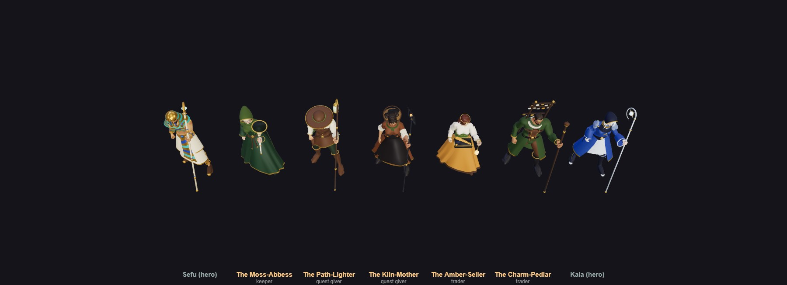

# The Climb's own people

The user, 2026-11-14: "if you need to create like new model for some npc and stuff make new ones also for enemies just make new dont
just reuse heroes that we have", then "also make new models for npc, don't reuse them from heroes". **Since then every person on a
Climb floor (keeper, quest givers, trader) is a figure of its own, in the game** (not live until the next deploy). The rivals,
gatekeepers and rulers are still heroes, and the enemies are still drawn in code: see the plan below.

**The page of all 25, chapter by chapter: [index.html](index.html)** (made by `python blender/tower/page.py`).



## The 25

| Chapter | Keeper (all ten floors) | Quest giver at the camp | Quest giver out in the land | Traders (odd floors / even floors) |
|---|---|---|---|---|
| The Sea, 1-10 | The Bell-Warden | The Net-Father | The Lamp-Bearer | The Tide-Broker / The Coral-Pedlar |
| The Wood, 11-20 | The Moss-Abbess | The Path-Lighter | The Kiln-Mother | The Amber-Seller / The Charm-Pedlar |
| The Sands, 21-30 | The Star-Reader | The Storm-Counter | The Beacon-Keeper | The Silk-Merchant / The Glass-Seller |
| The Deep, 31-40 | The Echo-Hermit | The Candle-Crowned | The Ferryman | The Crystal-Seller / The Firefly-Seller |
| The War, 41-50 | The Herald | The Turncloak | The White Sister | The Camp-Mother / The Quartermaster |

Each is described in the head of its module (`blender/tower/<chapter>/<name>.py`) and on the page. Per chapter here:
`<chapter>-lineup-game.jpg` and `<chapter>-lineup-front.jpg` (the five beside Sefu and Kaia), `<chapter>-sheet.jpg` and one
`<chapter>-<name>.jpg` each (front, back, the game's camera, the face), and `<chapter>-ingame.jpg` (the camp of the chapter's first
floor in the game, the trader's card open). The Sea's drowned docker and Drowned Admiral (`sea-docker.jpg`, `sea-admiral.jpg`, and
the first sample's own line-ups `sea-sample-lineup-game.jpg`, `sea-sample-lineup-front.jpg`, `sea-sample-sheet.jpg`) are an enemy
and a ruler: built, not in the game.

**Checked against the heroes they might echo**, side by side (not kept): the Crystal-Seller against Opaline (she lost her silver
hair and lavender for dark hair and sea-glass green), the Firefly-Seller against Gus (his cone hat became a flat-crowned one), the
Echo-Hermit against Gus (his robe went from blue-grey to violet-black), the Ferryman against Nyx (his lining from violet to deep
sea-green), the Charm-Pedlar against Hank, the Moss-Abbess against Fenna, the Star-Reader against Lyra.

**How they were made to differ:** within a chapter no two share more than one of headwear, the held thing's top, the lower outline
(gown, coat, skirt or legs) and the main colour; the pack has one face per sex, so faces do not tell them apart. Each holds its
thing in the LEFT hand and stands as the hero Sefu holds his staff (the Turncloak holds a shield on his left arm, as Auriel does),
at ease. One small light each. 450-550 KB and 19,000-24,500 faces each, like a hero; **12.3 MB for all 25**, about 1.5 MB on a
floor (three or four of them).

**Decided here, for the user to overrule:** all the names, the sexes, the roles, which trader is first.

## How a floor picks its people (src/tower/world/folk.ts)

- `TOWER_FOLK` lists the 25 with their model, name, slot and the hero whose way of holding they borrow. `withFolk(n, floor)`
  (applied to every floor in `floors/index.ts`) gives each person a `figure` by the floor's number: the chapter's keeper; the first
  giver of the floor (the camp's, `giver`) the camp giver, the second (`villager`, or the War's `healer`) the giver out in the land;
  the trader the first on odd floors and the second on even ones. So a floor shows four of the five (one trader at a time): a
  generated floor and floor 1 show the keeper, both givers and a trader; floors 11, 21 and 31 have no second giver and show three;
  floor 41 shows three and Brannoc (below). The giver out in the land first appears on a chapter's second floor (and on floor 1).
- **Their lines are the slots' own**, so the givers do not swap slots: the Sea's camp giver hauls nets, the War's land giver is the
  healer. On the generated floors the keeper and both givers are the same on every floor of a chapter; only the trader alternates.
- A person who was named after a hero takes the figure's name on its card and mark and in every line of the floor that names it
  (quests, doors, the rival's lines): "Gus has a quest about a key" became "The Bell-Warden has a quest about a key". Ids stay
  (saved runs name them). The few lines written for a hero that the figure would not say (floor 41's deserter was a cat with nine
  lives, floor 11's keeper had sheep) are rewritten in `LINES` and `QUEST_LINES` there.
- The rival stays a hero, and so does a person who is the rival's hero (floor 41's Brannoc, who holds the ground for his duel).
- `people.ts` draws a person with a `figure` from `models/tower/<figure>_v4.glb`, loaded when the floor starts: a floor loads only
  its own three or four.

## How they are built, and the command

One module per figure, `blender/tower/<chapter>/<name>.py`, each with a `build()` that dresses a `Real` exactly as a hero's
`blender/heroes/real/<theme>.py` does (the kit is `blender/heroes/realkit.py`, the shared parts `blender/heroes/real/parts_*.py`,
and the people's own `blender/tower/folk.py`: a held thing's frame, poles, a hanging lantern, a wide hat, a veil, a basket and
straps, a tray). `blender/tower/build.py --out public/models/tower` writes the game's models (committed); without `--out` it writes
`docs/tower/models/glb/` (not committed). The `_v4.glb` ending is what makes the game's figure code treat a model as one of this style.

```
"C:/Program Files/Blender Foundation/Blender 5.2/blender.exe" --background --factory-startup --python blender/tower/build.py -- wood.abbess wood.lighter wood.kiln wood.amber wood.charm --out public/models/tower
python pipeline/tools/page-shots.py <wrapper.js> docs/tower/models --port 5254
python blender/tower/page.py
```

The pictures: `pipeline/tools/tower-models-sheet.js` draws one chapter (`window._towerChapter = 'wood';` on a line before the
file's own text, in a copy given to page-shots; default the Sea) from the game's own models and figure code. The tool page shows
one 404 when it loads (its favicon); the game's own runs show no console errors.

## The plan for all 50 floors (the people are done; rulers and enemies are next)

The ladder (pipeline/designs/tower-50.md): five chapters of ten floors; in each, one handmade floor, eight made by the
generator, and a crown. **The five crowns are Raid bosses and need nothing.** Gatekeepers and rivals stay heroes (they
are duels against a hero by design).

**Everything new, nothing repeated:** three people on every floor, the crowns included (the made crown, sea-10, has a
keeper, a giver and a trader like the others: 150), one ruler on each of the 45 other floors, and the enemy kinds (about
five a chapter, 25): **about 220 models.** Too many to make well, and a player would not tell most of them apart. (The
made crown's boss, the Sun Warden in sea-10, is today also a `RulerDef` standing as a hero, Isolde: if the crowns are to
show their Raid boss's own model, they need nothing new; if not, five more rulers.)

**Recommended: about 50, and no hero reused.**

| Kind | Per chapter | All five | How they are spread |
|---|---|---|---|
| People | 5: the chapter's keeper (the same person on all its ten floors, a thread through the chapter), 2 quest givers, 2 traders | 25 | The keeper stays; the givers and traders take turns, so each floor's set differs from the floor before (with its gatekeeper and rival heroes, no two floors look the same) |
| Rulers | 3, each used on three made floors with its own tint, size and name (as rulers are tinted today) | 15 | Floor 1 of the chapter gets the first ruler untinted |
| Enemies (people-shaped) | 3: the common melee one, the ranged or casting one, the big one (the Mate, the chief) built heavy | 15 | The beasts (crabs, hounds, mites, golems, the stag) cannot be made from the pack's human body: they stay drawn in code, or need an animal pack (a separate decision) |
| **Total** | **11** | **55** | the Sea's five here are the first of them |

A smaller set that still reuses no hero: 4 people a chapter (keeper, two givers, a trader), 2 rulers, 3 enemies: 45.

**Costs to know:** each figure is a skinned model of its own (the figure code clones it per unit), so a pack of six
dockers is six of them. Enemies should get a lighter budget than a hero's (about 10,000 faces; fewer things on them,
the body's hidden skin dropped), and a floor's packs measured with `python pipeline/tools/perf.py` before the rest are
made. A floor loads about 3 people, 3 enemy kinds and its ruler: about 3.5 MB of models.

## What the game code needs for the rest

1. **People: done** (above). `PersonDef.figure`, the stand-in hero for the way of holding (`Folk.stand`: no change to the figure
   code was needed), the names in the floor's words.
2. **Rulers** (`src/tower/world/pieces/types.ts` `RulerDef.stand`, read at `src/tower/world/pieces/ruler.ts:85`): the
   stand-in hero gives four things: the model, the hit size (`HERO_BODIES`), whether it is melee and how it strikes
   (`standKit`), and the tint. A ruler of its own needs `model`, `body` (radius and height, measured on the model) and
   `melee`/`attack` in its def; `tint` becomes optional. Its size stays `scale` (`HeroFigure.setScale`). The made floors'
   Drowned Admiral is drawn at 2.42 today (sea-02); these pictures use 2.2 as asked.
3. **Enemies** (`EnemySpec.look` through `lookOf` in `src/tower/world/looks.ts`): today every look is a `MinionLook`
   drawn in code, animated by `animate(dt, pose)` with `walk`, `swing` and `shot`. A model needs one more kind of look
   that loads the GLB (a `RealHero`), returns its root at once and fills it when loaded, and maps the pose to the pack's
   clips (idle, walk, the sword or punch clips for `swing`, the spell clip for `shot`, hit, death), with the hit flash on
   its materials (a `RealHero` already keeps its materials; the ruler's tint uses them).
4. **Files:** build into `public/models/tower/` (`--out`), and load a floor's figures ahead with its other models.
