# Floor 1: The Drowned Harbour

Plays from the camp to the gate with no error and no stuck spot; every person, pack, door and the ruler work, the ruler in its own model. One slip in the words fixed (the market had two names); the ruler's name left for you.

## Measured

- Reachable from the camp: 34968 m²; 51 spots of the floor's data, 0 cut off
- Props probe: 14 float, 56 gap, 0 buried, 0 in cover (each looked at; see below)
- Grass and small things on ground steeper than 31°: 0
- Packs table for the open world (server/climb-packs.mjs): matches
- Route bot (Lyra): cleared in 1604 game s, every checkpoint reached; 23 kills, 2 falls, stars 1101; ruler tries 1, gate tries 3; page errors 0
- Ruler: The Drowned Captain (Anchor, cannon and tide), model models/tower/sea_admiral_v4.glb, loaded yes after 2419 ms of real time
- Frame check at the busiest spot (-71, -67), 5 units awake: median 11.4, 10.8, 10.4 ms, p95 18, 17.6, 14.7 ms (desktop, machine shared: rough)
- Console errors while taking the pictures: 0

## Found

- **fixed: The market had two names.** The map, the keeper and the place said “the fish market”, but the main quest's step said “Clear the oyster market” and its waystone was “The oyster market stone”; the step “Light the lighthouse and the signal fire” named a place the map calls “The beacon”. Cause: the floor's maker (src/tower/world/gen/harbour.ts) renamed the places but not the words that name them. Now the steps and the stone follow the new names (only these three strings changed in the baked floor).
  - 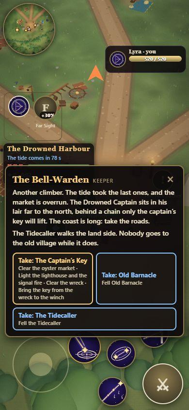 Before: the keeper's quest card (phone)
  -  After
- **list: The ruler's name: Captain or Admiral?** The floor calls its ruler “the Drowned Captain” (keeper's line, the lair, the quest, the boss card); the Codex (climb/rulers.md, climb/sea.md) says the Drowned Admiral rules floors 1 and 2, and floor 2 calls him the Drowned Admiral. Its model is the Admiral's. Renaming floor 1's to “the Drowned Admiral” is five strings in gen/harbour.ts and a re-bake; say if you want it.
  - 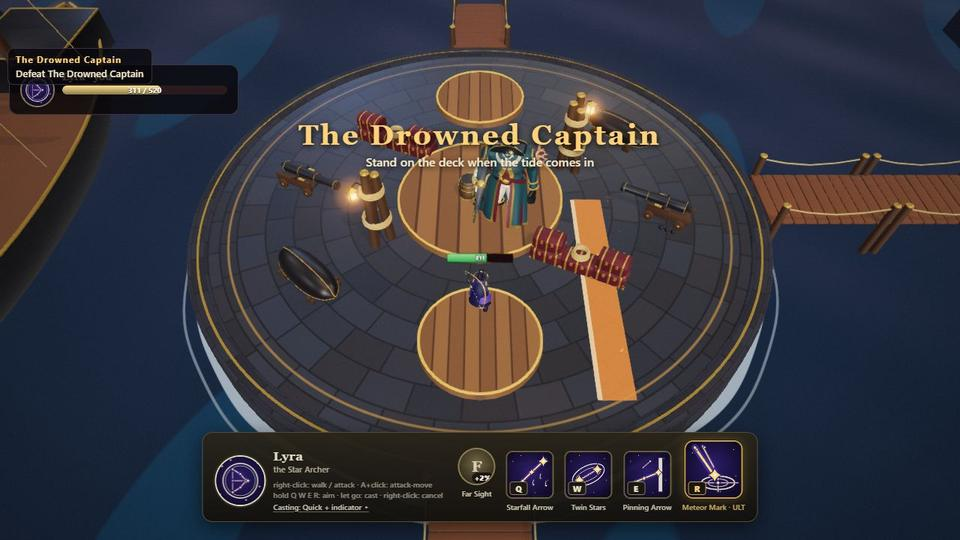 Floor 1's ruler: the Admiral's model under the name “The Drowned Captain”
- **ok: On the map, “The gate up” sat on “The camp”.** Fixed for every floor on floor 2 (names on the M map step aside); this phone picture is from before.
  - 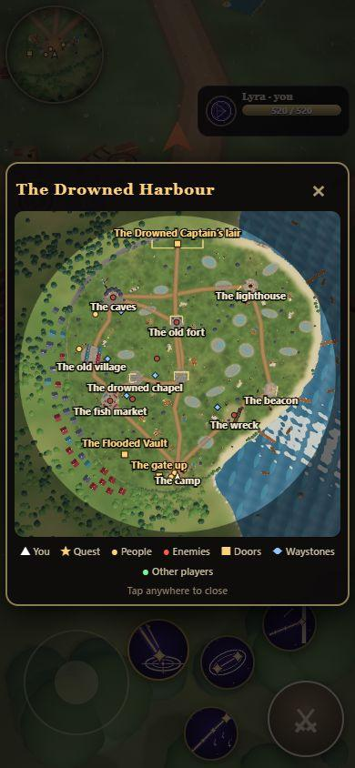 The M map on a phone
- **ok: The props the probe flagged.** 14 “float” are pines on the hills past the edge (the probe measures them against the play ground, not the hill under them) and boats on the sea; 56 “gap” are pines on the cliff top whose root side hangs over the cliff. Each looked at from low: they stand on their ground.
  - 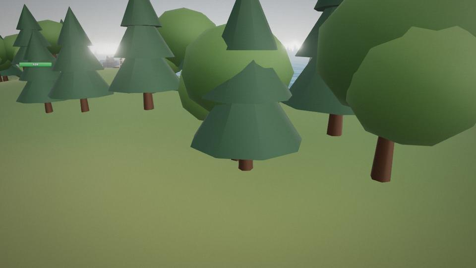 “Float”: pines and oaks past the edge, on their hill
  - 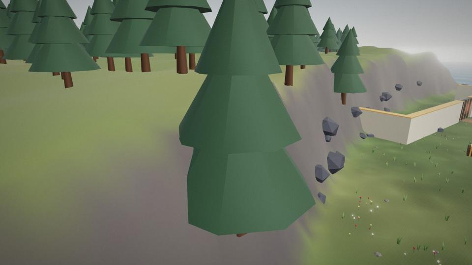 “Gap”: a pine on the cliff top

## Not checked

- the shared packs online (alone a cleared pack does not come back: as designed, pipeline/designs/climb-open-world.md)
- buying at the trader (the card and prices shown; the bot's heals use it)

## Pictures

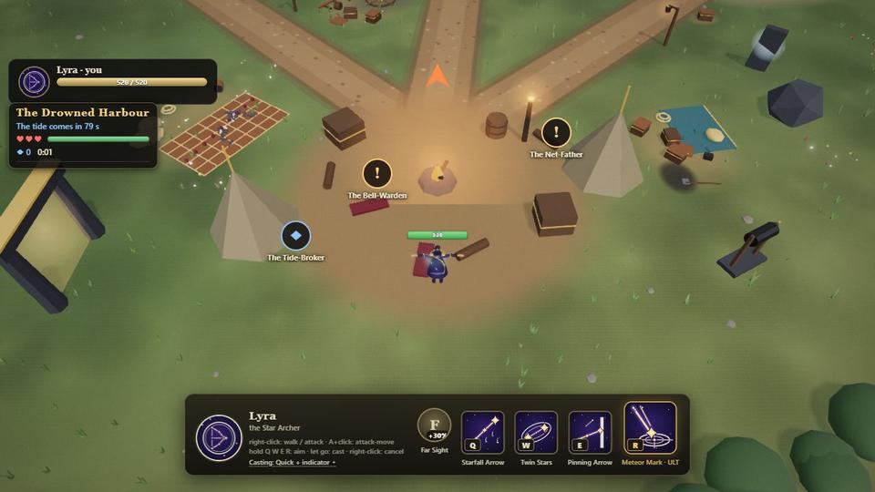  
The floor as it opens (the minimap comes a moment later, once the zone has drawn)

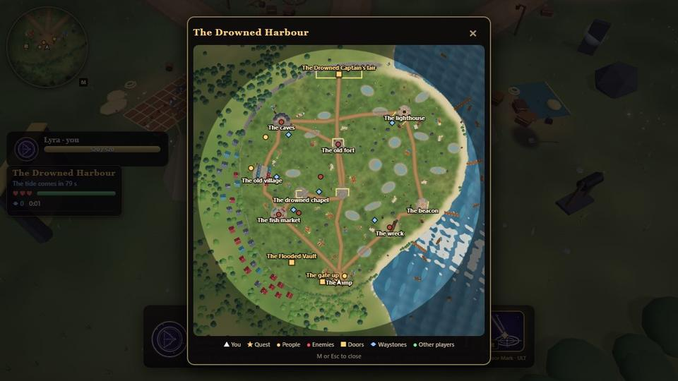  
The M map

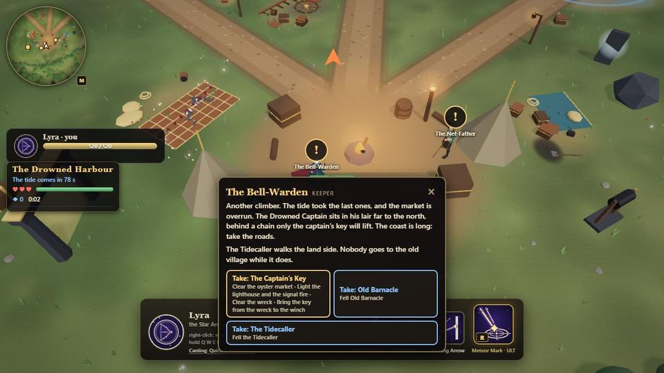  
The Bell-Warden's card

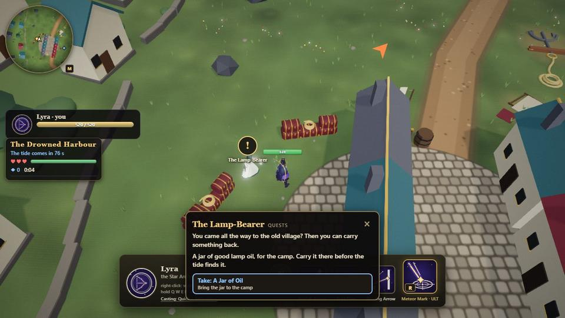  
The Lamp-Bearer out in the old village

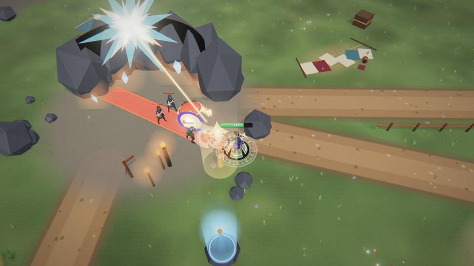  
The route bot fighting the caves' pack

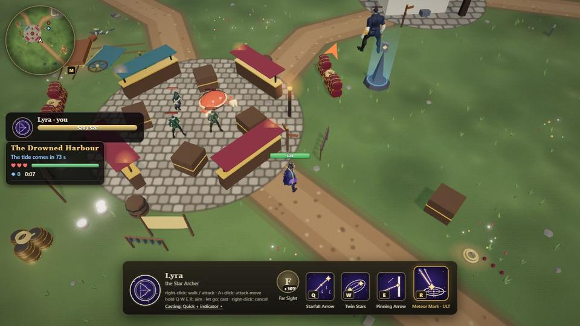  
The fish market's pack at home

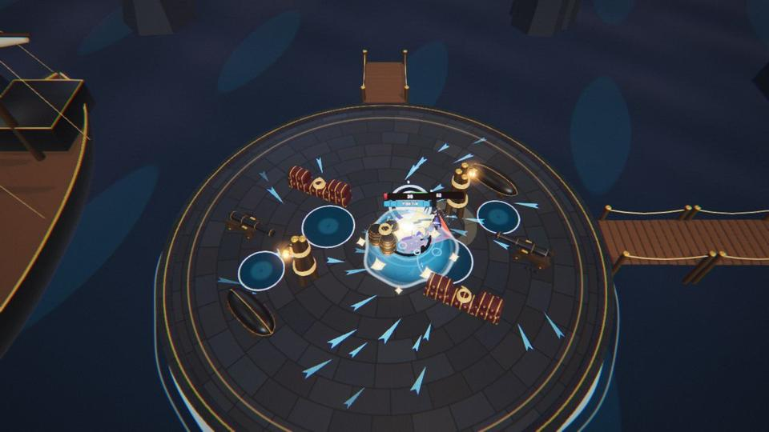  
The gate: Marin

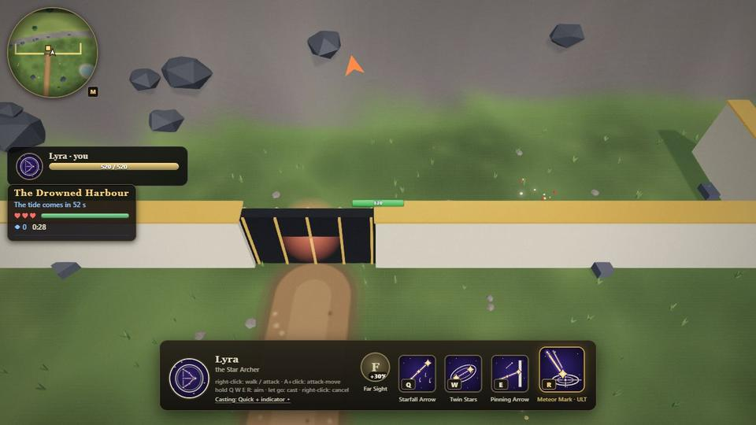  
The lair's chain, shut

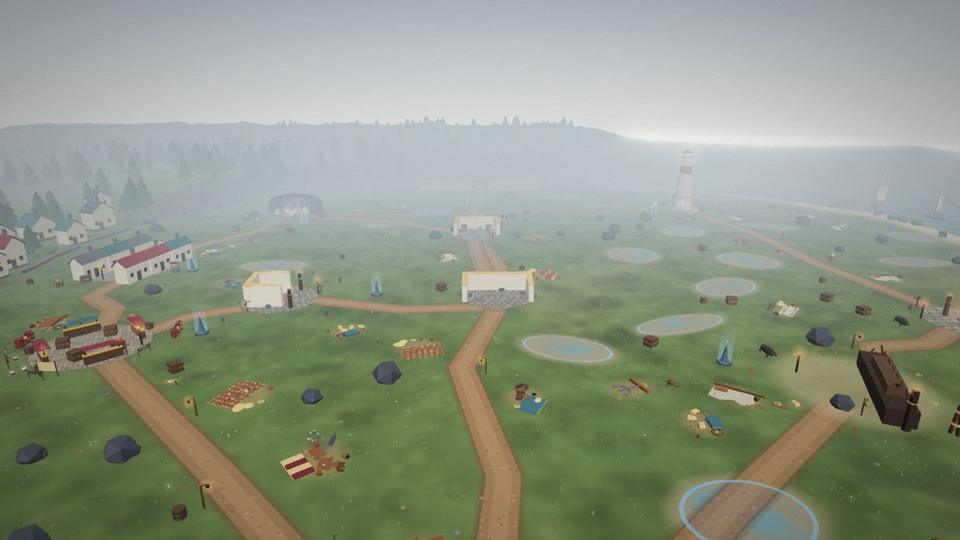  
From the south edge

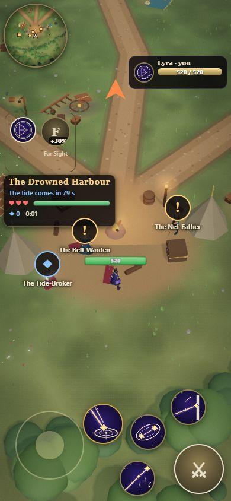  
Phone: the camp

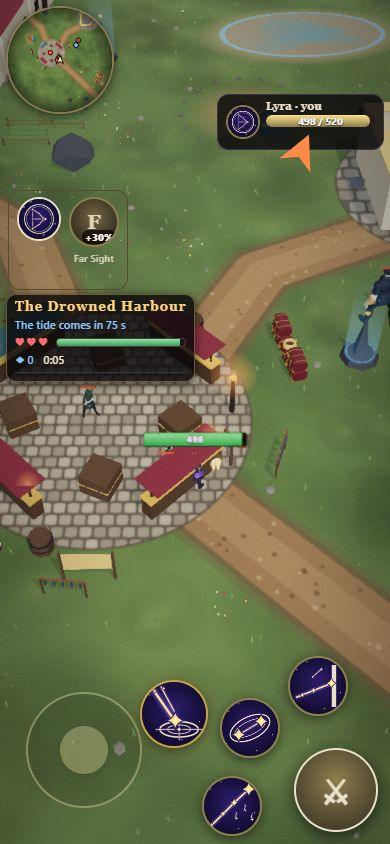  
Phone: a fight

