# Floor 2: The Salt Docks

Clean: the route bot cleared it with all four stars and no fall, the rival (Hank), the trial, the ruler (the Drowned Admiral, own model) and the gate (Vesper) all played; no console error. The M map's names stood on each other: fixed for every floor.

## Measured

- Reachable from the camp: 34918 m²; 51 spots of the floor's data, 0 cut off
- Props probe: 25 float, 54 gap, 1 buried, 0 in cover (each looked at; see below)
- Grass and small things on ground steeper than 31°: 0
- Packs table for the open world (server/climb-packs.mjs): matches
- Route bot (Lyra): cleared in 1729 game s, every checkpoint reached; 23 kills, 0 falls, stars 1111; ruler tries 1, gate tries 1; page errors 0
- Ruler: The Drowned Admiral (Fleet, cannon and tide), model models/tower/sea_admiral_v4.glb, loaded yes after 5095 ms of real time
- Frame check at the busiest spot (14, -54), 5 units awake: median 10.7, 11.3, 11 ms, p95 17.5, 17.2, 14.8 ms (desktop, machine shared: rough)
- Console errors while taking the pictures: 0

## Found

- **fixed: Names on the M map lay over each other (every floor).** Two places or a door close together wrote their names in the same spot: “The signal fire” ran into “The drowned chapel”, “The gate up” sat on “The camp” (on every floor: the gate is beside the camp). Now a name that would cover one already written steps one line away (a door's up, a place's down). Only the map's drawing changed (src/tower/world/map.ts). The floors 31-50 review fixed the same thing for all chapters at the same time (its version also keeps a name inside the map's edge); on merging, that version was kept. The pictures are from my version.
  - 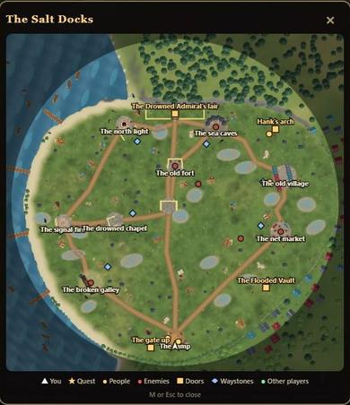 Before
  - 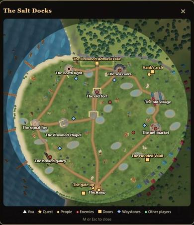 After
- **ok: The props the probe flagged.** “Float”: pines on the hills past the edge, boats on the sea, and the slats of a jetty 9 cm over the sand; “gap”: houses on the hillside (they stand on their stone plinths, as set right in the props pass) and pines on the cliff top; one stone 22 cm under the sand. Looked at from low: nothing in the air.
  - 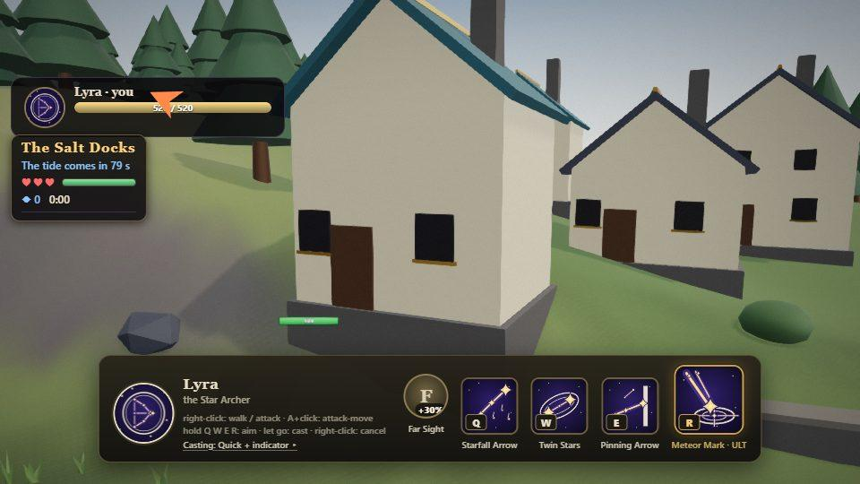 A house on the slope the probe flagged: on its plinth

## Not checked

- the shared packs online
- buying at the trader (card and prices shown)

## Pictures

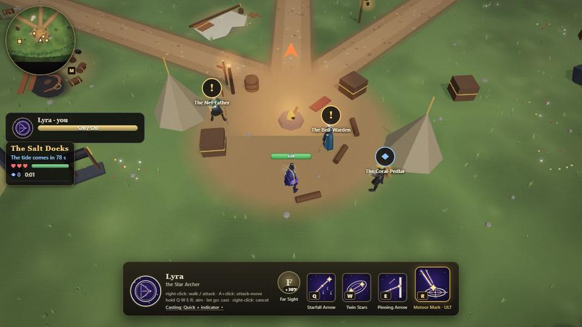  
The camp

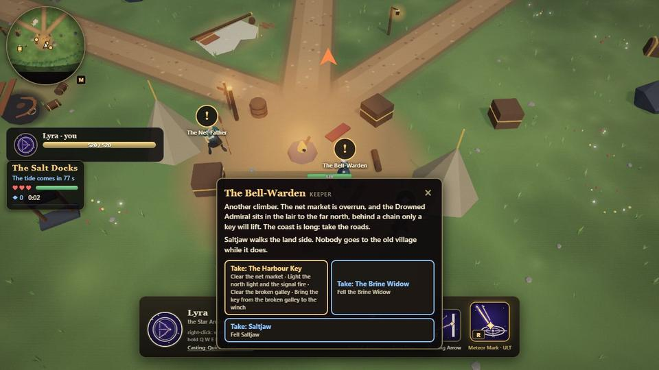  
The Bell-Warden's card

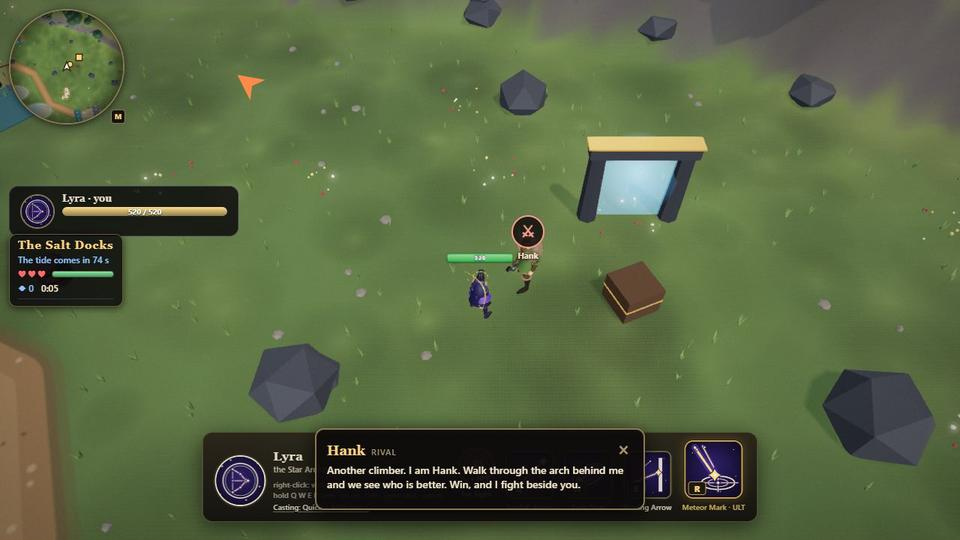  
Hank, the rival, before his arch

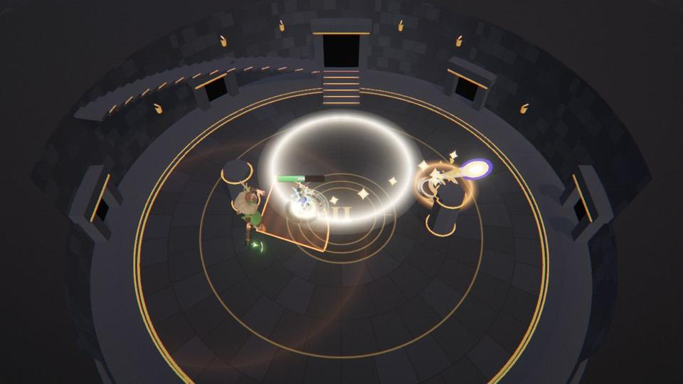  
The duel with Hank

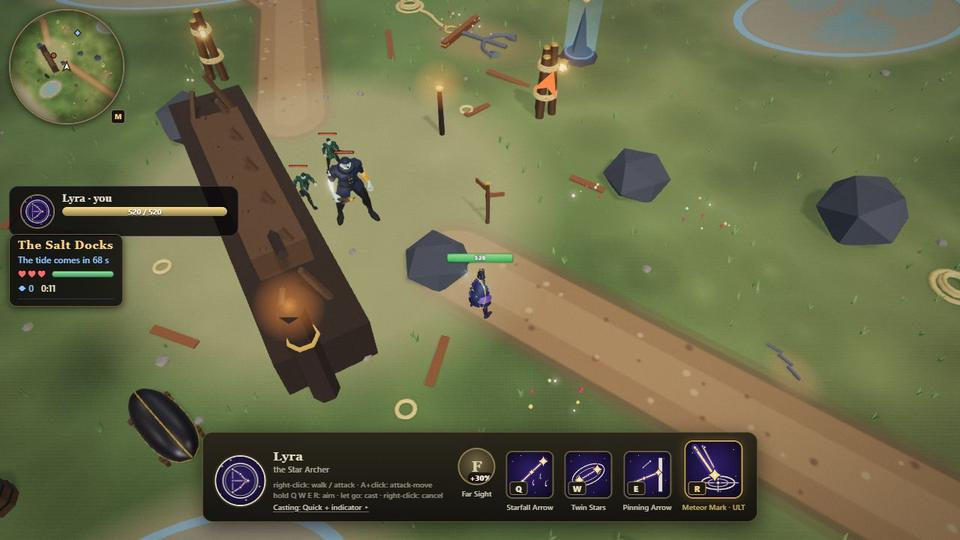  
The broken galley's pack and the Mate

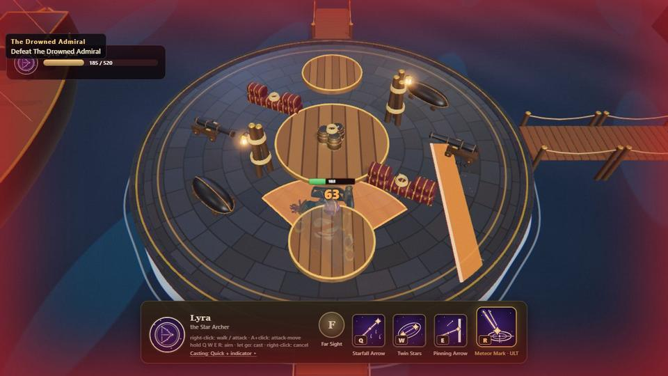  
The Drowned Admiral's fight

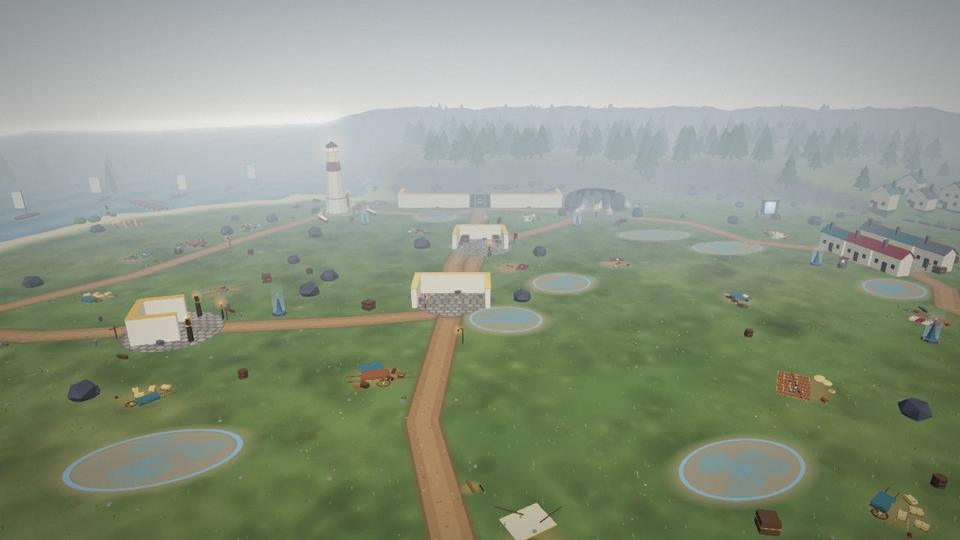  
From the south edge

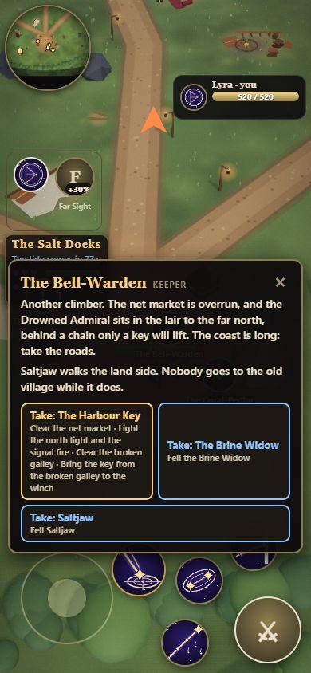  
Phone: the keeper's card

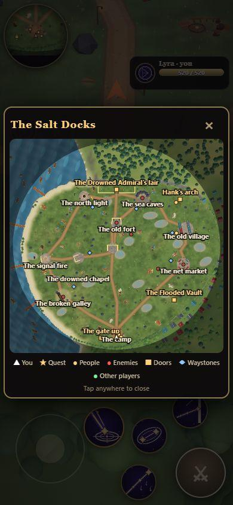  
Phone: the map (names apart)

