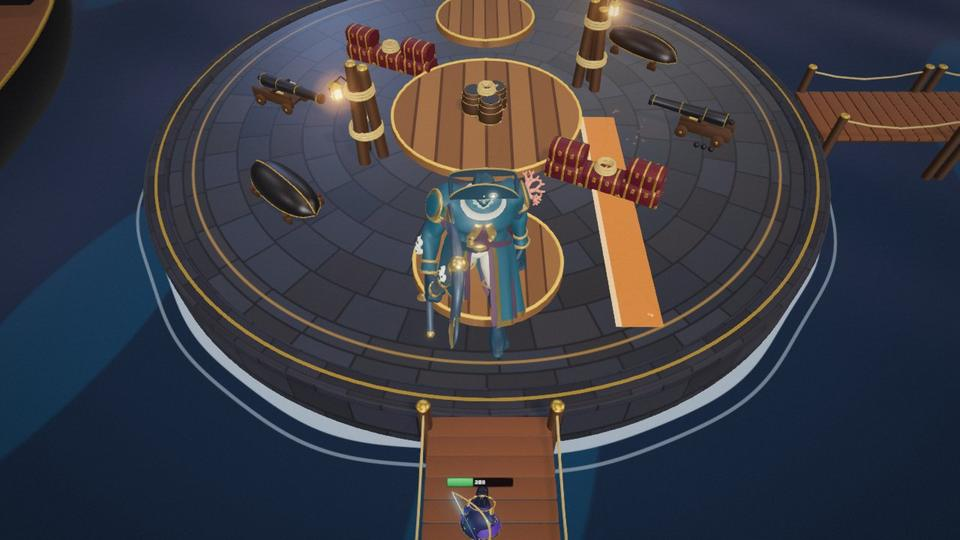
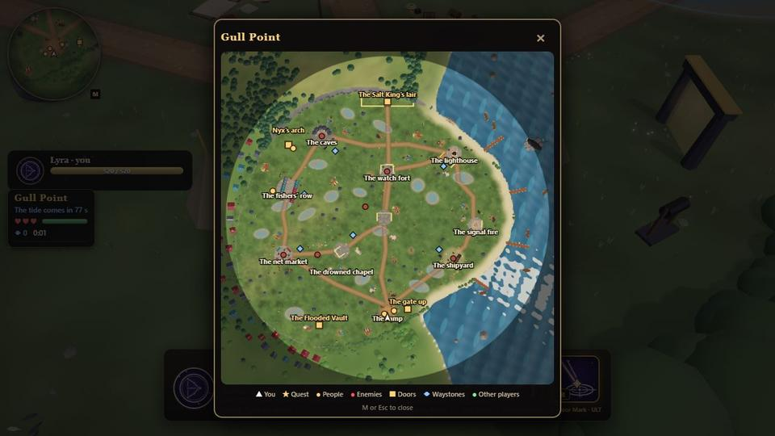
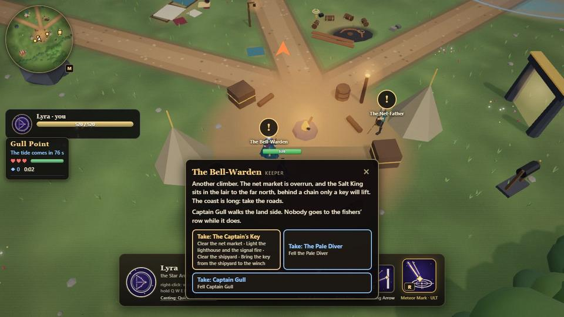
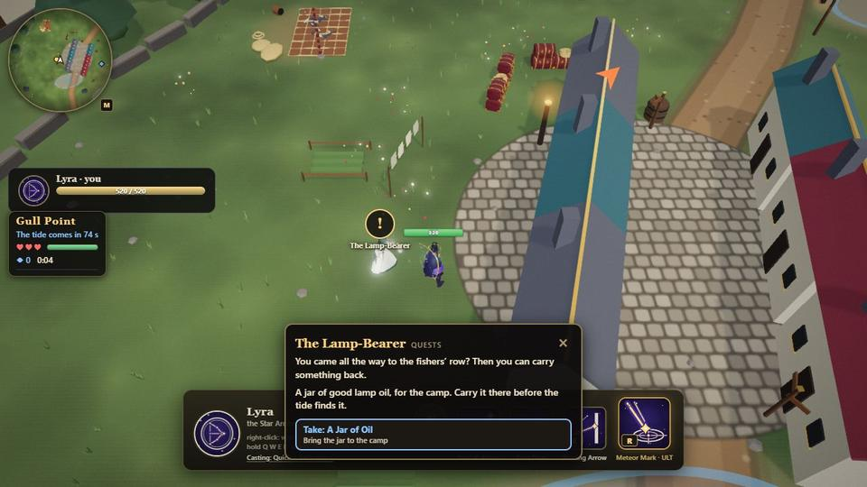
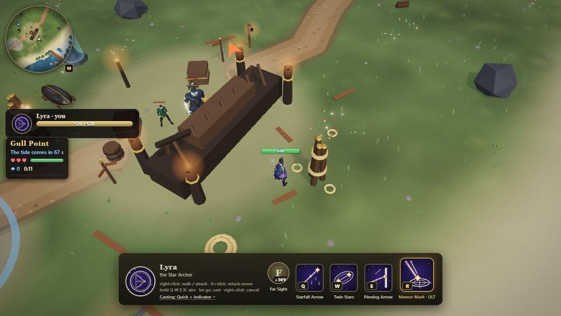
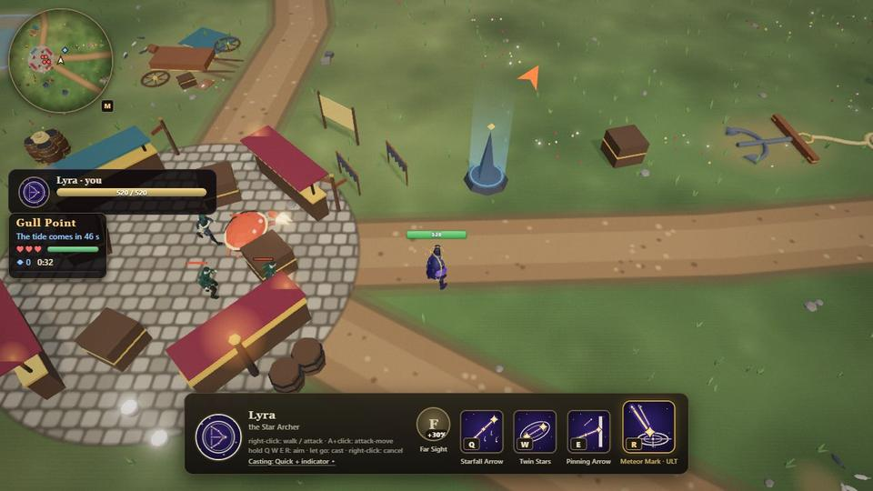
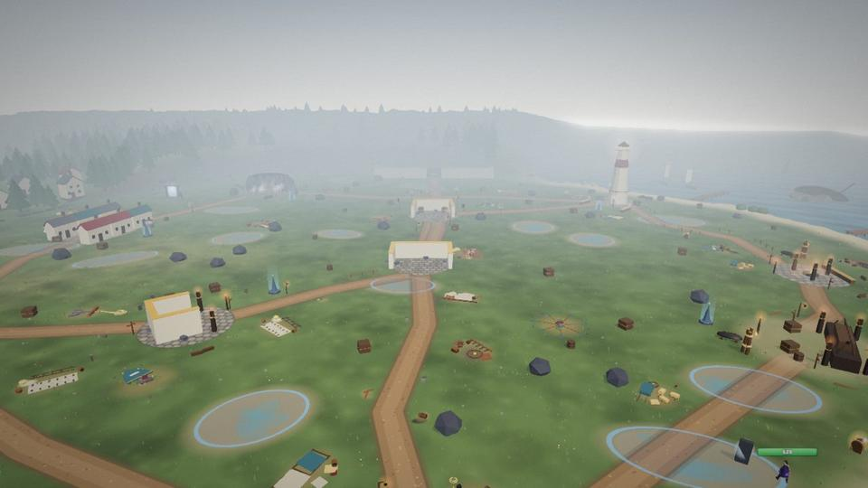
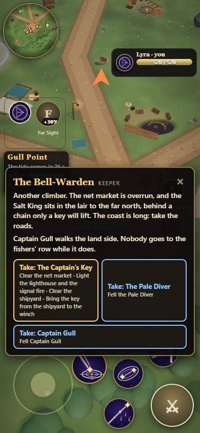

# Floor 3: Gull Point

Clean: cleared with four stars and no fall; the rival (Nyx), the trial (a horde), the ruler (the Salt King, in the Admiral's model tinted) and the gate (Tempo) all played; no console error, every spot reachable, the texts match the Codex (the Salt King rules floor 3).

## Measured

- Reachable from the camp: 34953 m²; 51 spots of the floor's data, 0 cut off
- Props probe: 16 float, 80 gap, 1 buried, 2 in cover (each looked at; see below)
- Grass and small things on ground steeper than 31°: 0
- Packs table for the open world (server/climb-packs.mjs): matches
- Route bot (Lyra): cleared in 1480 game s, every checkpoint reached; 23 kills, 0 falls, stars 1111; ruler tries 1, gate tries 1; page errors 0
- Ruler: The Salt King (Crowned in brine), model models/tower/sea_admiral_v4.glb, loaded yes after 4447 ms of real time
- Frame check at the busiest spot (-76, 39), 6 units awake: median 11.8, 9.4, 9.6 ms, p95 18, 11.8, 12.8 ms (desktop, machine shared: rough)
- Console errors while taking the pictures: 0

## Found

- **ok: A boss that stands between the camera and the hero fades.** In the first pictures the Salt King looked see-through. That is the duel's own rule (duel.ts: a boss that hides the hero fades to a tenth), not a fault: with the hero on its other side it stands in full.
  -  The Salt King, the hero below him
- **ok: The props the probe flagged.** As on floors 1 and 2: pines on the hills and the cliff top, boats on the sea, a stone just under the sand; two pines whose trunks touch the edge of a cliff-top rock. Nothing in the air.

## Not checked

- the shared packs online
- buying at the trader (card and prices shown)

## Pictures

  
The M map

  
The Bell-Warden

  
The Lamp-Bearer in the fishers' row

  
The shipyard's pack

  
The busiest spot (the frame check)

  
From the south edge

  
Phone: the keeper's card

