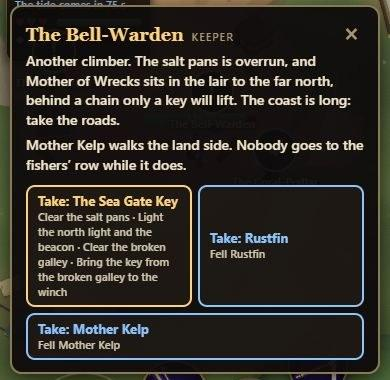
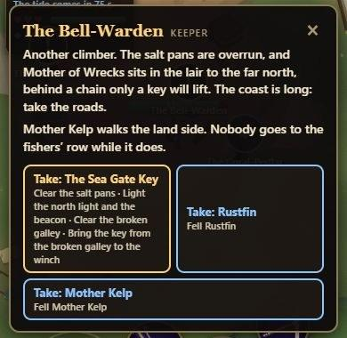
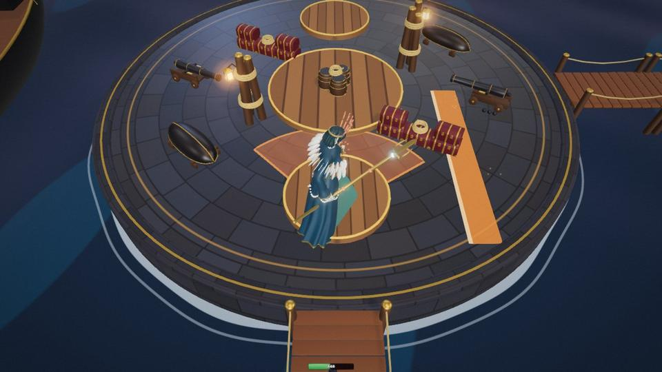
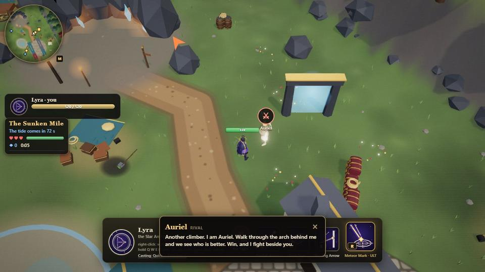
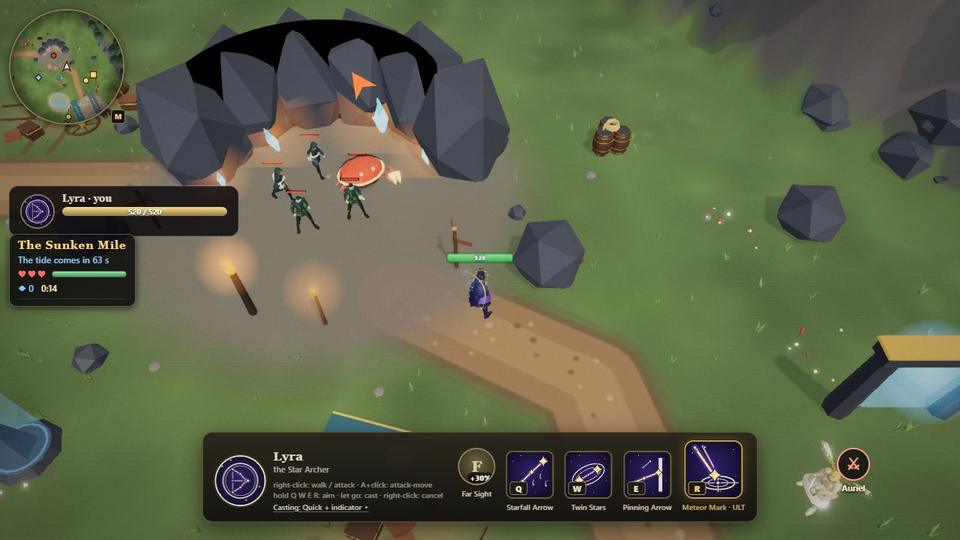
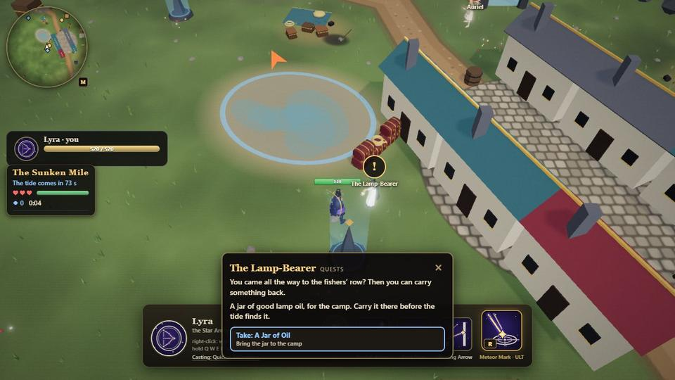
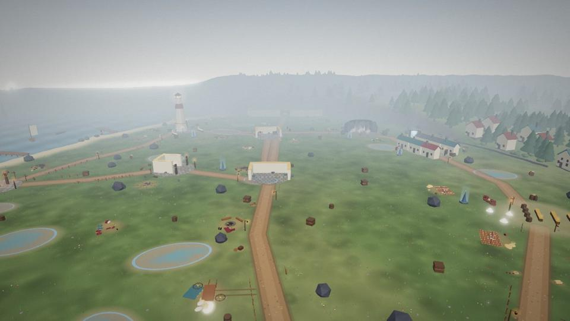
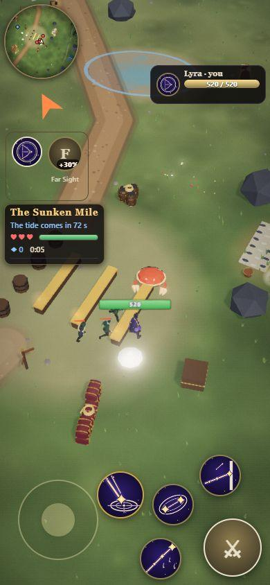

# Floor 4: The Sunken Mile

Clean but for one line of the keeper's: cleared with four stars and no fall; the rival (Auriel), the trial, the ruler (Mother of Wrecks, in the Gull Queen's model) and the gate (Ada) all played; no console error, every spot reachable.

## Measured

- Reachable from the camp: 35004 m²; 51 spots of the floor's data, 0 cut off
- Props probe: 18 float, 58 gap, 1 buried, 0 in cover (each looked at; see below)
- Grass and small things on ground steeper than 31°: 0
- Packs table for the open world (server/climb-packs.mjs): matches
- Route bot (Lyra): cleared in 1613 game s, every checkpoint reached; 23 kills, 0 falls, stars 1111; ruler tries 1, gate tries 1; page errors 0
- Ruler: Mother of Wrecks (She keeps what sinks), model models/tower/sea_queen_v4.glb, loaded yes after 5111 ms of real time
- Frame check at the busiest spot (20, -54), 6 units awake: median 13.3, 14.1, 11.2 ms, p95 24.8, 21.7, 16.8 ms (desktop, machine shared: rough)
- Console errors while taking the pictures: 0

## Found

- **fixed: “The salt pans is overrun”.** The keeper's greeting is made from the main place's name with “is overrun”; a plural place read wrong (here, and “The drying racks is overrun” on floor 5). The sea's maker (src/tower/world/gen/sea.ts) now says “are” for a name ending in s; floors 2 to 10 re-baked, and only these two lines changed.
  -  Before
  -  After
- **ok: The props the probe flagged.** Pines on the hills and the cliff top, boats on the sea, three shells 10 cm over the sand, the gold edge of the lair's wall where it runs into the hill (seen and left in the props pass). Nothing in the air.

## Not checked

- the shared packs online
- buying at the trader (card and prices shown)

## Pictures

  
Mother of Wrecks

  
Auriel, the rival

  
The sea caves' pack

  
The Lamp-Bearer in the fishers' row

  
From the south edge

  
Phone: a fight

