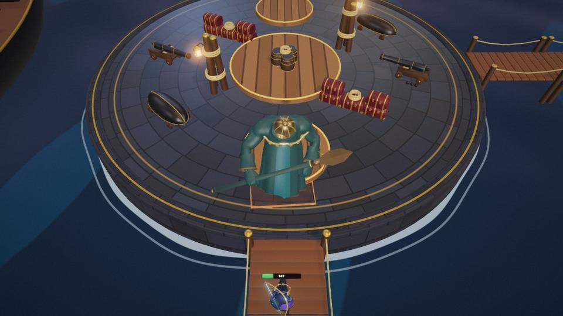
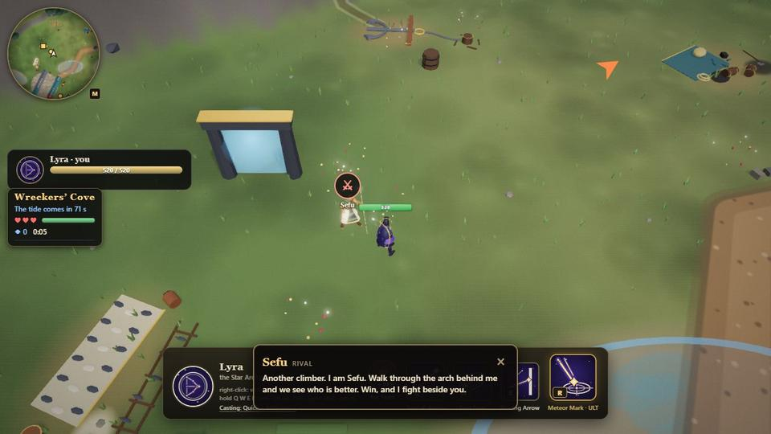
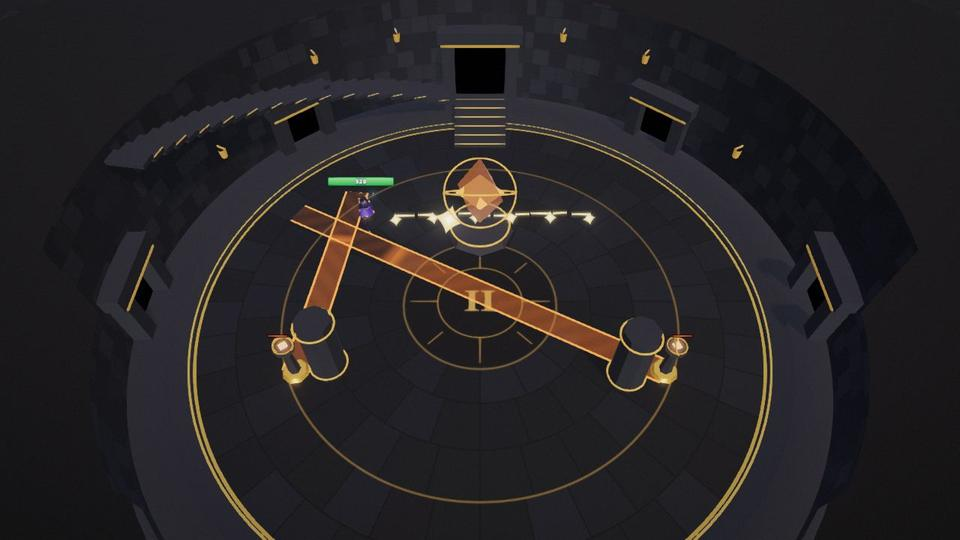
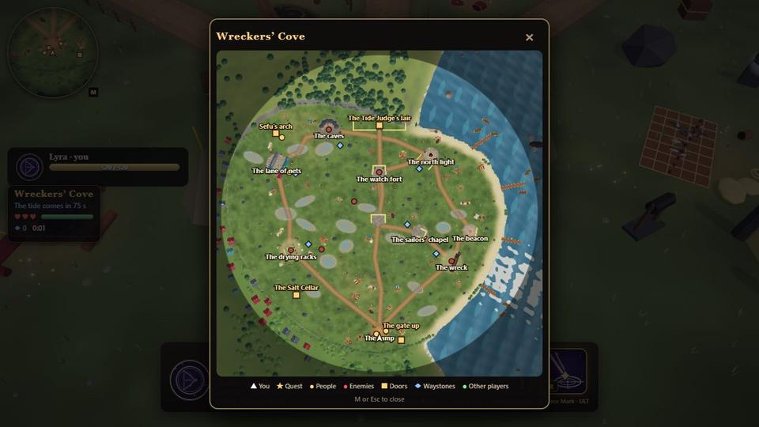
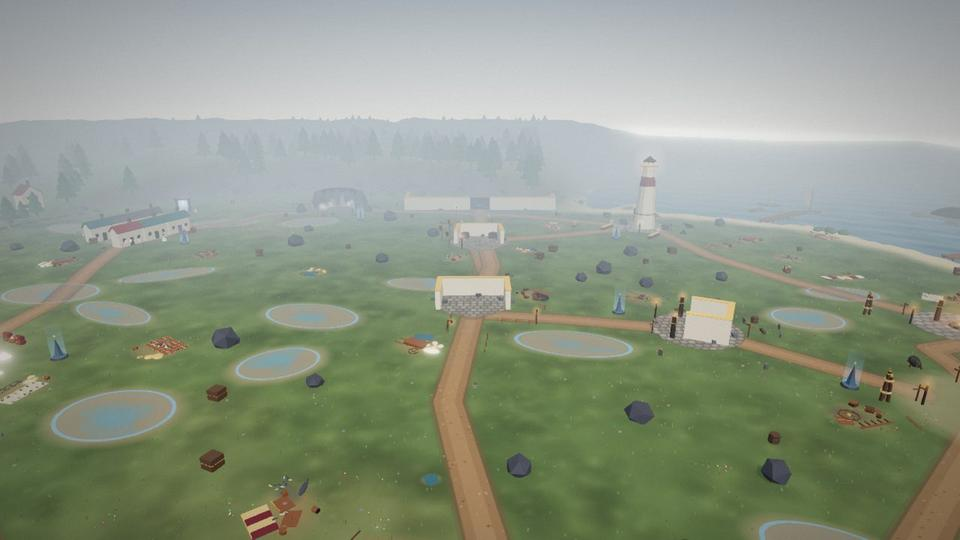
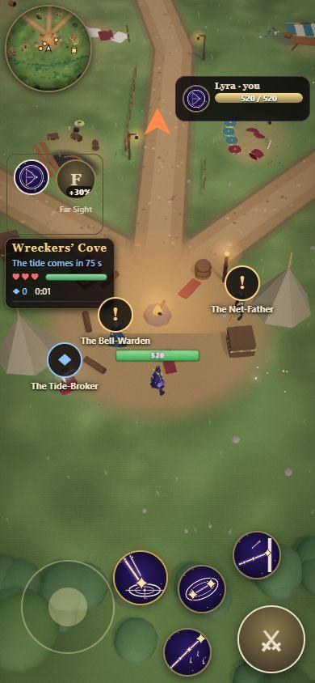

# Floor 5: Wreckers’ Cove

Clean: cleared with four stars and no fall; the rival (Sefu), the trial (The Salt Cellar), the ruler (the Tide Judge, own model) and the gate (Bram) all played; no console error, every spot reachable. The keeper's “drying racks are overrun” is the line fixed on floor 4.

## Measured

- Reachable from the camp: 34930 m²; 51 spots of the floor's data, 0 cut off
- Props probe: 19 float, 68 gap, 0 buried, 0 in cover (sorted by kind; one or more of each kind looked at by eye)
- Grass and small things on ground steeper than 31°: 0
- Packs table for the open world (server/climb-packs.mjs): matches
- Route bot (Lyra): cleared in 1763 game s, every checkpoint reached; 23 kills, 0 falls, stars 1111; ruler tries 1, gate tries 1; page errors 0
- Ruler: The Tide Judge (Every tide a sentence), model models/tower/sea_judge_v4.glb, loaded yes (its picture taken 3689 ms of real time into the fight)
- Frame check at the busiest spot (-64, 36), 6 units awake: median 3.2, 3.5, 4.3 ms, p95 4.8, 4.5, 6.5 ms (desktop, machine shared: rough)
- Console errors while taking the pictures: 0

## Found

- **ok: The props the probe flagged.** Pines on the hills and the cliff top, boats on the sea, houses on their plinths on the hillside. Nothing in the air.

## Not checked

- the shared packs online

## Pictures

  
The Tide Judge

  
Sefu, the rival

  
The trial: the Salt Cellar

  
The M map

  
From the south edge

  
Phone: the camp

