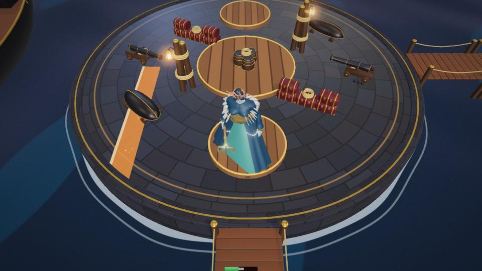
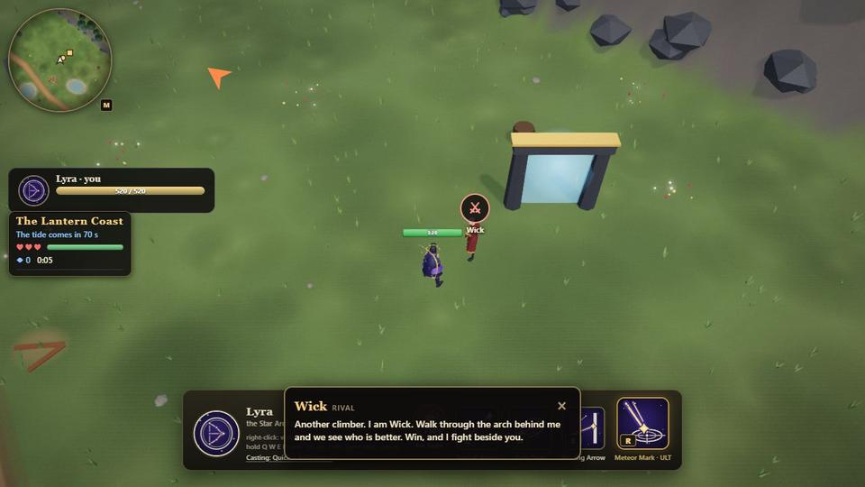
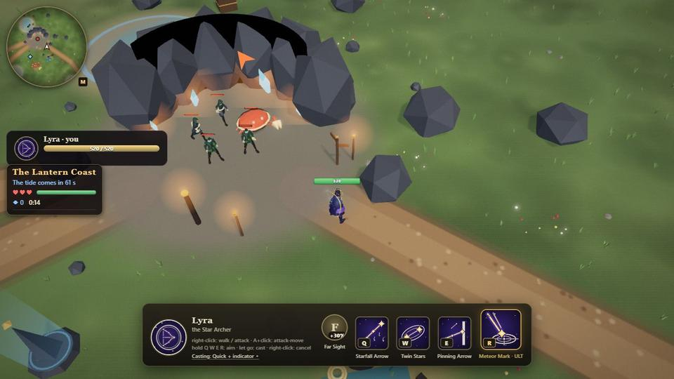
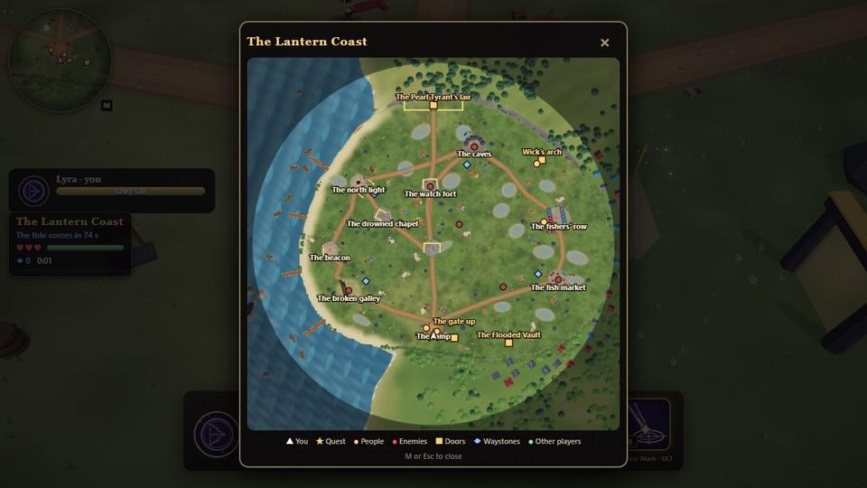
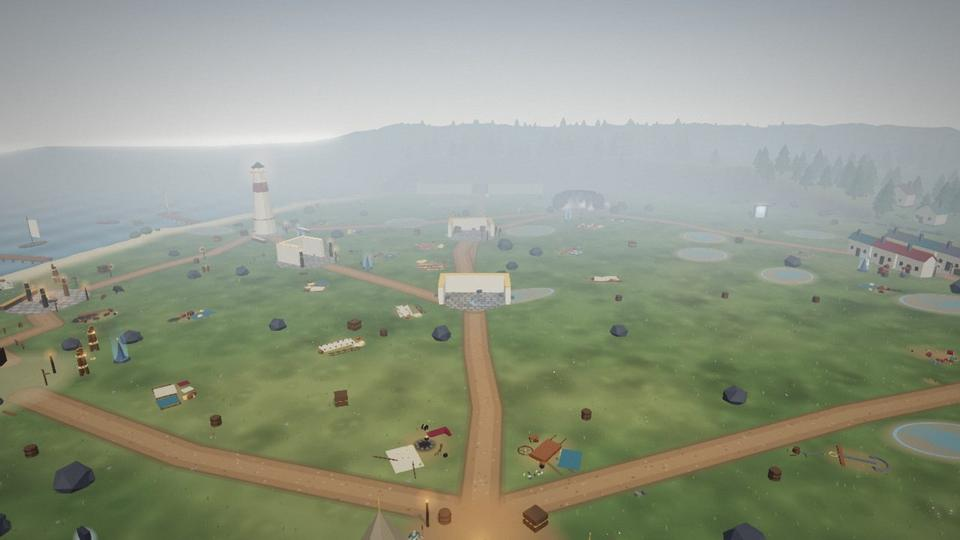
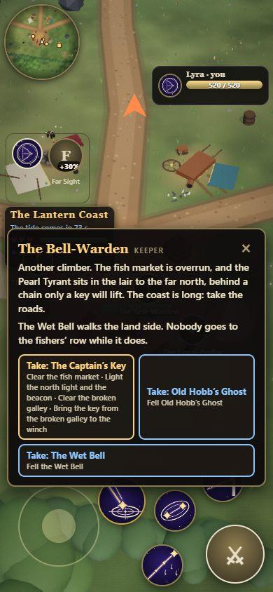

# Floor 6: The Lantern Coast

Plays clean: cleared, no console error, every spot reachable; the rival (Wick), the trial, the ruler (the Pearl Tyrant) and the gate (Mum) all played. The bot needed four tries at Mum's gate (balance, not a fault). One lore mismatch for you.

## Measured

- Reachable from the camp: 34872 m²; 51 spots of the floor's data, 0 cut off
- Props probe: 12 float, 56 gap, 2 buried, 0 in cover (sorted by kind; one or more of each kind looked at by eye)
- Grass and small things on ground steeper than 31°: 0
- Packs table for the open world (server/climb-packs.mjs): matches
- Route bot (Lyra): cleared in 1964 game s, every checkpoint reached; 23 kills, 3 falls, stars 1100; ruler tries 1, gate tries 4; page errors 0
- Ruler: The Pearl Tyrant (Hoarder of the shallows), model models/tower/sea_queen_v4.glb, loaded yes (its picture taken 5659 ms of real time into the fight)
- Frame check at the busiest spot (15, -74), 5 units awake: median 13.9, 12.1, 13.8 ms, p95 24.4, 20.8, 23 ms (desktop, machine shared: rough)
- Console errors while taking the pictures: 0

## Found

- **list: The Pearl Tyrant is a man in the Codex, a crowned woman on the floor.** The Codex (climb/rulers.md): “A pearl merchant ... He drowned holding the strongbox.” Floor 6 draws him with the Gull Queen's model (sea_queen, pieces/rulerModels.ts RULER_OF[6]), a crowned woman in a gown. Either the Codex says “she”, or floor 6 takes the Admiral's or the Judge's model (one number in RULER_OF; the three Sea models would then not be three floors each).
  -  The Pearl Tyrant as drawn
- **ok: The props the probe flagged.** Pines on the hills and the cliff top, boats on the sea, houses on their plinths, the lair wall's gold edge into the hill, two stones and a tuft just under the ground. Nothing in the air.

## Not checked

- the shared packs online

## Pictures

  
Wick, the rival

  
The caves' pack

  
The M map

  
From the south edge

  
Phone: the keeper's card

