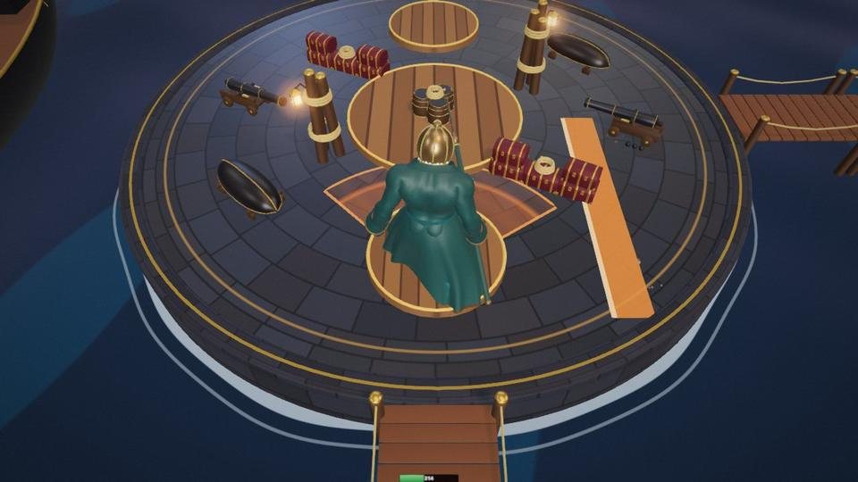
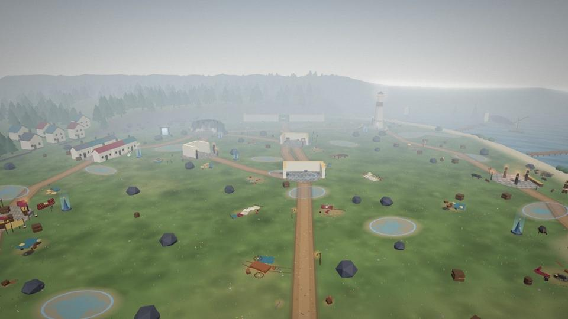

# Floor 7: Kelp Hollow

Plays clean: cleared, no console error, every spot reachable; the rival (Silvane), the trial (a horde), the ruler (the Bell Below; the bot lost the first try and won the second, as a person may) and the gate (Kaia) all played.

## Measured

- Reachable from the camp: 34888 m²; 51 spots of the floor's data, 0 cut off
- Props probe: 17 float, 81 gap, 3 buried, 0 in cover (each looked at; see below)
- Grass and small things on ground steeper than 31°: 0
- Packs table for the open world (server/climb-packs.mjs): matches
- Route bot (Lyra): cleared in 1841 game s, every checkpoint reached; 23 kills, 1 falls, stars 1101; ruler tries 2, gate tries 1; page errors 0
- Ruler: The Bell Below (It rings the sea in), model models/tower/sea_judge_v4.glb, loaded yes after 4851 ms of real time
- Frame check at the busiest spot (-65, 29), 6 units awake: median 12.9, 11.6, 11.1 ms, p95 23.1, 21.4, 15.6 ms (desktop, machine shared: rough)
- Console errors while taking the pictures: 0

## Found

- **list: The Bell Below is a bell in the Codex, a judge on the floor.** The Codex: “The harbour's old bell ... It rings underwater, and something answers.” Floor 7 draws it with the Tide Judge's model (a robed figure), as RULER_OF puts the Judge on floors 5, 7 and 8 (floor 8's Lantern Leviathan, “a great fish”, too). The ruler models' names and floors were left to you when the models were made; this is one more reason to look: the Codex could say the bell's ringer is what climbers fight, or these two floors get rulers of their own.
  -  The Bell Below as drawn
- **ok: The props the probe flagged.** Pines on the hills and the cliff top, boats on the sea, houses on their plinths, three shells just under the sand. Nothing in the air.

## Not checked

- the shared packs online
- buying at the trader (card and prices shown)

## Pictures

  
Silvane, the rival

  
The boat sheds' pack

  
The Lamp-Bearer in the old village

  
The M map

  
From the south edge

