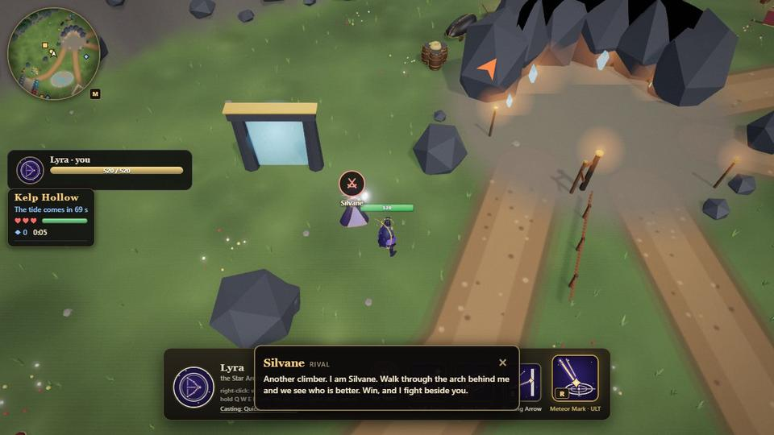
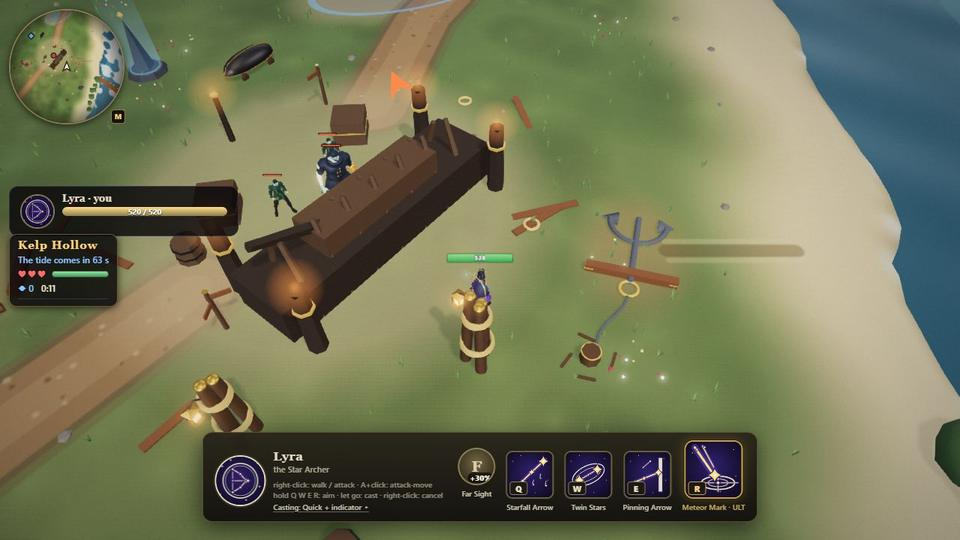
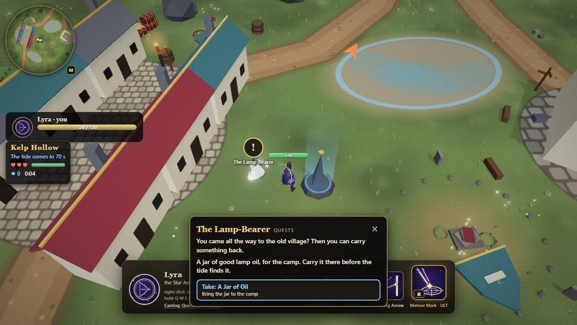
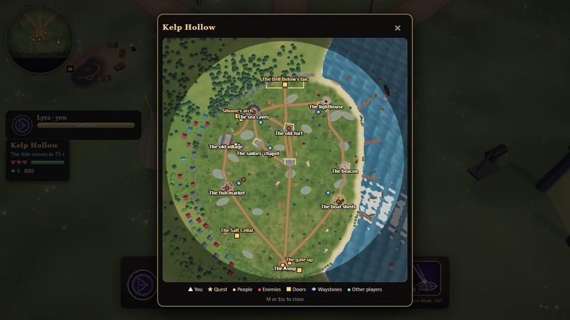

# Floor 7: Kelp Hollow

Plays clean: cleared, no console error, every spot reachable; the rival (Silvane), the trial (a horde), the ruler (the Bell Below; the bot lost the first try and won the second, as a person may) and the gate (Kaia) all played.

## Measured

- Reachable from the camp: 34888 m²; 51 spots of the floor's data, 0 cut off
- Props probe: 17 float, 81 gap, 3 buried, 0 in cover (each looked at; see below)
- Grass and small things on ground steeper than 31°: 0
- Packs table for the open world (server/climb-packs.mjs): matches
- Route bot (Lyra): cleared in 1841 game s, every checkpoint reached; 23 kills, 1 falls, stars 1101; ruler tries 2, gate tries 1; page errors 0
- Ruler: The Bell Below (It rings the sea in), model models/tower/sea_judge_v4.glb, loaded yes after 4851 ms of real time
- Frame check at the busiest spot (-65, 29), 6 units awake: median 12.9, 11.6, 11.1 ms, p95 23.1, 21.4, 15.6 ms (desktop, machine shared: rough)
- Console errors while taking the pictures: 0

## Found

- **list: Rulers the Codex calls beasts or things are drawn as people.** The ruler models are robed giants (their line-ups were accepted on 2026-11-15, STATUS “Decided”), but the Codex (climb/rulers.md) describes many of them otherwise: the Bell Below “the harbour's old bell” (floor 7, in the Tide Judge's figure), the Lantern Leviathan “a great fish” (8), the Lantern Root, a root with an amber lantern (17), the Grey Oak, a dead oak (18), the Mire Heart, a bog (19), and in the Sands the Scarab Colossus “a beetle the size of a house” (21), the Scarab King, its son (22), the Dune Colossus “a giant of sand and stone” (23), the Brass Sphinx “a lion of brass with a woman's face” (24), the Glass Serpent (25). Since the figures are accepted, the likely fix is the Codex's words (these as the realm's people who carry those names, or the Tower's echo of them in a giant's shape); else new models (Blender, one at a time). Yours to say.
  -  The Bell Below as drawn
- **ok: The props the probe flagged.** Pines on the hills and the cliff top, boats on the sea, houses on their plinths, three shells just under the sand. Nothing in the air.

## Not checked

- the shared packs online
- buying at the trader (card and prices shown)

## Pictures

  
Silvane, the rival

  
The boat sheds' pack

  
The Lamp-Bearer in the old village

  
The M map

  
From the south edge

