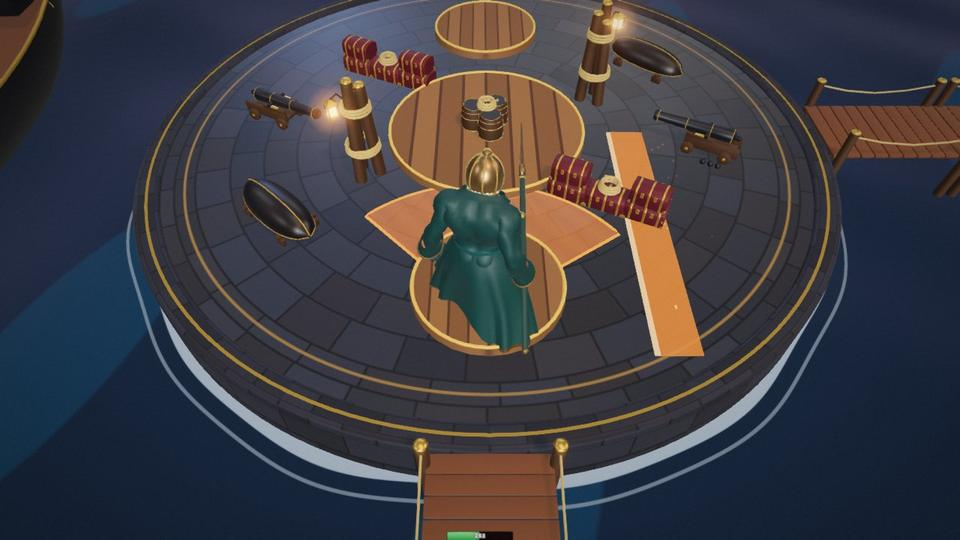
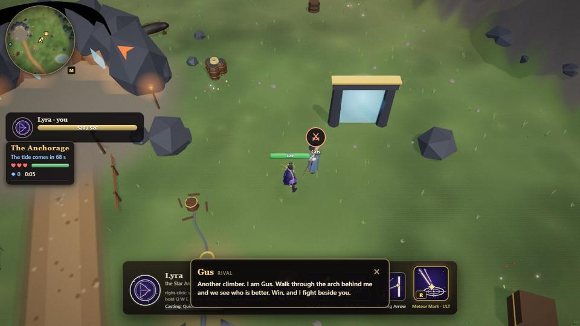
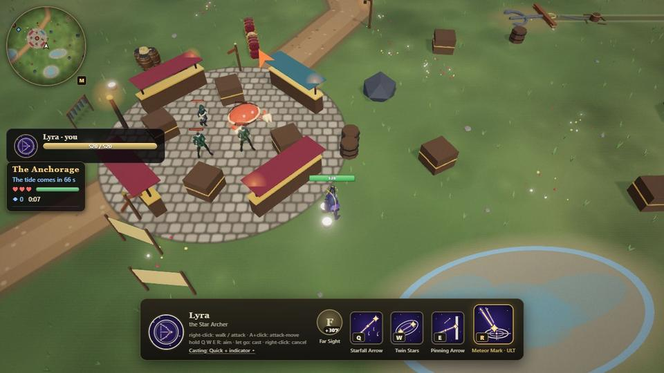
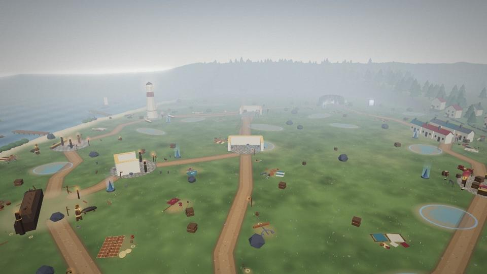

# Floor 8: The Anchorage

Plays clean: cleared, no console error, every spot reachable; the rival (Gus), the trial, the ruler (the Lantern Leviathan; the bot's first try lost, the second won) and the gate (Mabel) all played. The Leviathan, “a great fish” in the Codex, is drawn with the Tide Judge's figure: see floor 7's item.

## Measured

- Reachable from the camp: 34910 m²; 51 spots of the floor's data, 0 cut off
- Props probe: 17 float, 67 gap, 2 buried, 0 in cover (each looked at; see below)
- Grass and small things on ground steeper than 31°: 0
- Packs table for the open world (server/climb-packs.mjs): matches
- Route bot (Lyra): cleared in 1819 game s, every checkpoint reached; 24 kills, 1 falls, stars 1101; ruler tries 2, gate tries 1; page errors 0
- Ruler: The Lantern Leviathan (A light that eats ships), model models/tower/sea_judge_v4.glb, loaded yes after 3093 ms of real time
- Frame check at the busiest spot (40, -79), 5 units awake: median 4.2, 3.9, 3.5 ms, p95 8.7, 9, 8.2 ms (desktop, machine shared: rough)
- Console errors while taking the pictures: 0

## Found

- **ok: The props the probe flagged.** Pines on the hills and the cliff top, boats on the sea, houses on their plinths, two stones under the ground. Nothing in the air.

## Not checked

- the shared packs online
- buying at the trader (card and prices shown)

## Pictures

  
The Lantern Leviathan, in the Judge's figure

  
Gus, the rival

  
The oyster market's pack

  
From the south edge

