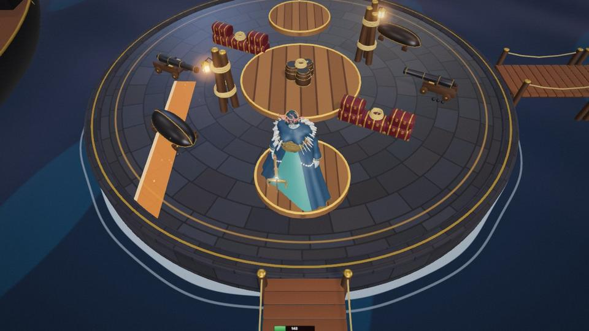
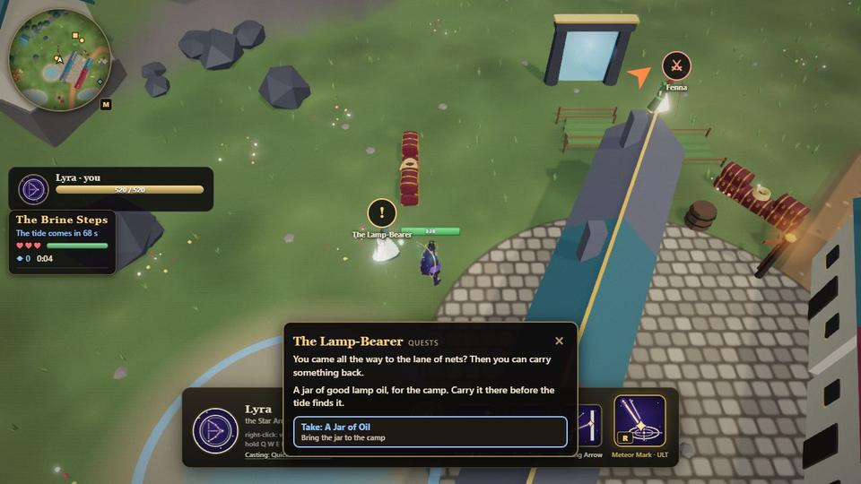
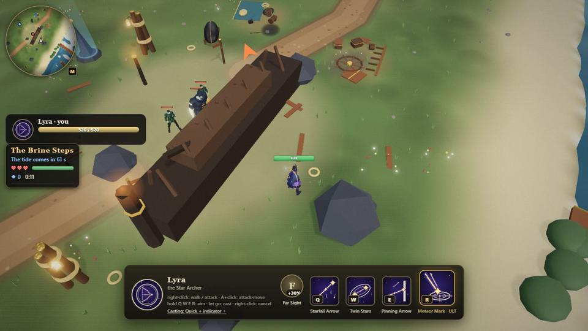
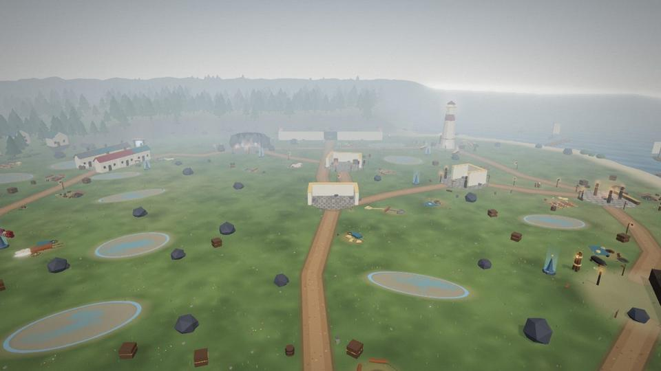

# Floor 9: The Brine Steps

Clean: cleared with four stars and no fall, no console error, every spot reachable; the rival (Fenna), the trial, the ruler (the Gull Queen, in her own model) and the gate (Zephyr) all played.

## Measured

- Reachable from the camp: 34888 m²; 51 spots of the floor's data, 0 cut off
- Props probe: 14 float, 67 gap, 1 buried, 0 in cover (each looked at; see below)
- Grass and small things on ground steeper than 31°: 0
- Packs table for the open world (server/climb-packs.mjs): matches
- Route bot (Lyra): cleared in 1716 game s, every checkpoint reached; 19 kills, 0 falls, stars 1111; ruler tries 1, gate tries 1; page errors 0
- Ruler: The Gull Queen (Wings and anchors), model models/tower/sea_queen_v4.glb, loaded yes after 3461 ms of real time
- Frame check at the busiest spot (-72, 34), 6 units awake: median 4.8, 3.9, 3.8 ms, p95 8.3, 6.5, 5 ms (desktop, machine shared: rough)
- Console errors while taking the pictures: 0

## Found

- **ok: The props the probe flagged.** Pines on the hills and the cliff top, boats on the sea, houses on their plinths, a tuft under the ground. Nothing in the air.

## Not checked

- the shared packs online
- buying at the trader (card and prices shown)

## Pictures

  
The Gull Queen

  
The Lamp-Bearer in the lane of nets

  
The wreck's pack

  
From the south edge

