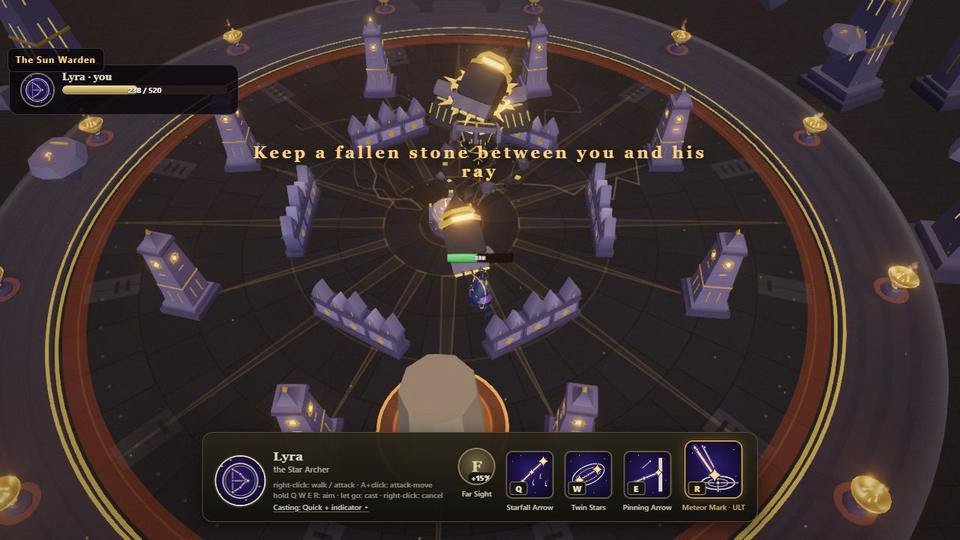
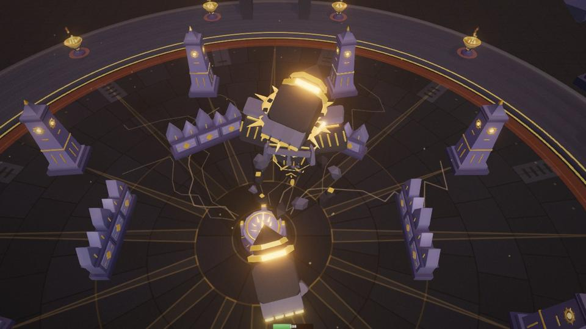
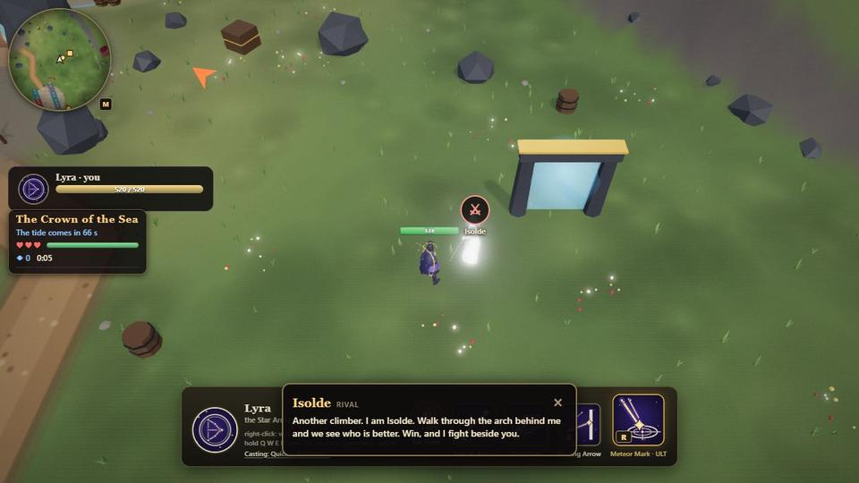
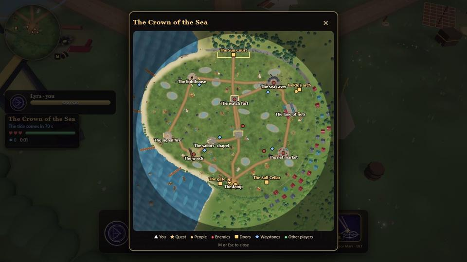
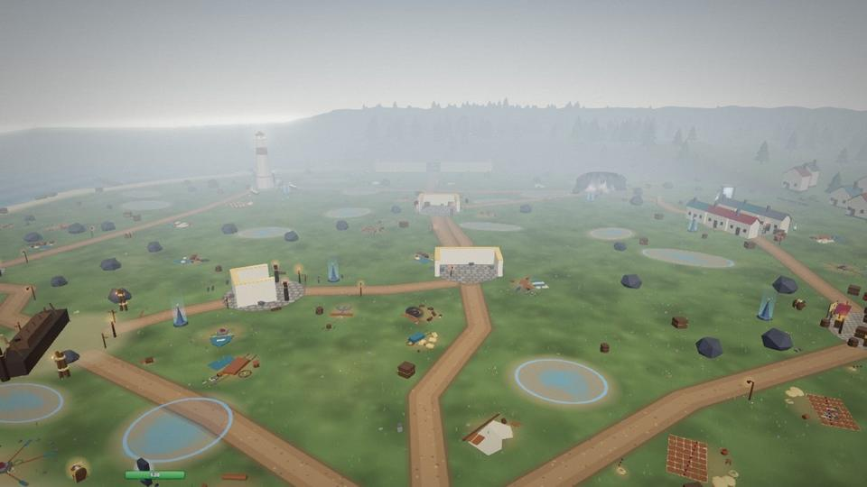

# Floor 10: The Crown of the Sea

Clean: the Sea's crown. Cleared with four stars and no fall, no console error, every spot reachable; the Sun Warden (the Raid's boss, its own model, alone in the Sun Court) fought and fell to the bot on the first try; the rival (Isolde), the trial and the gate (Shiori) all played.

## Measured

- Reachable from the camp: 34825 m²; 51 spots of the floor's data, 0 cut off
- Props probe: 16 float, 67 gap, 0 buried, 0 in cover (each looked at; see below)
- Grass and small things on ground steeper than 31°: 1
- Packs table for the open world (server/climb-packs.mjs): matches
- Route bot (Lyra): cleared in 1776 game s, every checkpoint reached; 23 kills, 0 falls, stars 1111; ruler tries 1, gate tries 1; page errors 0
- Ruler: The Sun Warden (Keeper of the Sun Court), model models/bosses/warden.glb, loaded yes after 4123 ms of real time
- Frame check at the busiest spot (38, -63), 5 units awake: median 5.7, 5.4, 5.7 ms, p95 8.8, 7.6, 10.1 ms (desktop, machine shared: rough)
- Console errors while taking the pictures: 0

## Found

- **ok: The props the probe flagged.** Pines on the hills and the cliff top, boats on the sea, houses on their plinths. Nothing in the air.

## Not checked

- the shared packs online
- buying at the trader (card and prices shown)

## Pictures

  
The Sun Court: the Sun Warden's fight as it opens

  
The Sun Warden

  
Isolde, the rival

  
The M map

  
From the south edge

