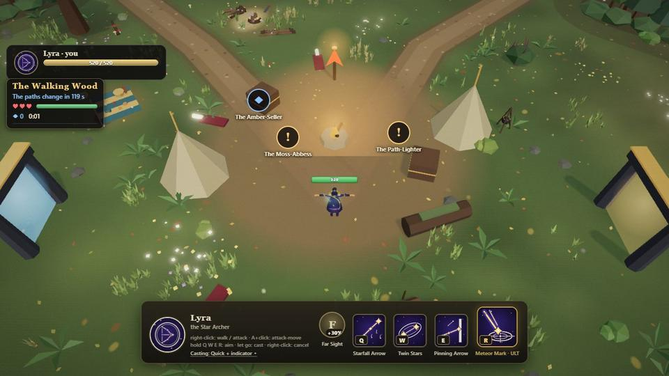
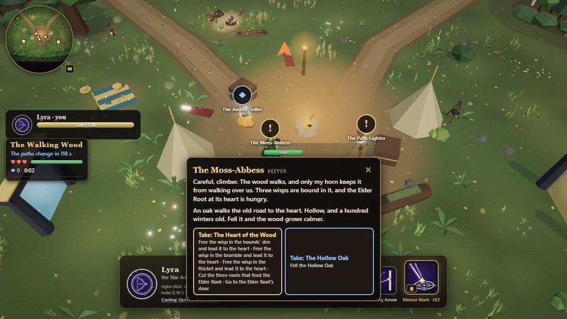
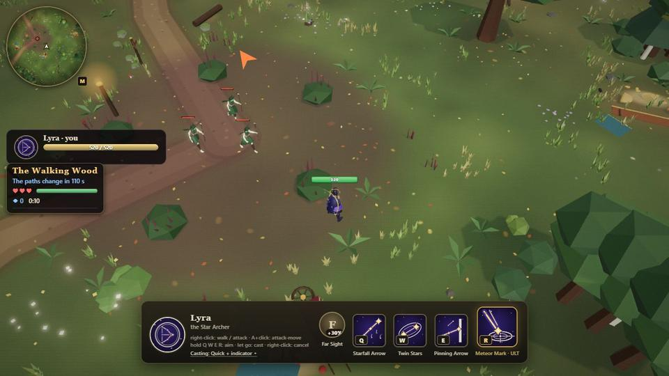
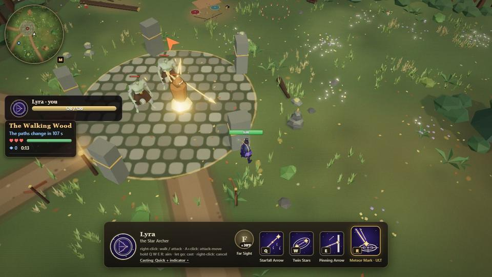
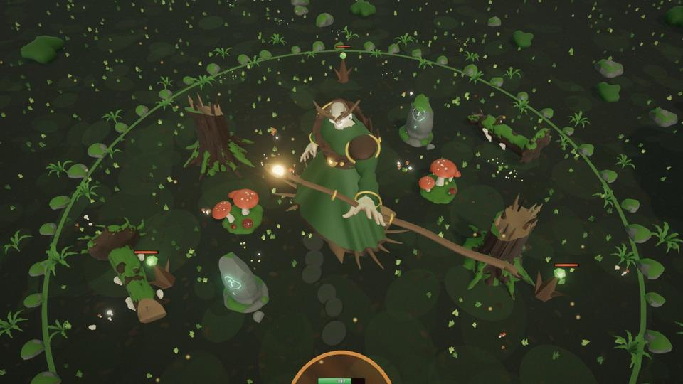
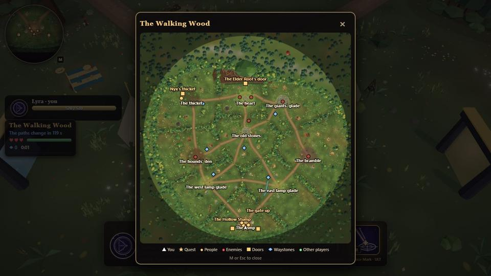
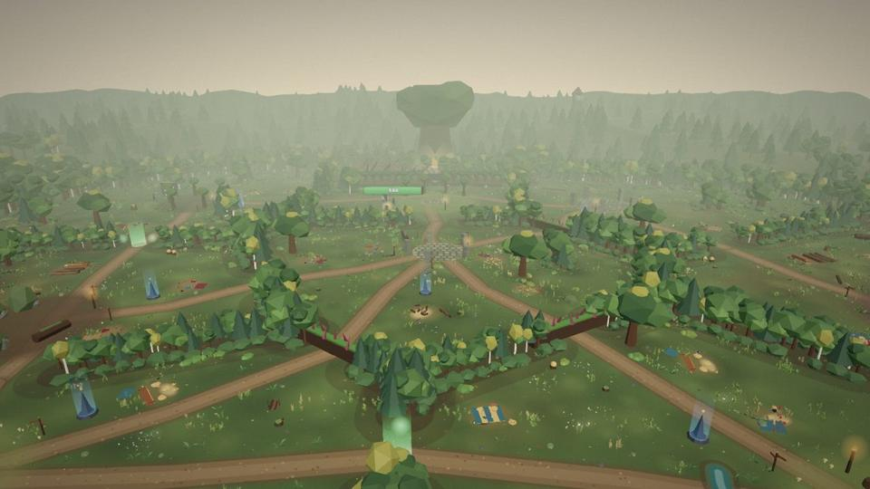
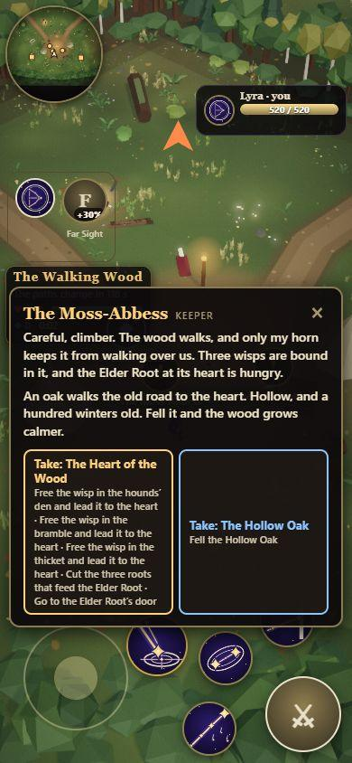

# Floor 11: The Walking Wood

Clean: the Wood's handmade floor. Cleared with four stars and no fall, no console error; every spot reachable in both states of the walking paths; the wisps, the roots, the rival (Nyx), the trial, the Elder Root (own model) and the gate (Fenna) all played; the people and their lines match the Codex (the Moss-Abbess's horn, the Path-Lighter's spore lamps).

## Measured

- Reachable from the camp: 31761 m², 31761 m²; 48 spots of the floor's data, 0 cut off
- Props probe: 58 float, 72 gap, 12 buried, 3170 in cover (each looked at; see below)
- Grass and small things on ground steeper than 31°: 0
- Packs table for the open world (server/climb-packs.mjs): matches
- Route bot (Lyra): cleared in 1031 game s, every checkpoint reached; 10 kills, 0 falls, stars 1111; ruler tries 1, gate tries 1; page errors 0
- Ruler: The Elder Root (The heart of the wood), model models/tower/wood_elder_v4.glb, loaded yes after 4725 ms of real time
- Frame check at the busiest spot (-77, 23), 4 units awake: median 6.6, 5.7, 6.5 ms, p95 9.7, 8.4, 8.5 ms (desktop, machine shared: rough)
- Console errors while taking the pictures: 0

## Found

- **ok: Two packs the bot never woke.** The bramble's thorn sprites and the giants' glade sleep through the bot's route: nothing it is asked to do takes it near them (they spawn and fight as anyone walks in: pictures below).
- **ok: The props the probe flagged.** The Wood's trees are its cover, so the probe's thousands of “in cover” are the trees themselves; the “float” are white spore motes drifting in the air (meant), and pines on the hills past the edge; a few leaves lie a hair under the ground.

## Not checked

- the shared packs online
- buying at the trader (card and prices shown)

## Pictures

  
The camp as it opens

  
The Moss-Abbess

  
The bramble's thorn sprites

  
The giants' glade and the Stag-Crowned

  
The Elder Root

  
The M map

  
From the south edge

  
Phone: the keeper's card

