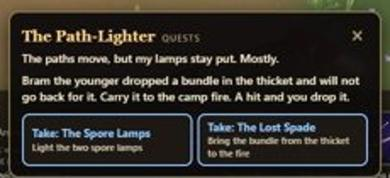
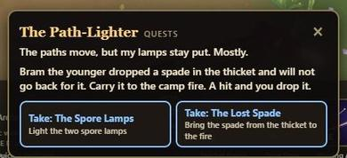
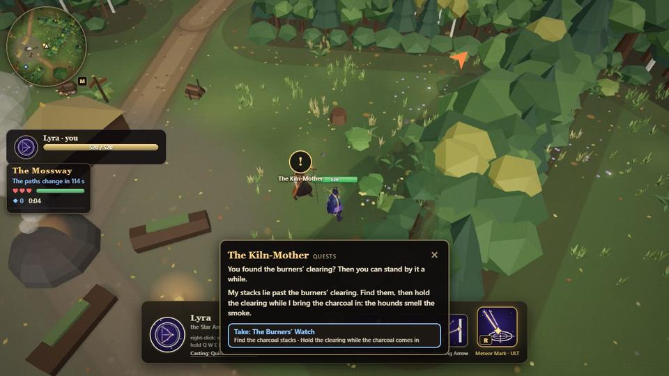
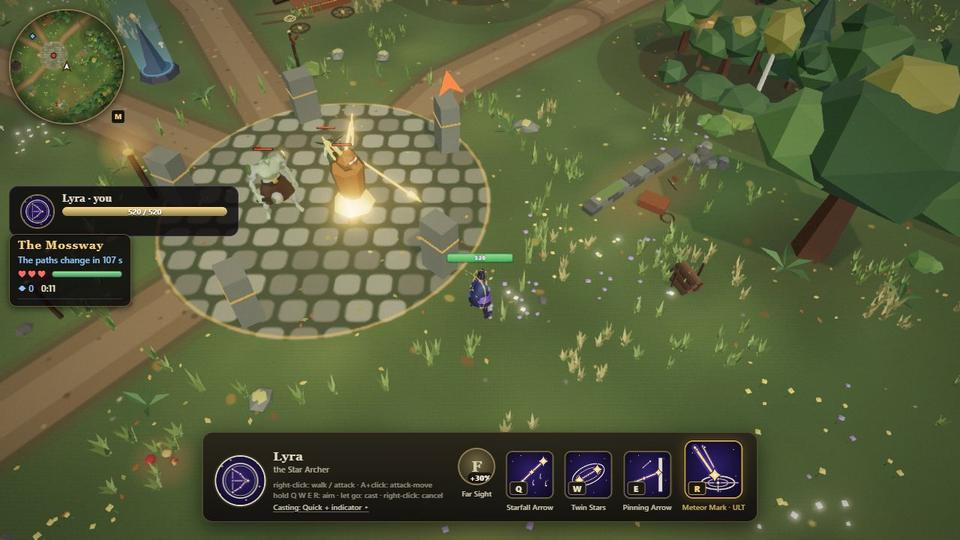
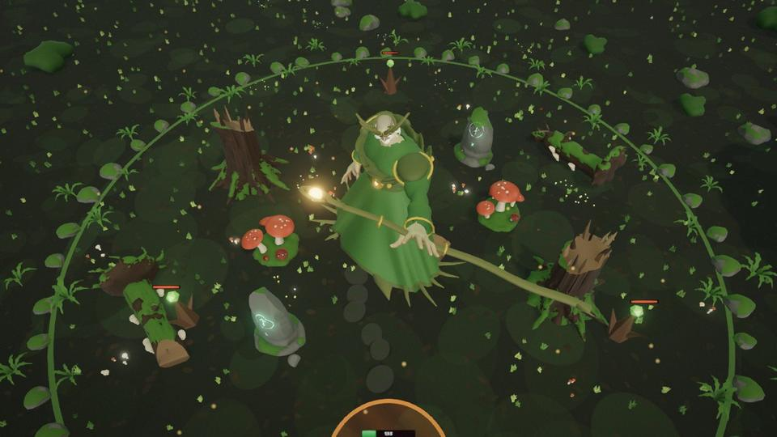
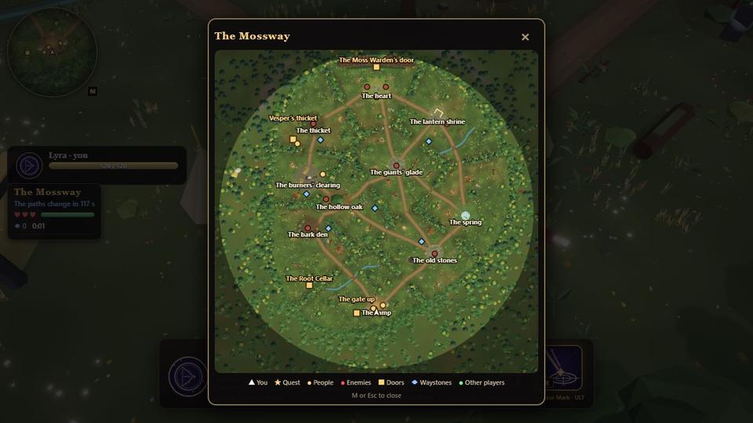
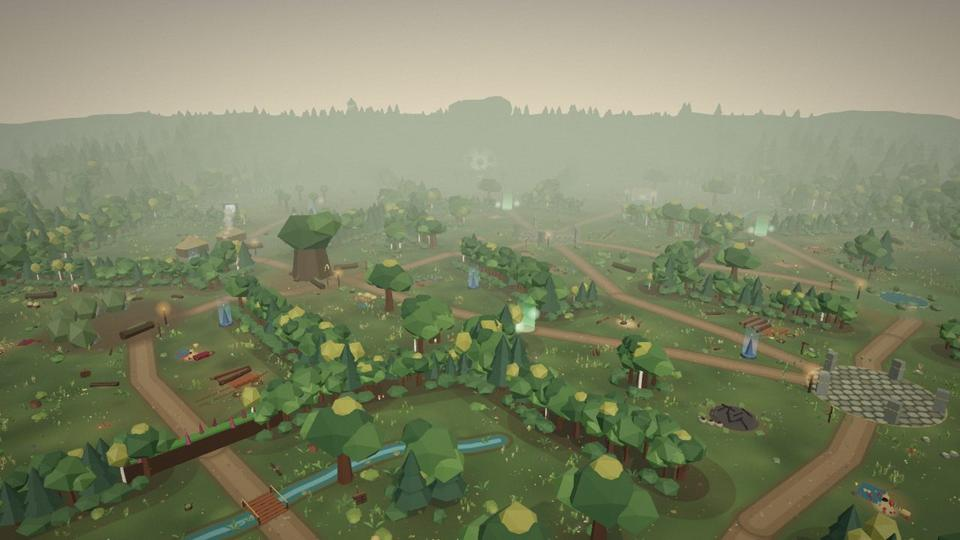

# Floor 12: The Mossway

Plays clean: cleared, no console error, every spot reachable in both states of the paths; the wisps, the roots, the rival (Vesper), the trial, the ruler (the Moss Warden, in the Elder's model) and the gate (Nyx; second try) all played. One quest's words fixed.

## Measured

- Reachable from the camp: 31826 m², 31827 m²; 57 spots of the floor's data, 0 cut off
- Props probe: 57 float, 132 gap, 4 buried, 3174 in cover (each looked at; see below)
- Grass and small things on ground steeper than 31°: 0
- Packs table for the open world (server/climb-packs.mjs): matches
- Route bot (Lyra): cleared in 1421 game s, every checkpoint reached; 21 kills, 1 falls, stars 1101; ruler tries 1, gate tries 2; page errors 0
- Ruler: The Moss Warden (Green over everything), model models/tower/wood_elder_v4.glb, loaded yes after 3436 ms of real time
- Frame check at the busiest spot (-59, 5), 5 units awake: median 4.2, 4.6, 4.4 ms, p95 5.5, 5.7, 5.1 ms (desktop, machine shared: rough)
- Console errors while taking the pictures: 0

## Found

- **fixed: “The Lost Spade” asked for a bundle.** The Wood's maker names the camp giver's second quest “The Lost Spade”, “The Lost Lantern” or “The Lost Bundle”, but its words always spoke of a bundle. Now the thing dropped, carried and named on the HUD is the one in the quest's name (src/tower/world/gen/wood.ts; floors 12 to 20 re-baked: only those words changed, on seven floors; it is still drawn as a bundle in the hand).
  -  Before
  -  After
- **ok: The props the probe flagged.** As on floor 11: the trees are the cover; spore motes in the air; trees on the hills past the edge. Nothing out of place by eye.

## Not checked

- the shared packs online
- buying at the trader (card and prices shown)

## Pictures

  
The Kiln-Mother at the burners' clearing

  
The old stones and the Stag-Crowned

  
The Moss Warden

  
The M map

  
From the south edge

