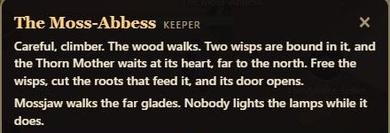
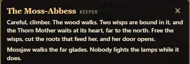
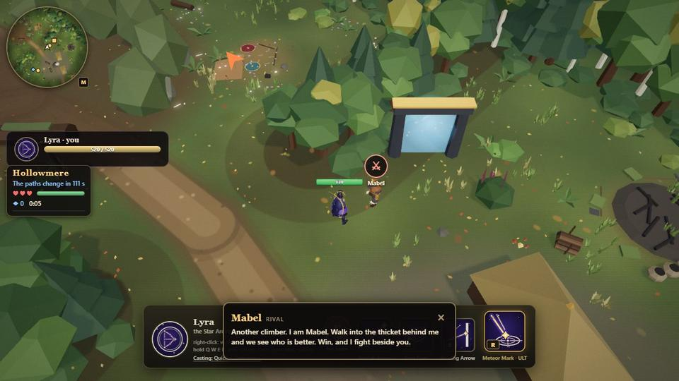
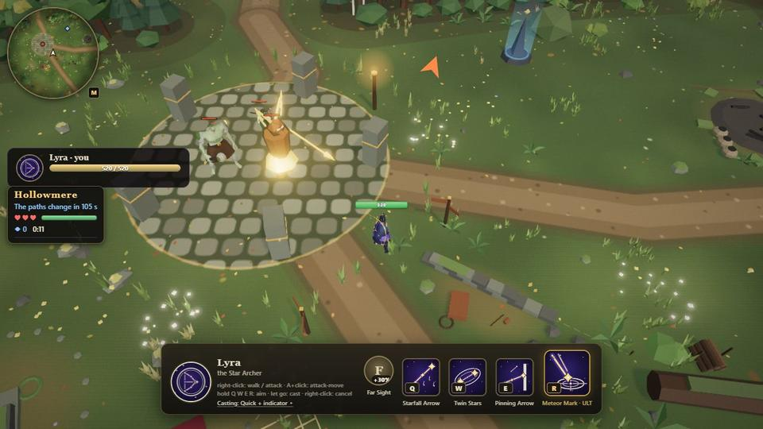
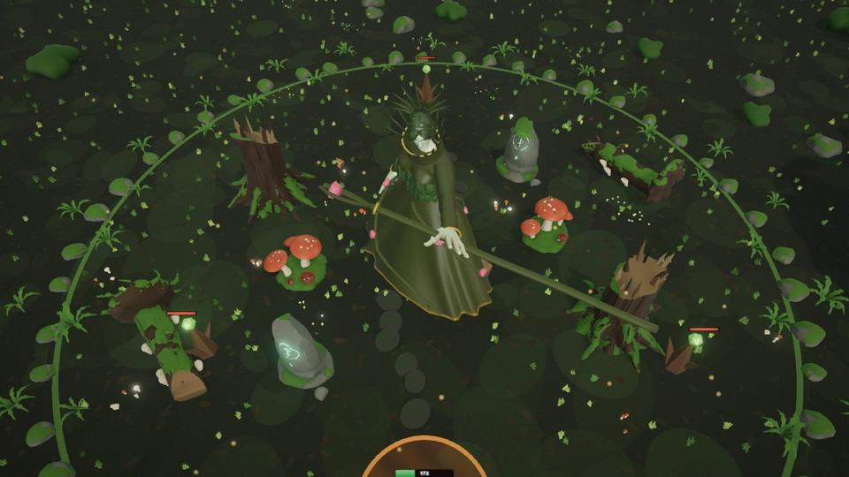
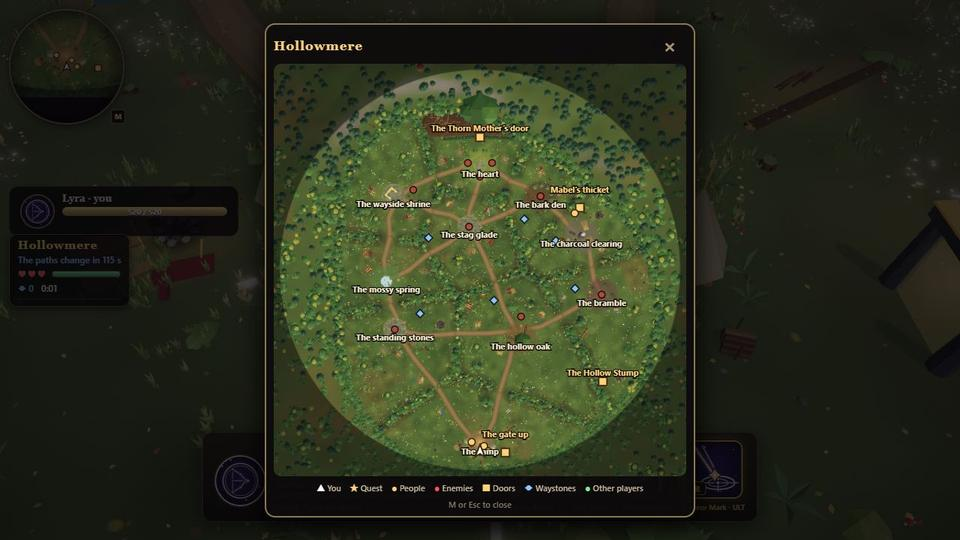
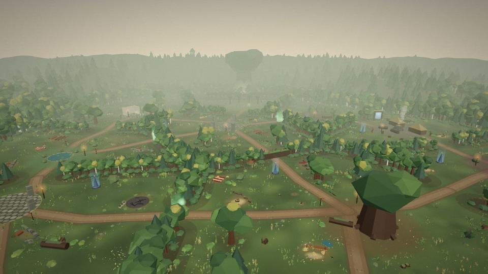

# Floor 13: Hollowmere

Clean but for one line: cleared with four stars and no fall, no console error, every spot reachable in both states of the paths; the rival (Mabel), the trial, the Thorn Mother (own model) and the gate (Mortis) all played.

## Measured

- Reachable from the camp: 31625 m², 31624 m²; 57 spots of the floor's data, 0 cut off
- Props probe: 60 float, 91 gap, 9 buried, 3365 in cover (each looked at; see below)
- Grass and small things on ground steeper than 31°: 0
- Packs table for the open world (server/climb-packs.mjs): matches
- Route bot (Lyra): cleared in 1438 game s, every checkpoint reached; 21 kills, 0 falls, stars 1111; ruler tries 1, gate tries 1; page errors 0
- Ruler: The Thorn Mother (She grows the walls), model models/tower/wood_briar_v4.glb, loaded yes after 5393 ms of real time
- Frame check at the busiest spot (-6, -38), 4 units awake: median 8.8, 8.6, 8.8 ms, p95 12.4, 15.6, 11.7 ms (desktop, machine shared: rough)
- Console errors while taking the pictures: 0

## Found

- **fixed: The keeper called the Thorn Mother “it”.** “... cut the roots that feed it, and its door opens”, for the Thorn Mother, the Moss Warden, the Antler King, the Briar Witch, and “Ash and Ember waits” on the crown. The Wood's maker now gives each its word: her, him, them (a tree, a root or a bog stays “it”). src/tower/world/gen/wood.ts; floors 12-20 re-baked, only those lines changed (five floors).
  -  Before
  -  After
- **ok: Packs and props.** The stag glade's pack slept through the bot's route (nothing it is asked takes it there); the props probe's hits are the Wood's trees, its spore motes and the trees on the hills past the edge.

## Not checked

- the shared packs online
- buying at the trader (card and prices shown)

## Pictures

  
Mabel, the rival

  
The standing stones and the Stag-Crowned

  
The Thorn Mother

  
The M map

  
From the south edge

