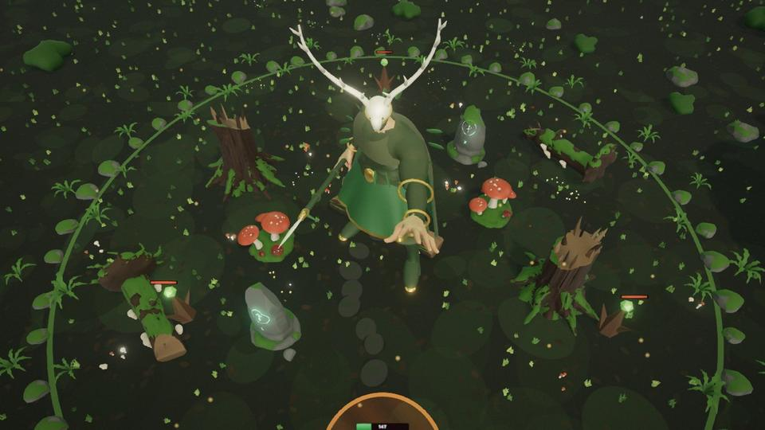
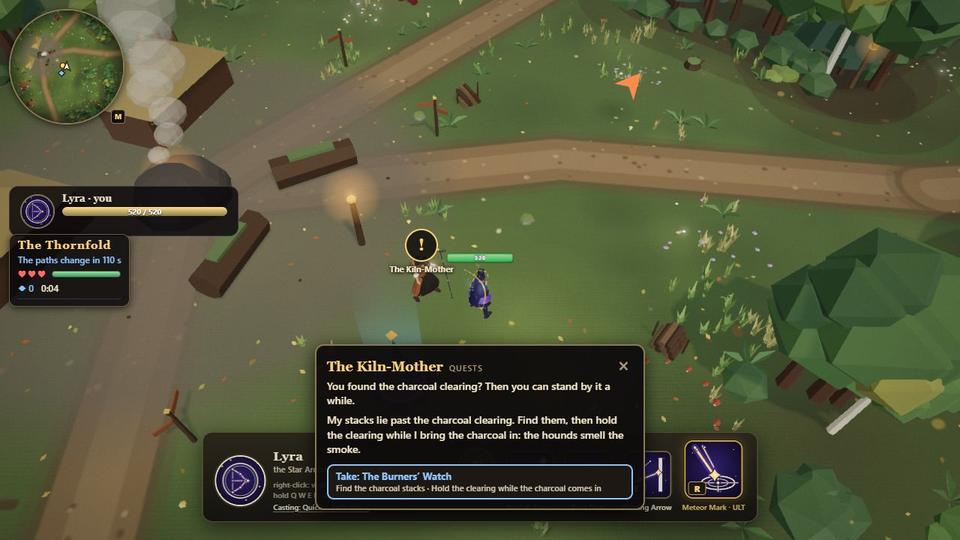
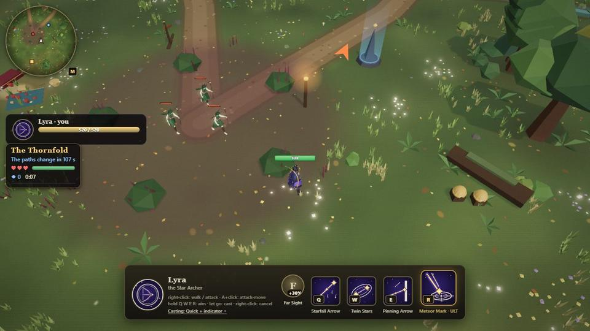
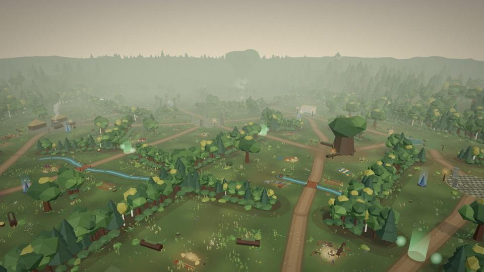

# Floor 14: The Thornfold

Clean: cleared with four stars and no fall, no console error, every spot reachable in both states of the paths; the rival (Sirix), the trial, the Antler King (own model) and the gate (Isolde) all played. The keeper's “feed him, and his door” is floor 13's fix.

## Measured

- Reachable from the camp: 32010 m², 32011 m²; 60 spots of the floor's data, 0 cut off
- Props probe: 58 float, 94 gap, 9 buried, 3112 in cover (sorted by kind; one or more of each kind looked at by eye)
- Grass and small things on ground steeper than 31°: 0
- Packs table for the open world (server/climb-packs.mjs): matches
- Route bot (Lyra): cleared in 1449 game s, every checkpoint reached; 20 kills, 0 falls, stars 1111; ruler tries 1, gate tries 1; page errors 0
- Ruler: The Antler King (Crowned in branches), model models/tower/wood_antler_v4.glb, loaded yes (its picture taken 4659 ms of real time into the fight)
- Frame check at the busiest spot (-62, -70), 4 units awake: median 6.5, 8.7, 8.6 ms, p95 10.1, 15, 13.6 ms (desktop, machine shared: rough)
- Console errors while taking the pictures: 0

## Found

- **ok: Packs and props.** The thicket's pack slept through the bot's route; the probe's hits are the Wood's trees, spore motes and the hills past the edge.

## Not checked

- the shared packs online

## Pictures

  
The Antler King

  
The Kiln-Mother at the charcoal clearing

  
The thorn brake's pack

  
From the south edge

