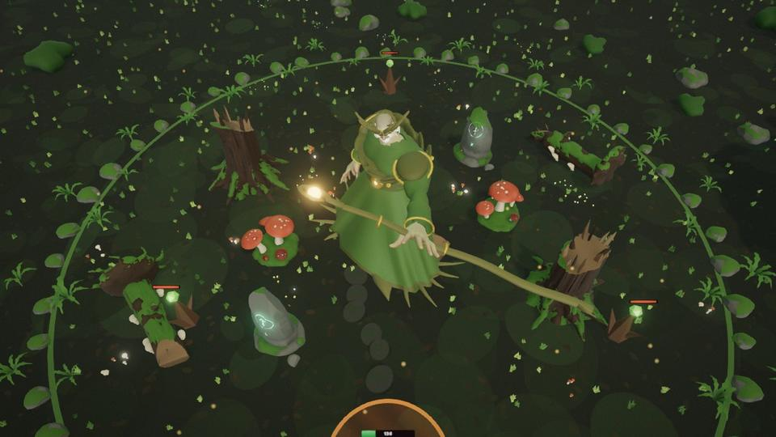
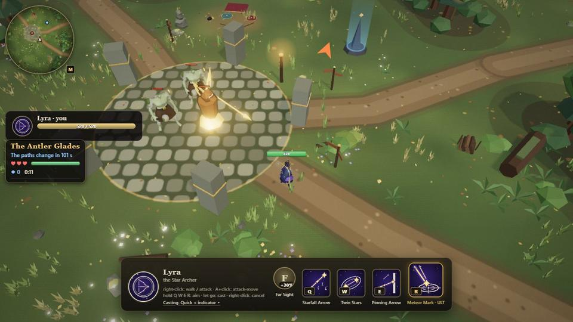
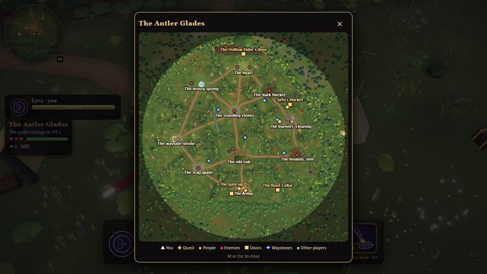
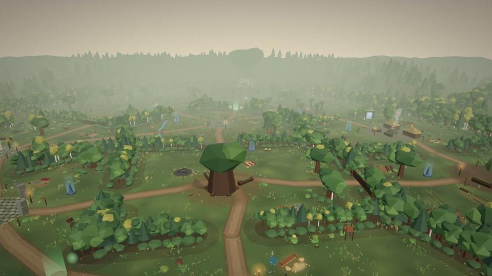

# Floor 15: The Antler Glades

Clean: cleared with four stars and no fall, no console error, every spot reachable in both states of the paths; the rival (Sefu), the trial (a horde), the Hollow Elder (the Elder's model, tinted) and the gate (Silvane) all played.

## Measured

- Reachable from the camp: 31487 m², 31488 m²; 57 spots of the floor's data, 0 cut off
- Props probe: 56 float, 69 gap, 5 buried, 3283 in cover (sorted by kind; one or more of each kind looked at by eye)
- Grass and small things on ground steeper than 31°: 0
- Packs table for the open world (server/climb-packs.mjs): matches
- Route bot (Lyra): cleared in 1314 game s, every checkpoint reached; 22 kills, 0 falls, stars 1111; ruler tries 1, gate tries 1; page errors 0
- Ruler: The Hollow Elder (Older than the paths), model models/tower/wood_elder_v4.glb, loaded yes (its picture taken 5216 ms of real time into the fight)
- Frame check at the busiest spot (16, -55), 4 units awake: median 6.4, 8.9, 9.5 ms, p95 11, 12.5, 13 ms (desktop, machine shared: rough)
- Console errors while taking the pictures: 0

## Found

- **ok: Packs and props.** The standing stones' pack slept through the bot's route; the probe's hits are the Wood's trees, spore motes and the hills past the edge.

## Not checked

- the shared packs online

## Pictures

  
The Hollow Elder

  
The stag glade and the Stag-Crowned

  
The M map

  
From the south edge

