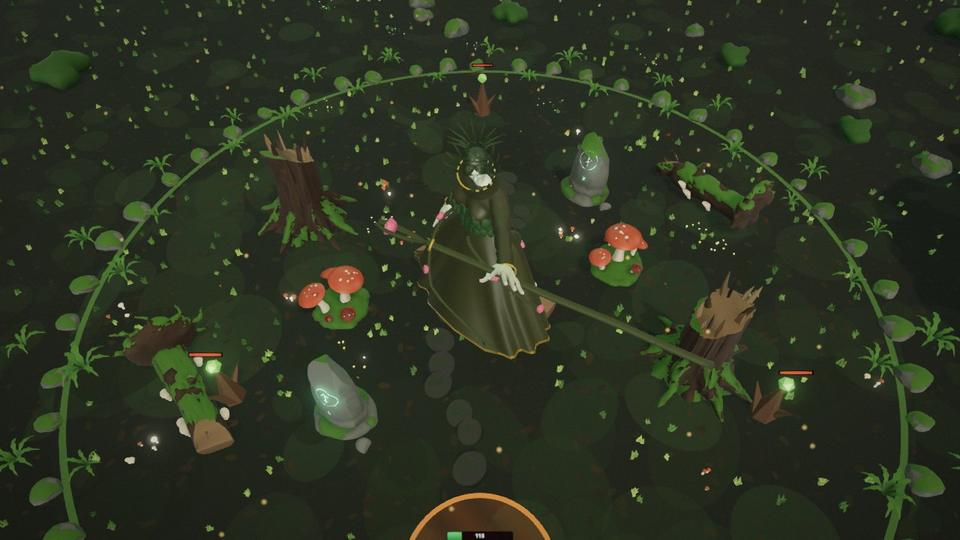
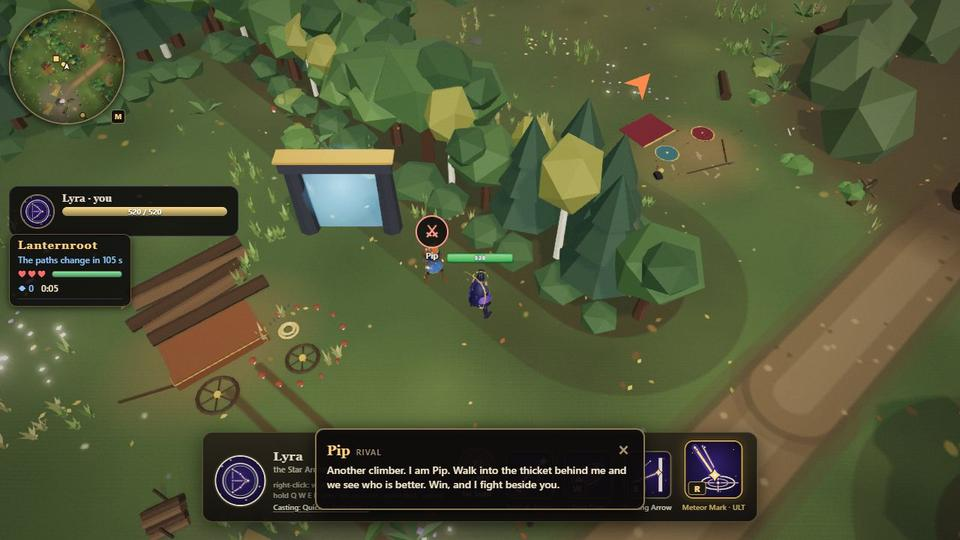
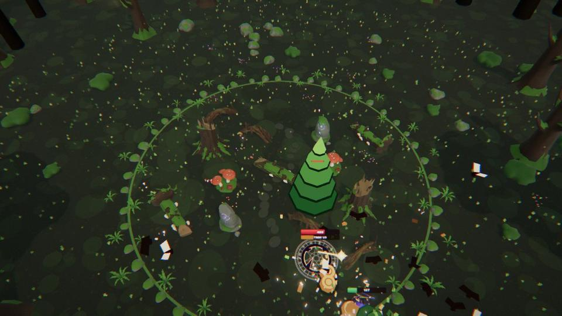
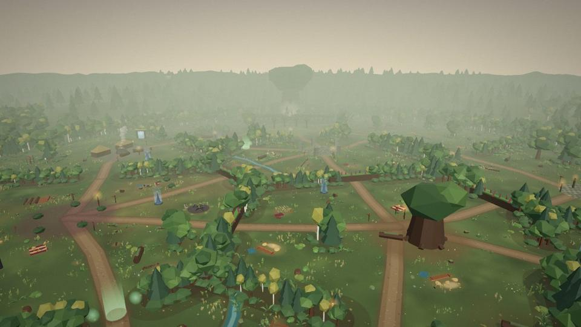

# Floor 16: Lanternroot

Plays clean: cleared, no console error, every spot reachable in both states of the paths; the rival (Pip), the trial, the Briar Witch (own model, tinted) and the gate (Hank) all played. The bot needed six tries at Hank's gate (the most of any floor so far): a balance note, not a fault.

## Measured

- Reachable from the camp: 31839 m², 31839 m²; 57 spots of the floor's data, 0 cut off
- Props probe: 66 float, 61 gap, 8 buried, 3120 in cover (each looked at; see below)
- Grass and small things on ground steeper than 31°: 0
- Packs table for the open world (server/climb-packs.mjs): matches
- Route bot (Lyra): cleared in 1509 game s, every checkpoint reached; 21 kills, 5 falls, stars 1101; ruler tries 1, gate tries 6; page errors 0
- Ruler: The Briar Witch (Every thorn a word), model models/tower/wood_briar_v4.glb, loaded yes after 3760 ms of real time
- Frame check at the busiest spot (-25, -63), 5 units awake: median 8, 5.1, 5.7 ms, p95 18.9, 7.5, 15.9 ms (desktop, machine shared: rough)
- Console errors while taking the pictures: 0

## Found

- **ok: Packs and props.** The hounds' den slept through the bot's route; the probe's hits are the Wood's trees, spore motes and the hills past the edge.

## Not checked

- the shared packs online
- buying at the trader (card and prices shown)

## Pictures

  
The Briar Witch

  
Pip, the rival

  
The gate: Hank

  
From the south edge

