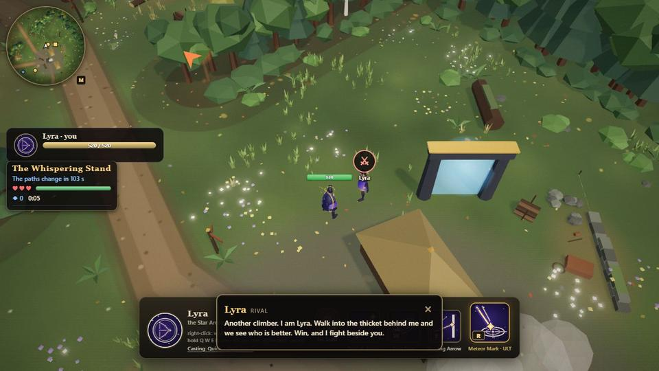
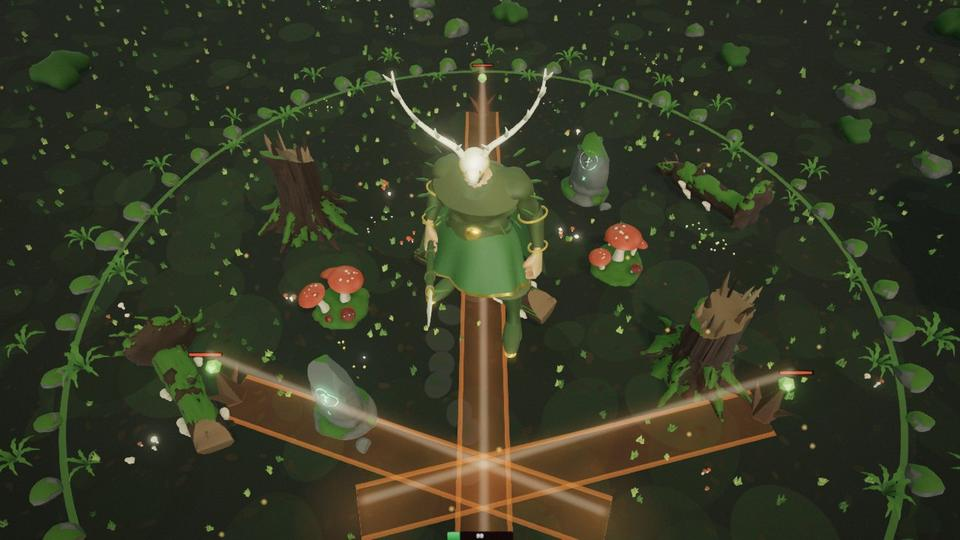
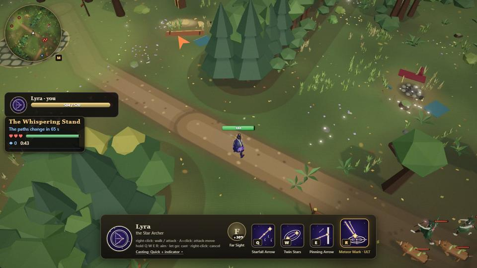
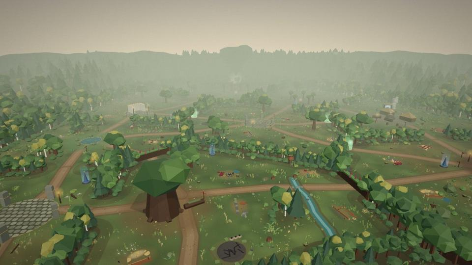

# Floor 17: The Whispering Stand

Plays clean: cleared, no console error, every spot reachable in both states of the paths; the rival (Lyra), the trial, the Lantern Root (in the Antler King's model) and the gate (Bram; second try) all played.

## Measured

- Reachable from the camp: 31926 m², 31926 m²; 56 spots of the floor's data, 0 cut off
- Props probe: 72 float, 99 gap, 7 buried, 3125 in cover (each looked at; see below)
- Grass and small things on ground steeper than 31°: 0
- Packs table for the open world (server/climb-packs.mjs): matches
- Route bot (Lyra): cleared in 1539 game s, every checkpoint reached; 25 kills, 1 falls, stars 1101; ruler tries 1, gate tries 2; page errors 0
- Ruler: The Lantern Root (It drinks the light), model models/tower/wood_antler_v4.glb, loaded yes after 6948 ms of real time
- Frame check at the busiest spot (23, -72), 4 units awake: median 11.6, 10, 9.9 ms, p95 21.9, 15.7, 13.5 ms (desktop, machine shared: rough)
- Console errors while taking the pictures: 0

## Found

- **list: Meeting yourself as the rival.** The bot played Lyra, and floor 17's rival is Lyra: “Another climber. I am Lyra.” Any hero meets this on the floor whose rival (or gatekeeper) is that same hero. The fight is a mirror duel and works. If it should read better: the rival's line could say so when the hero is the same (people.ts builds the card), or the floor could pick another rival for that hero (a design call).
  -  Lyra meets Lyra
- **ok: The Lantern Root's figure.** The Codex's Lantern Root is a root with an amber lantern; it is drawn with the Antler King's stag-crowned figure (RULER_OF). Listed with the other rulers whose Codex form is not a person (floor 7's item).

## Not checked

- the shared packs online
- buying at the trader (card and prices shown)

## Pictures

  
The Lantern Root

  
The busiest spot (the frame check)

  
From the south edge

