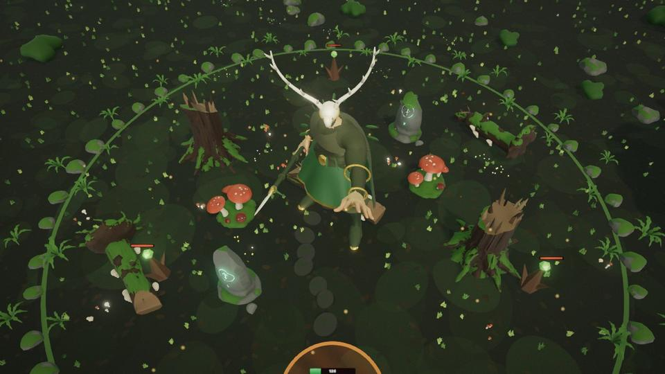
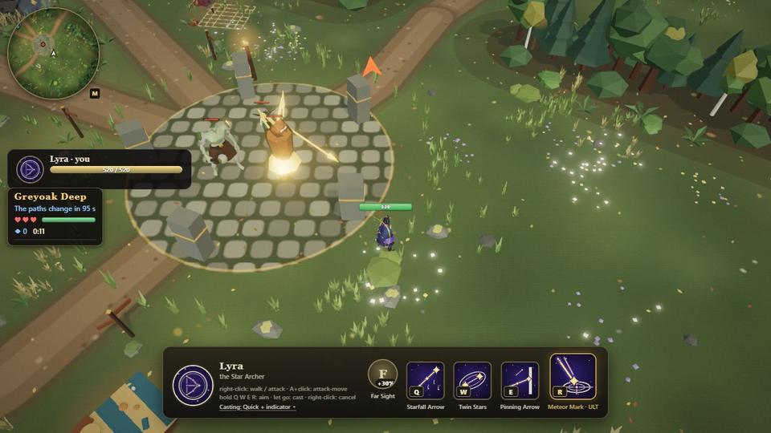
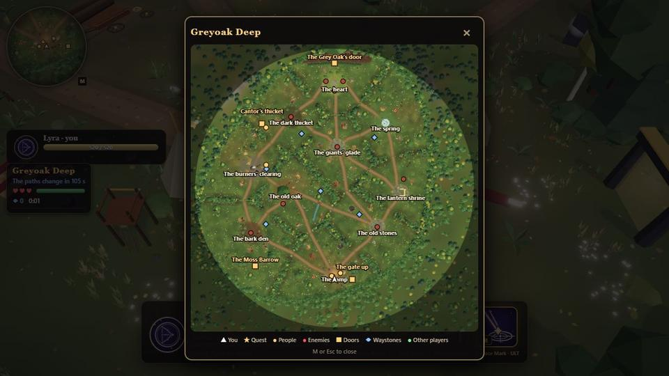
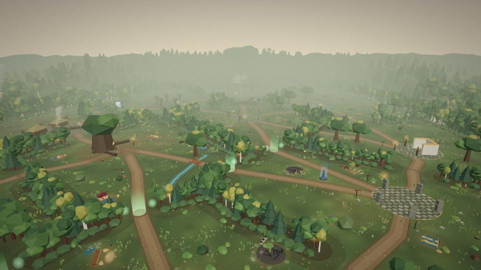

# Floor 18: Greyoak Deep

Clean: cleared with four stars and no fall, no console error, every spot reachable in both states of the paths; the rival (Cantor), the trial, the Grey Oak (in the Antler King's model: a dead oak in the Codex, see floor 7's item) and the gate (Brannoc) all played.

## Measured

- Reachable from the camp: 31882 m², 31881 m²; 59 spots of the floor's data, 0 cut off
- Props probe: 68 float, 133 gap, 4 buried, 3164 in cover (sorted by kind; one or more of each kind looked at by eye)
- Grass and small things on ground steeper than 31°: 0
- Packs table for the open world (server/climb-packs.mjs): matches
- Route bot (Lyra): cleared in 1579 game s, every checkpoint reached; 25 kills, 0 falls, stars 1111; ruler tries 1, gate tries 1; page errors 0
- Ruler: The Grey Oak (Bark like a shield), model models/tower/wood_antler_v4.glb, loaded yes (its picture taken 4448 ms of real time into the fight)
- Frame check at the busiest spot (-94, 42), 4 units awake: median 10.2, 8.9, 8.1 ms, p95 13.8, 11.6, 10.3 ms (desktop, machine shared: rough)
- Console errors while taking the pictures: 0

## Found

- **ok: Packs and props.** Every pack fought and cleared; the probe's hits are the Wood's trees, spore motes and the hills past the edge.

## Not checked

- the shared packs online

## Pictures

  
The Grey Oak

  
The old stones and the Stag-Crowned

  
The M map

  
From the south edge

