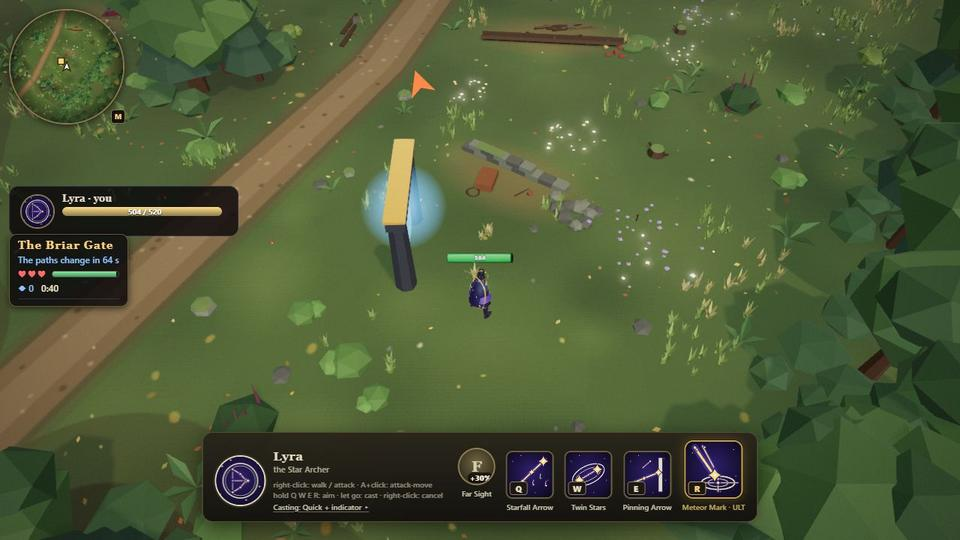
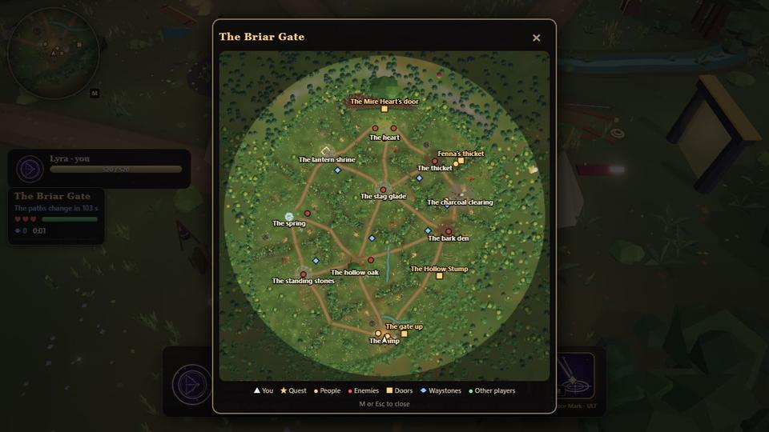
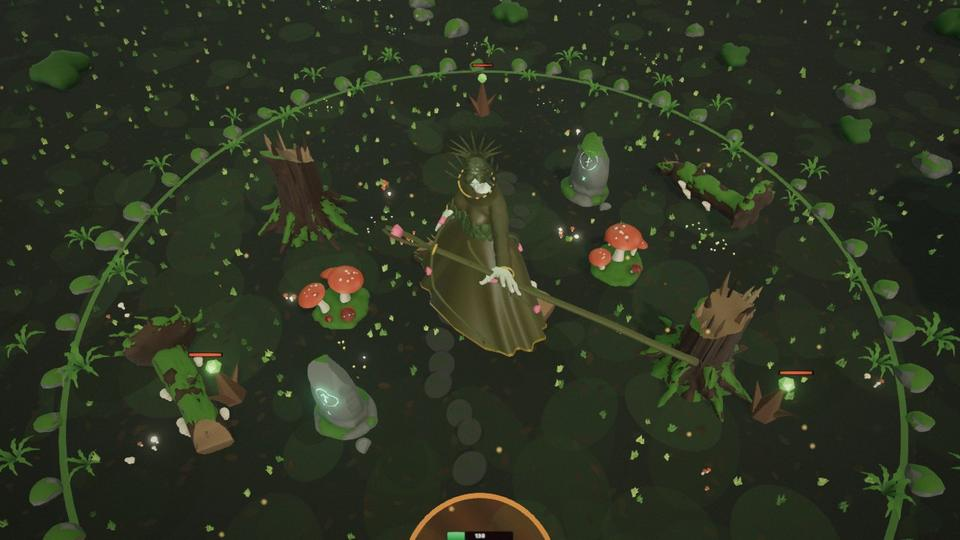
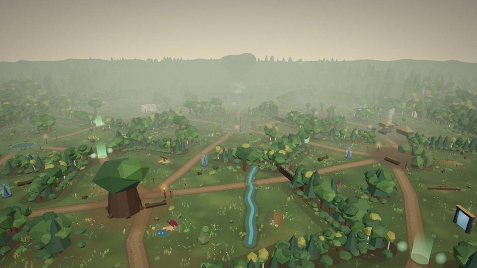

# Floor 19: The Briar Gate

Clean: cleared with four stars and no fall, no console error, every spot reachable in both states of the paths; the rival (Fenna), the trial, the Mire Heart (in the Thorn Mother's figure: a bog in the Codex, see floor 7's item) and the gate (Kaia) all played.

## Measured

- Reachable from the camp: 31736 m², 31735 m²; 56 spots of the floor's data, 0 cut off
- Props probe: 63 float, 85 gap, 6 buried, 3160 in cover (sorted by kind; one or more of each kind looked at by eye)
- Grass and small things on ground steeper than 31°: 0
- Packs table for the open world (server/climb-packs.mjs): matches
- Route bot (Lyra): cleared in 1459 game s, every checkpoint reached; 26 kills, 0 falls, stars 1111; ruler tries 1, gate tries 1; page errors 0
- Ruler: The Mire Heart (It beats under the moss), model models/tower/wood_briar_v4.glb, loaded yes (its picture taken 3766 ms of real time into the fight)
- Frame check at the busiest spot (28, -49), 4 units awake: median 5.5, 4.4, 4.7 ms, p95 7.5, 6.3, 6.2 ms (desktop, machine shared: rough)
- Console errors while taking the pictures: 0

## Found

- **ok: The bot stood still 45 s on its way to a cache: not a stuck spot.** The trial's door (the Hollow Stump) stands in the grass on the straight line from the camp's cache to cache c2, so the bot walked into it and the trial began (a door starts its piece when walked into, on every floor); its pause came after, while its goal was stale. Walked again from five spots round the door in both states of the paths, the hero reaches the cache in 13 to 31 s with no stop.
- **ok: Packs and props.** Every pack fought and cleared; the probe's hits are the Wood's trees, spore motes and the hills past the edge.

## Not checked

- the shared packs online

## Pictures

  
The trial's door in the grass

  
The M map

  
The Mire Heart

  
From the south edge

