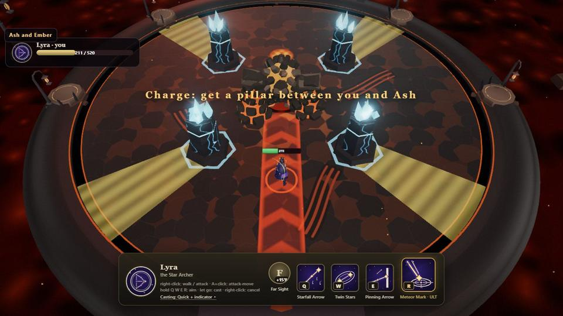
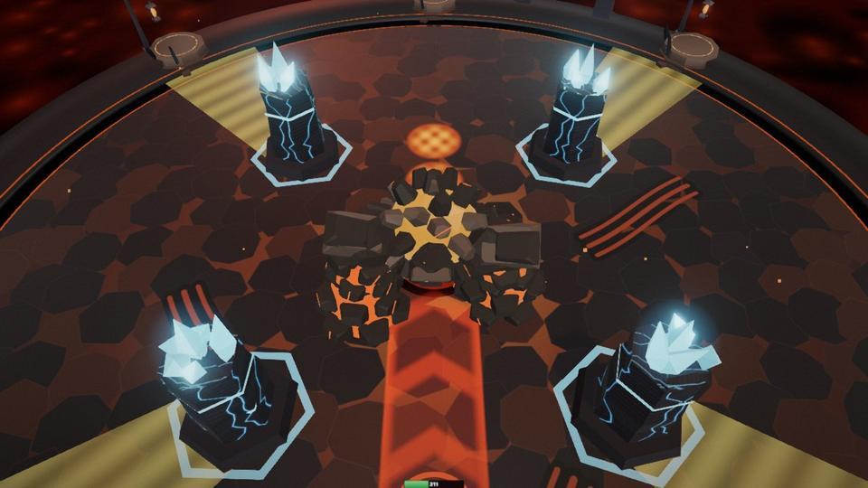
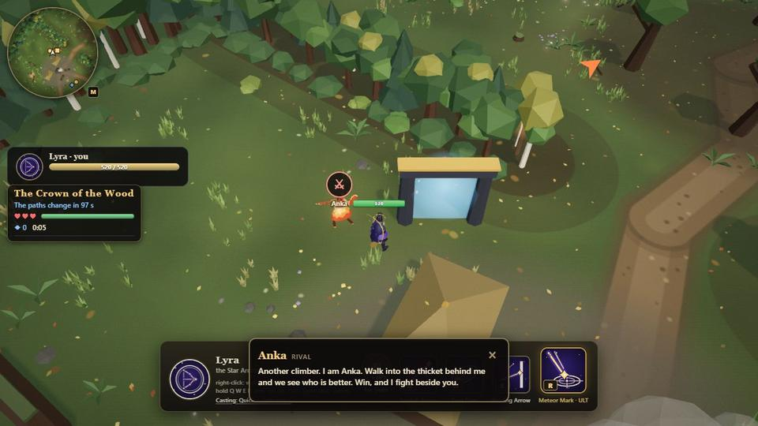
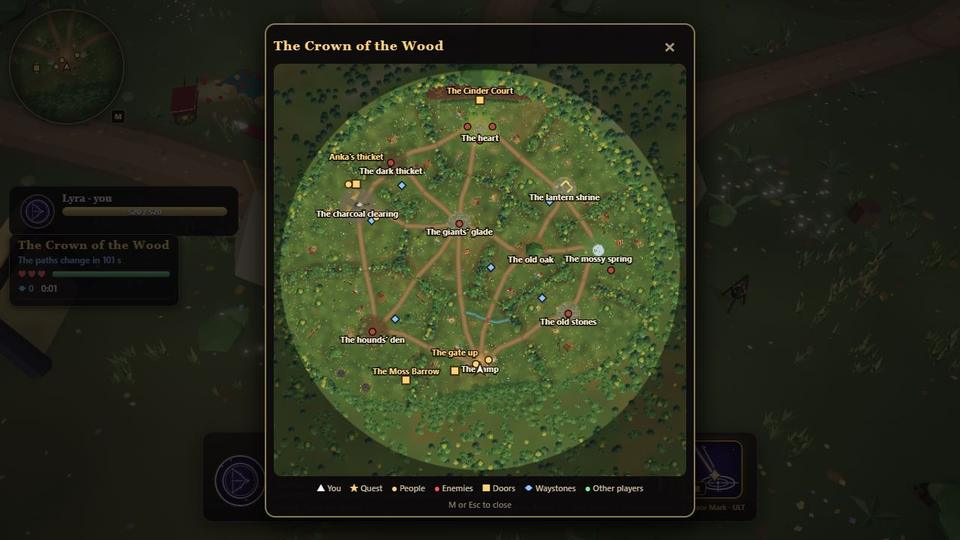
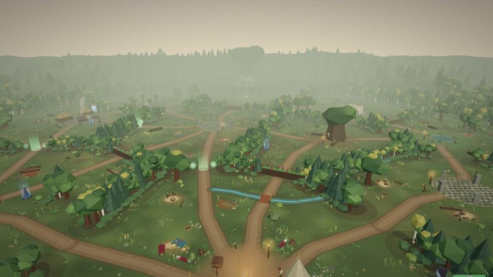

# Floor 20: The Crown of the Wood

Clean but for one word: the Wood's crown. Cleared with four stars and no fall, no console error, every spot reachable in both states of the paths; Ash and Ember (the Raid's twin bosses, their own models, in the Cinder Court) fell on the first try; the rival (Anka), the trial and the gate (Tempo) all played.

## Measured

- Reachable from the camp: 32043 m², 32042 m²; 60 spots of the floor's data, 0 cut off
- Props probe: 71 float, 97 gap, 10 buried, 3104 in cover (sorted by kind; one or more of each kind looked at by eye)
- Grass and small things on ground steeper than 31°: 0
- Packs table for the open world (server/climb-packs.mjs): matches
- Route bot (Lyra): cleared in 1321 game s, every checkpoint reached; 25 kills, 0 falls, stars 1111; ruler tries 1, gate tries 1; page errors 0
- Ruler: Ash and Ember (Keepers of the Cinder Pit), model models/bosses/ash.glb, loaded yes (its picture taken 5171 ms of real time into the fight)
- Frame check at the busiest spot (-86, 44), 4 units awake: median 9, 8.2, 8.8 ms, p95 12.7, 14.2, 11.2 ms (desktop, machine shared: rough)
- Console errors while taking the pictures: 0

## Found

- **fixed: “Once Ash and Ember has fallen”.** The gate's lock spoke of the twin crown in the singular. The Wood's maker now says “have” for them (with floor 13's fix, the keeper already says “Ash and Ember wait ... feed them, and their door opens”). gen/wood.ts; re-baked, only that line changed.
- **ok: The same words on floor 50: fixed by the floors 31-50 review.** Floor 50 said “Ash and Ember has fallen”; the War's agent fixed it at the same time (merged).

## Not checked

- the shared packs online

## Pictures

  
The Cinder Court: Ash and Ember as the fight opens

  
Ash

  
Anka, the rival

  
The M map

  
From the south edge

