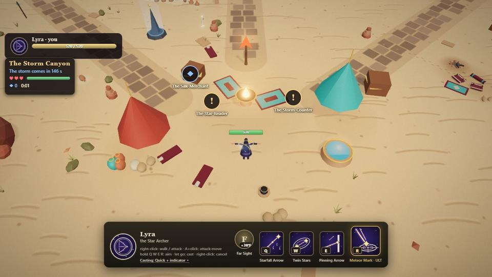
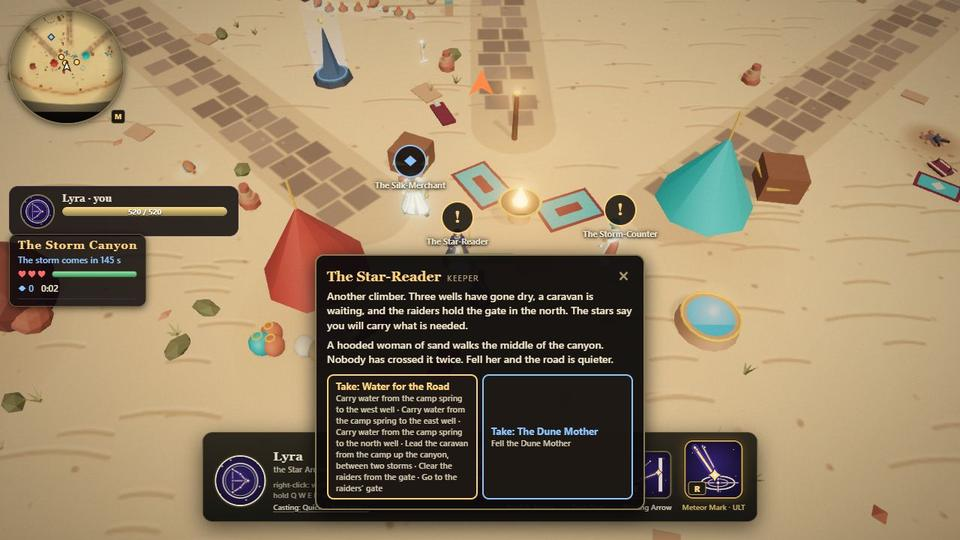
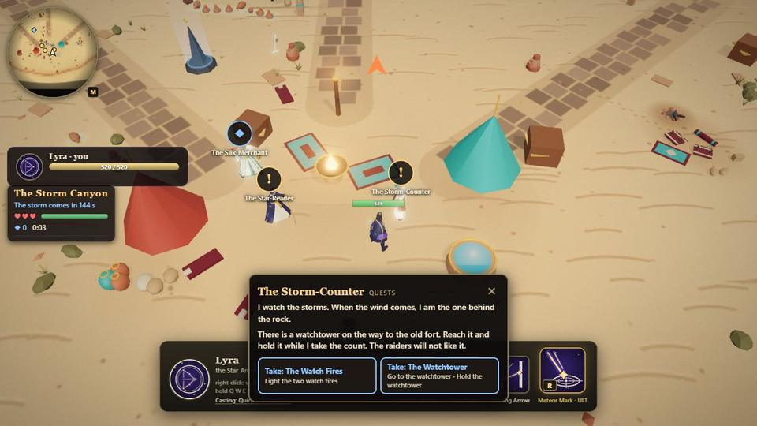
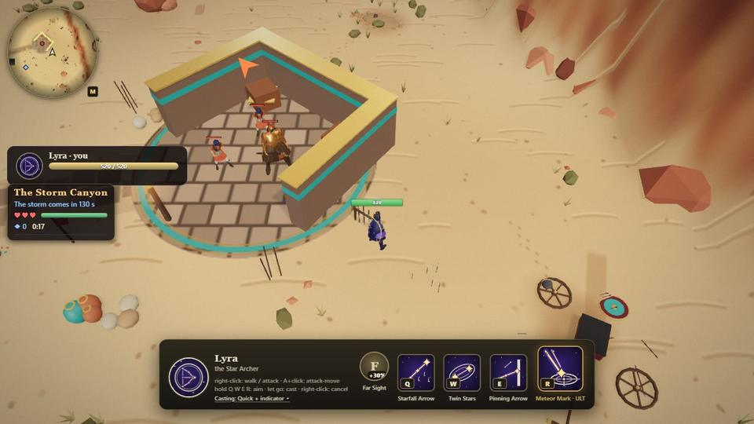
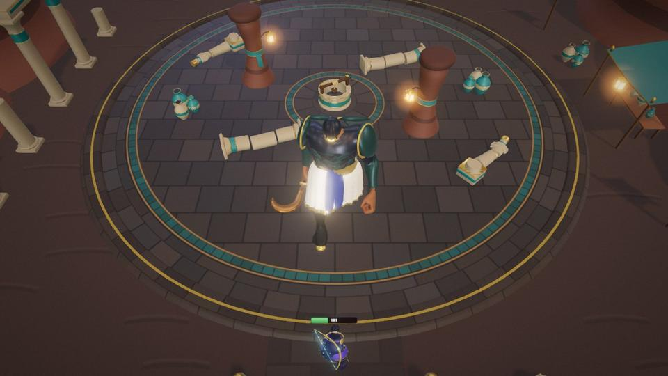
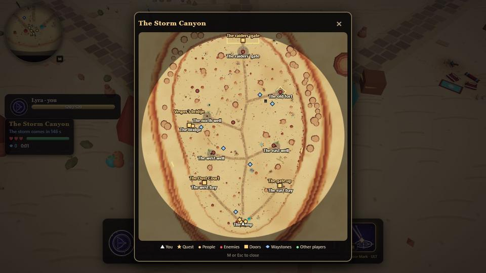
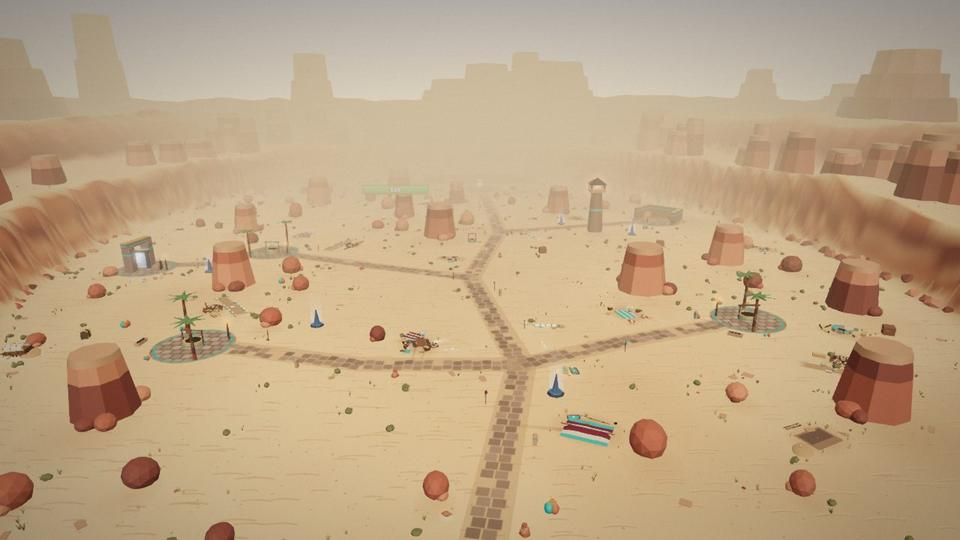
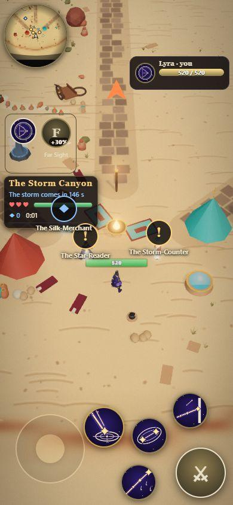

# Floor 21: The Storm Canyon

Clean: the Sands' handmade floor. Cleared with four stars and no fall through the storms, no console error, every spot reachable; the wells, the caravan, the rival (Vesper, as the Codex has it), the trial, the Scarab Colossus (own model) and the gate (Sefu) all played; the people and their lines match the Codex (the Star-Reader, the Storm-Counter).

## Measured

- Reachable from the camp: 34305 m²; 59 spots of the floor's data, 0 cut off
- Props probe: 2 float, 3 gap, 47 buried, 3 in cover (sorted by kind; one or more of each kind looked at by eye)
- Grass and small things on ground steeper than 31°: 3
- Packs table for the open world (server/climb-packs.mjs): matches
- Route bot (Lyra): cleared in 1604 game s, every checkpoint reached; 43 kills, 0 falls, stars 1111; ruler tries 1, gate tries 1; page errors 0
- Ruler: The Scarab Colossus (Under the sand), model models/tower/sands_scarab_v4.glb, loaded yes (its picture taken 3178 ms of real time into the fight)
- Frame check at the busiest spot (-80, -61), 3 units awake: median 6.1, 5.2, 3.7 ms, p95 8.1, 15.7, 6.3 ms (desktop, machine shared: rough)
- Console errors while taking the pictures: 0

## Found

- **ok: Packs and props.** The ridge's slingers and the fort's raiders slept through the bot's route (they fight as anyone walks in: picture). The probe: 47 red rocks at the canyon foot sunk a little into the sand (nothing shows), a house at the cliff foot and a crate on the rocks with a gap the eye does not see, two shrubs on the rim.

## Not checked

- the shared packs online

## Pictures

  
The camp as it opens

  
The Star-Reader

  
The Storm-Counter

  
The old fort and the Raider Chief

  
The Scarab Colossus

  
The M map

  
From the south edge

  
Phone: the camp

