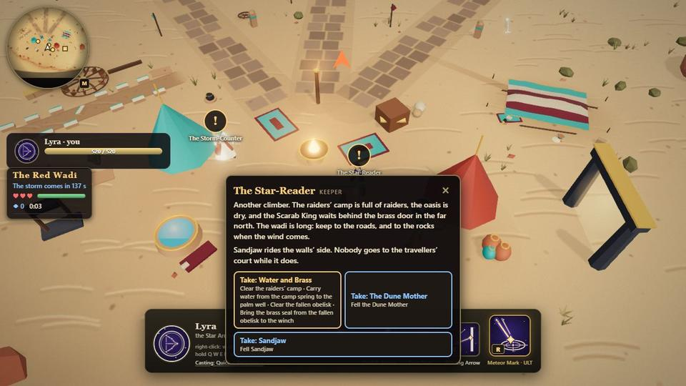
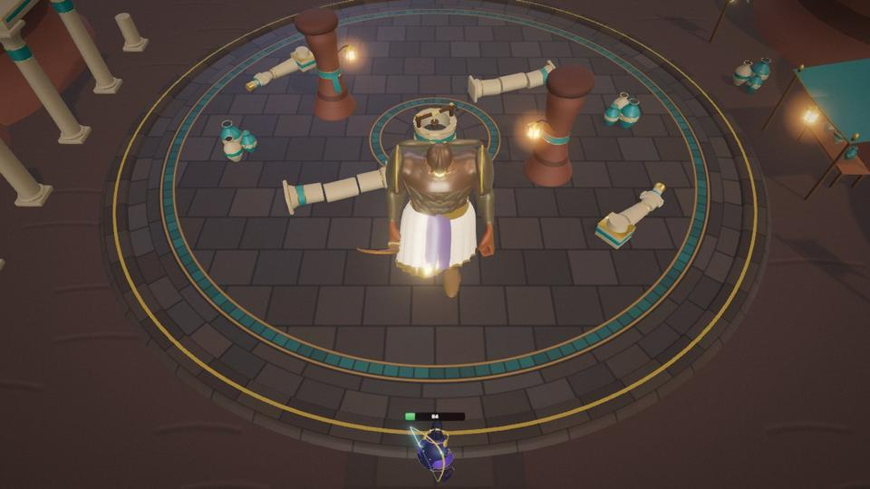
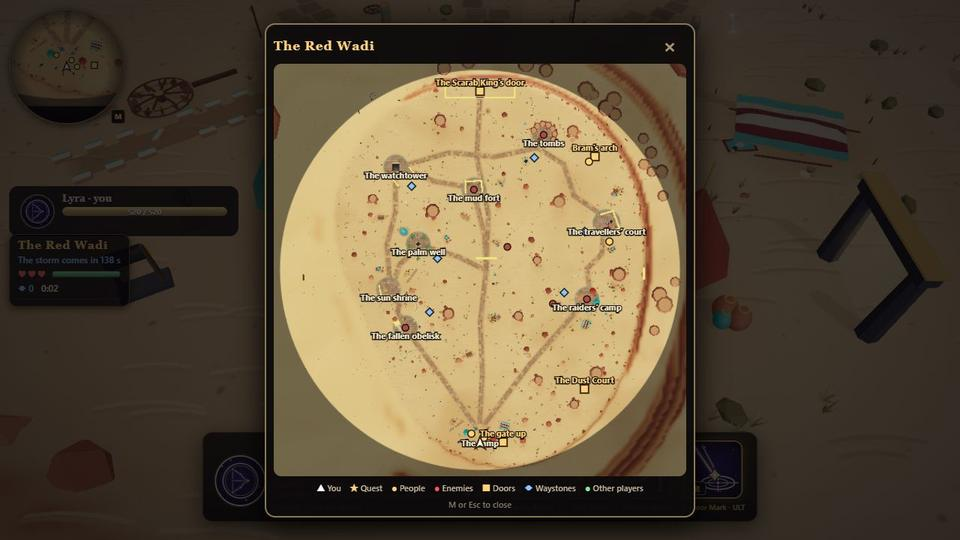
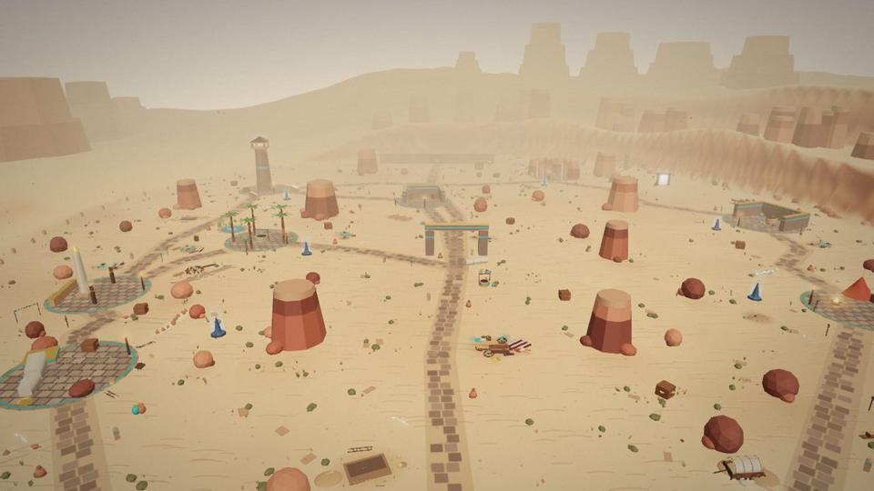

# Floor 22: The Red Wadi

Clean: cleared with four stars and no fall, no console error, every spot reachable; the caravan, the rival (Bram), the trial, the Scarab King (the Colossus's model, tinted) and the gate (Cantor) all played.

## Measured

- Reachable from the camp: 34300 m²; 59 spots of the floor's data, 0 cut off
- Props probe: 1 float, 1 gap, 18 buried, 2 in cover (sorted by kind; one or more of each kind looked at by eye)
- Grass and small things on ground steeper than 31°: 1
- Packs table for the open world (server/climb-packs.mjs): matches
- Route bot (Lyra): cleared in 1968 game s, every checkpoint reached; 61 kills, 0 falls, stars 1111; ruler tries 1, gate tries 1; page errors 0
- Ruler: The Scarab King (Crowned in a shell), model models/tower/sands_scarab_v4.glb, loaded yes (its picture taken 2418 ms of real time into the fight)
- Frame check at the busiest spot (52, 20), 6 units awake: median 3.3, 3.7, 3.6 ms, p95 5.8, 5.2, 5.4 ms (desktop, machine shared: rough)
- Console errors while taking the pictures: 0

## Found

- **list: Named enemies are all “it”.** On the made floors the keeper says “Fell it ... while it does” of every named enemy, so the Dune Mother is “her” on floor 21 and “it” here, as are Mother Kelp, Barnacle Bess, the Brine Widow, Grandmother Thorn, the Bark Widow. For beasts and things “it” is right. Giving the women their “her” is a word list in each chapter's maker (sea.ts, wood.ts, sands.ts...) and a re-bake; a matter of voice, so yours to say.
- **ok: The bot's 45 s wait in a storm.** Once the bot stood 45 s on its way to a lee during a storm, then went on: the storm's own wait (it shelters until the band has passed), not a stuck spot.
- **ok: Props.** A mesa past the north edge on its own high ground (the probe measures it against the play ground), a pillar on the sand, red rocks a little sunk at the canyon foot.

## Not checked

- the shared packs online

## Pictures

  
The Star-Reader

  
The Scarab King

  
The M map

  
From the south edge

