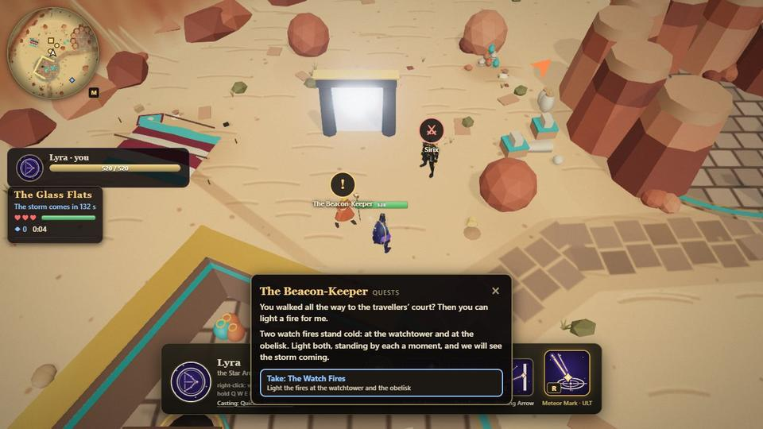
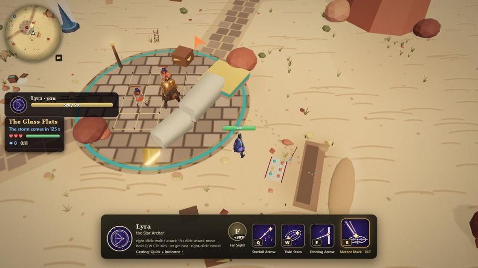
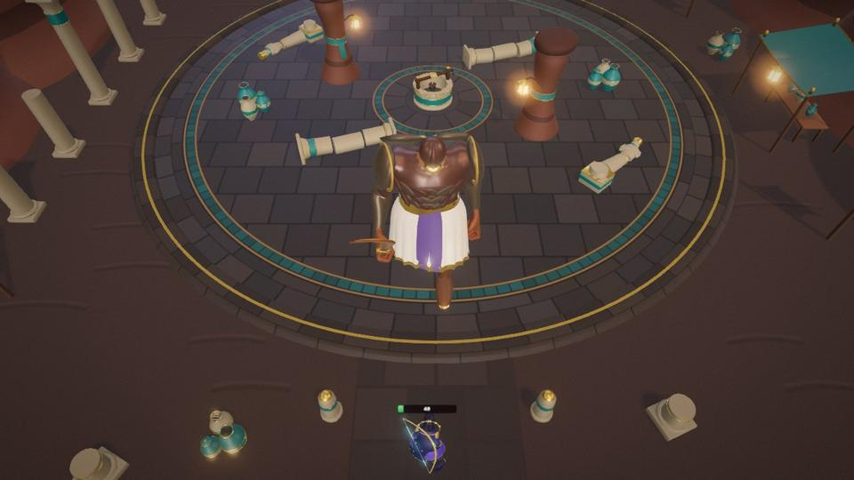
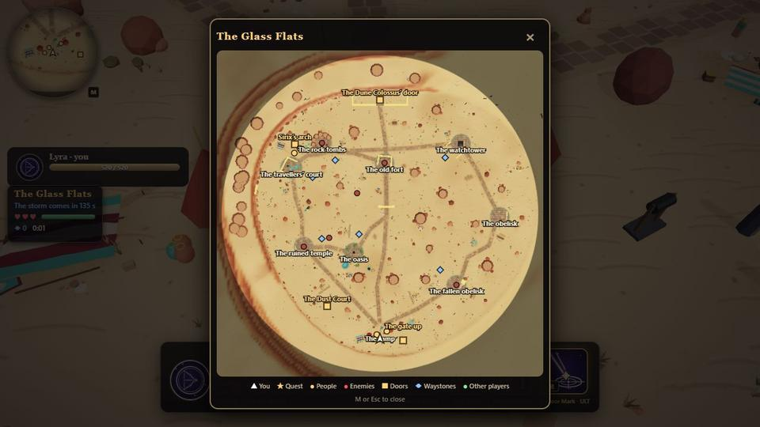
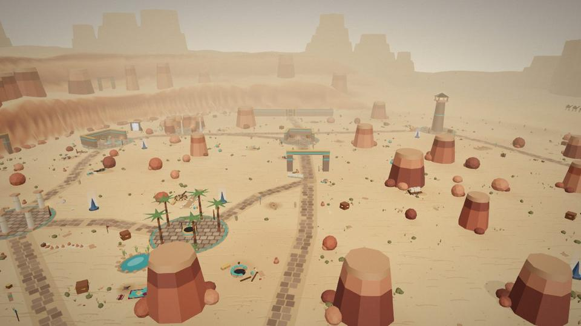

# Floor 23: The Glass Flats

Plays clean: cleared with four stars and no fall, no console error, every spot reachable; the caravan, the rival (Sirix), the trial, the Dune Colossus (the Scarab's model, tinted) and the gate (Silvane) all played. One word on the lair's door fixed.

## Measured

- Reachable from the camp: 34093 m²; 52 spots of the floor's data, 0 cut off
- Props probe: 0 float, 3 gap, 23 buried, 2 in cover (sorted by kind; one or more of each kind looked at by eye)
- Grass and small things on ground steeper than 31°: 0
- Packs table for the open world (server/climb-packs.mjs): matches
- Route bot (Lyra): cleared in 1716 game s, every checkpoint reached; 58 kills, 0 falls, stars 1111; ruler tries 1, gate tries 1; page errors 0
- Ruler: The Dune Colossus (A hill that walks), model models/tower/sands_scarab_v4.glb, loaded yes (its picture taken 2717 ms of real time into the fight)
- Frame check at the busiest spot (-55, 21), 6 units awake: median 5.8, 7, 6.7 ms, p95 7.6, 9.2, 9.9 ms (desktop, machine shared: rough)
- Console errors while taking the pictures: 0

## Found

- **fixed: The lair said “a quest about a seal” for a key.** The Sands' maker picks the main quest's item from the brass seal, the sun key and the scarab seal, but the lair's lock always said “The Star-Reader has a quest about a seal.” Here the item is the sun key. Now the lock names the floor's own item (“... a quest about the sun key”). gen/sands.ts; floors 22 to 30 re-baked, only that line changed on each.
- **ok: The bot's 45 s wait in a storm, and the props.** A wait in the lee while the storm passed, as on floor 22. The probe: an arch whose pillar stands among the rim's rocks, red rocks a little sunk at the canyon foot.

## Not checked

- the shared packs online

## Pictures

  
The Beacon-Keeper at the travellers' court

  
The fallen obelisk's pack

  
The Dune Colossus

  
The M map

  
From the south edge

