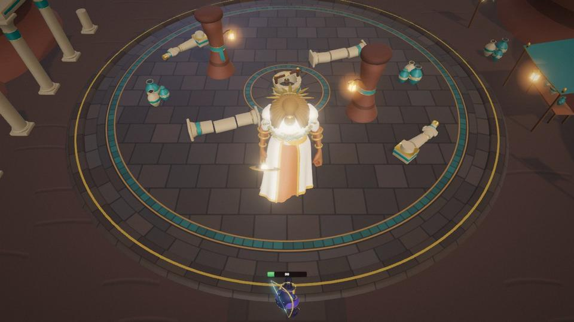
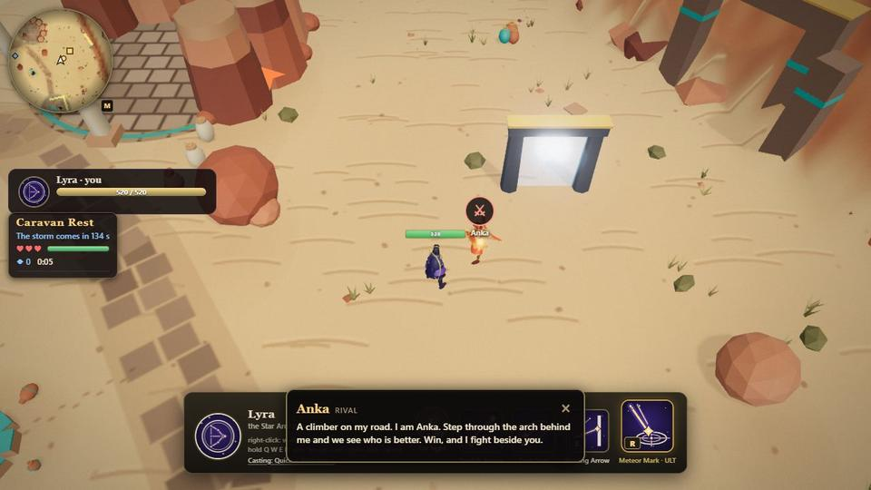
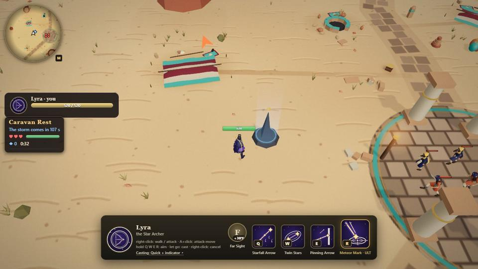
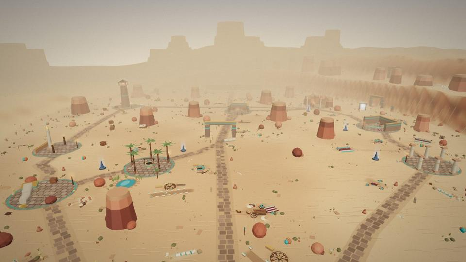

# Floor 24: Caravan Rest

Clean: cleared with four stars and no fall, no console error, every spot reachable; the caravan, the rival (Anka), the trial, the Brass Sphinx (own model) and the gate (Lyra) all played.

## Measured

- Reachable from the camp: 34194 m²; 55 spots of the floor's data, 0 cut off
- Props probe: 2 float, 6 gap, 32 buried, 2 in cover (sorted by kind; one or more of each kind looked at by eye)
- Grass and small things on ground steeper than 31°: 1
- Packs table for the open world (server/climb-packs.mjs): matches
- Route bot (Lyra): cleared in 1761 game s, every checkpoint reached; 56 kills, 0 falls, stars 1111; ruler tries 1, gate tries 1; page errors 0
- Ruler: The Brass Sphinx (Riddles and claws), model models/tower/sands_sphinx_v4.glb, loaded yes (its picture taken 3864 ms of real time into the fight)
- Frame check at the busiest spot (46, 26), 6 units awake: median 12.8, 11.9, 12 ms, p95 20.7, 19.3, 19.3 ms (desktop, machine shared: rough)
- Console errors while taking the pictures: 0

## Found

- **ok: Packs and props.** The mud fort's pack slept through the bot's route; the probe: the lair wall's gold edge where it runs into the dune, crates on the rim's slope, red rocks a little sunk at the canyon foot.

## Not checked

- the shared packs online

## Pictures

  
The Brass Sphinx

  
Anka, the rival

  
The busiest spot (the frame check)

  
From the south edge

