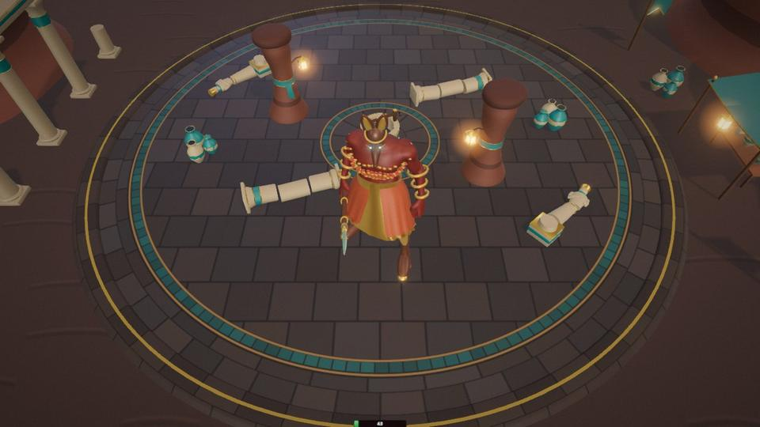
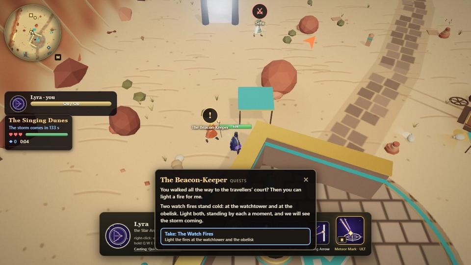
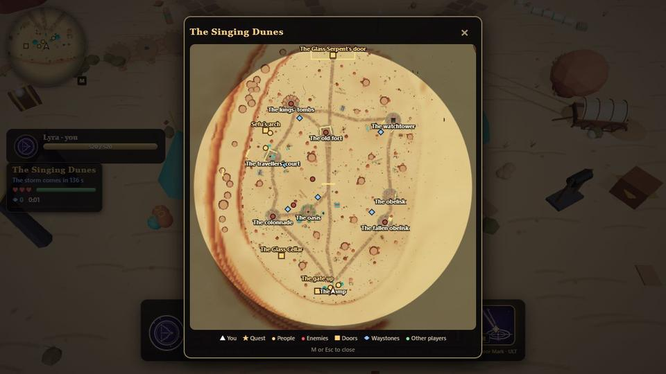
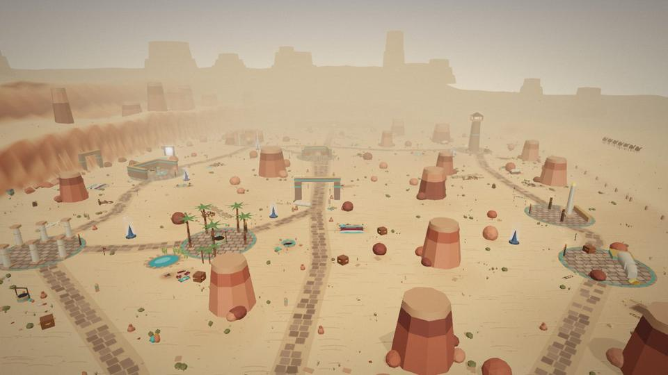

# Floor 25: The Singing Dunes

Clean: cleared with four stars and no fall, no console error, every spot reachable; the caravan, the rival (Sefu), the trial, the Glass Serpent (in the Red Jackal's figure: a serpent in the Codex, see floor 7's item) and the gate (Kaia) all played.

## Measured

- Reachable from the camp: 33962 m²; 55 spots of the floor's data, 0 cut off
- Props probe: 4 float, 2 gap, 27 buried, 2 in cover (sorted by kind; one or more of each kind looked at by eye)
- Grass and small things on ground steeper than 31°: 0
- Packs table for the open world (server/climb-packs.mjs): matches
- Route bot (Lyra): cleared in 1916 game s, every checkpoint reached; 57 kills, 0 falls, stars 1111; ruler tries 1, gate tries 1; page errors 0
- Ruler: The Glass Serpent (Sand burnt to glass), model models/tower/sands_jackal_v4.glb, loaded yes (its picture taken 2757 ms of real time into the fight)
- Frame check at the busiest spot (-56, 26), 6 units awake: median 9.4, 9, 7.9 ms, p95 12.2, 16.8, 10.2 ms (desktop, machine shared: rough)
- Console errors while taking the pictures: 0

## Found

- **ok: Packs and props.** The kings' tombs' pack slept through the bot's route; the probe: four small shrubs on the high rim (a few cm), crates on the rim's slope, red rocks a little sunk.

## Not checked

- the shared packs online

## Pictures

  
The Glass Serpent

  
The Beacon-Keeper

  
The M map

  
From the south edge

