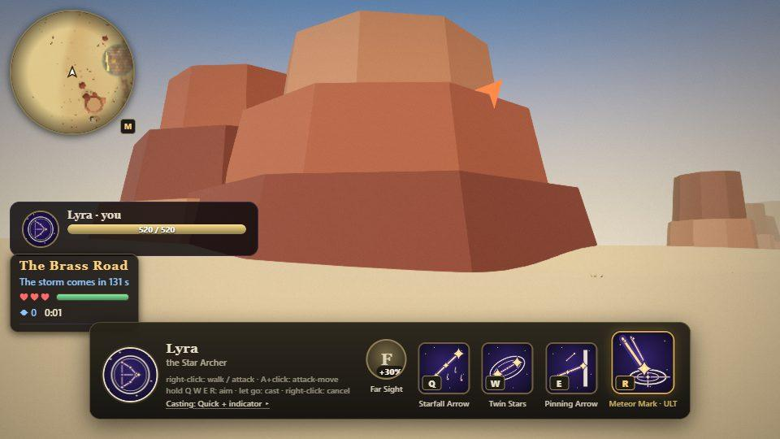
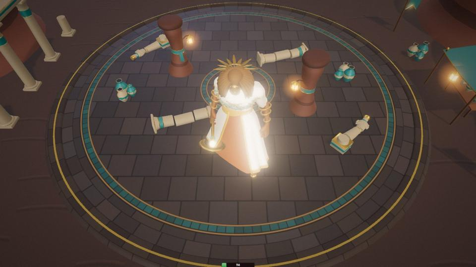
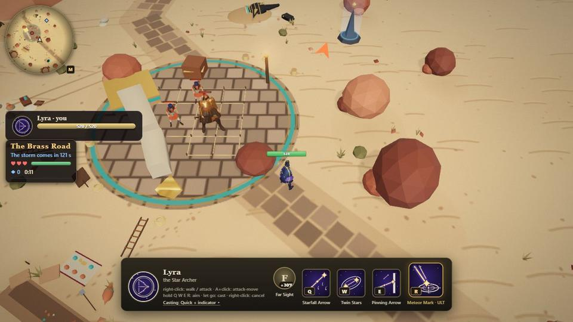
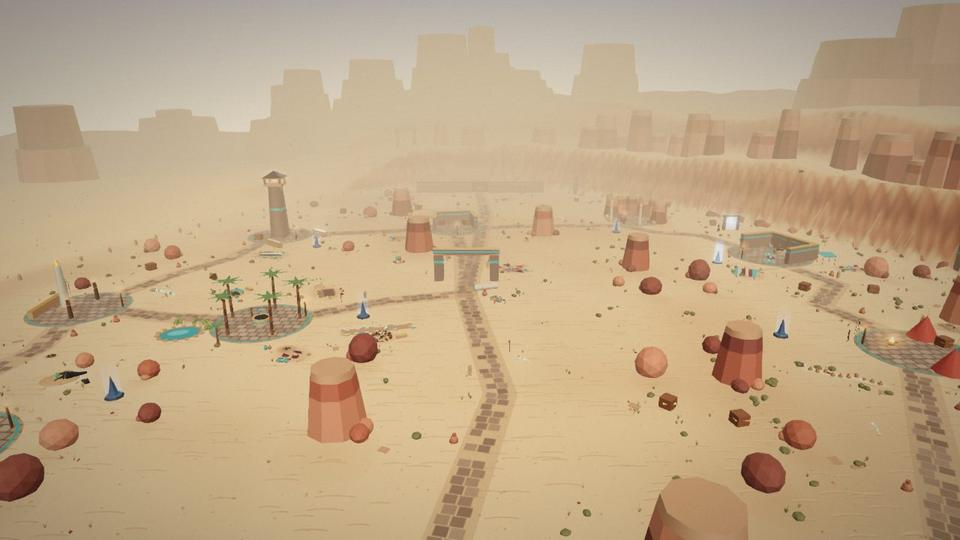

# Floor 26: The Brass Road

Plays clean: cleared, no console error, every spot reachable; the caravan, the rival (Tempo), the trial, the Mirage Lord (the Sphinx's model, tinted) and the gate (Gus; second try) all played.

## Measured

- Reachable from the camp: 34169 m²; 55 spots of the floor's data, 0 cut off
- Props probe: 2 float, 8 gap, 30 buried, 2 in cover (each looked at; see below)
- Grass and small things on ground steeper than 31°: 0
- Packs table for the open world (server/climb-packs.mjs): matches
- Route bot (Lyra): cleared in 2213 game s, every checkpoint reached; 60 kills, 1 falls, stars 1100; ruler tries 1, gate tries 2; page errors 0
- Ruler: The Mirage Lord (Never where it stands), model models/tower/sands_sphinx_v4.glb, loaded yes after 2428 ms of real time
- Frame check at the busiest spot (47, 30), 6 units awake: median 6.3, 6, 5.9 ms, p95 9.9, 11.1, 9.4 ms (desktop, machine shared: rough)
- Console errors while taking the pictures: 0

## Found

- **ok: A mesa the probe called floating.** A 33 m mesa past the west edge (and one on floor 22) “floats” by the probe's measure, which knows only the play ground; from low beside it, it stands on the outer sand.
  -  The mesa from low beside it
- **ok: Packs and other props.** The old fort's pack slept through the bot's route; the lair wall's gold edge runs into the dune; crates on the rim's slope; red rocks a little sunk.

## Not checked

- the shared packs online
- buying at the trader (card and prices shown)

## Pictures

  
The Mirage Lord

  
The scarab dig's pack

  
From the south edge

